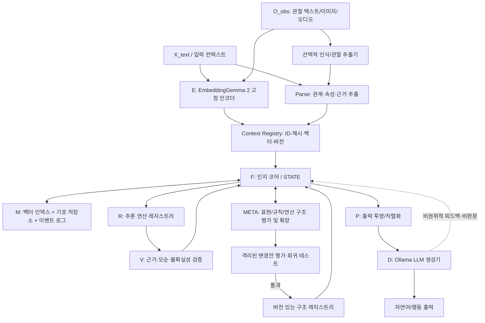

# Semantic Cognition — 통합 아키텍처 청사진

**문서 버전:** 0.2-draft  
**작성일:** 2026-10-20  
**목적:** 이 문서를 단일 설계 기준으로 삼아 작은 구성요소부터 구현하고, 실험으로 작동하지 않는 부분을 수정한다.  
**구현 원칙:** 설계 목표와 검증된 기능을 구분한다. 이 문서는 AGI 달성을 보장하지 않으며, 검증 가능한 인지 시스템 연구 계획이다.

---

## 0. 설계 핵심 요약

이 시스템은 일반적인 LLM 하나가 모든 상태와 추론을 담당하는 형태가 아니다. 별도 인지 코어 `F`가 컨텍스트를 저장하고, 기억을 검색하며, 추론·검증·상태 갱신을 수행한다. `EmbeddingGemma 2`는 입력을 의미 공간의 벡터로 바꾸는 **고정 인코더 E**로 우선 사용한다. 별도 파서가 관계를 구조화하고, 컨텍스트 레지스트리가 원본·출처·식별자·벡터를 관리한다. `META`는 문제 해결 결과를 보고 기존 표현이나 추론 구조를 확장할 필요가 있는지 평가한다.

핵심 루프는 세 가지다.

1. **인지 루프:** 컨텍스트 생성 → 기억 검색 → 추론 → 검증 → 내부 상태 갱신
2. **학습 루프:** 경험 축적 → 공통 구조/규칙 후보 추출 → 새로운 문제에 적용 → 성패 기록
3. **메타 루프:** 현재 구조의 한계 진단 → 구조 변경 제안 → 격리된 평가 → 승인 또는 롤백

이 세 루프는 연결되지만 기능상 구분한다. 일반 추론이 실패했다고 바로 내부 구조를 바꾸지 않는다. 먼저 입력 추출 오류, 기억 검색 오류, 추론 규칙 오류, 증거 부족, 표현 체계 한계 중 무엇인지 진단한다.

### 설계에서 고정할 원칙

- E와 D는 입출력 모듈이다. 지속적인 지식 상태의 권위 있는 소유자는 F다.
- EmbeddingGemma 2의 원본 임베딩 `z_raw`는 초기에 고정한다.
- 벡터 유사성은 검색 신호이지 논리적 참/거짓 판정이 아니다.
- 컨텍스트 해시는 식별·중복 관리용이다. 의미를 담거나 유사성을 계산하는 벡터로 취급하지 않는다.
- 사실, 가설, 추론 결과, LLM이 만든 문장은 서로 다른 상태로 저장한다.
- 구조 변경은 제안 → 테스트 → 승인 → 버전 기록 → 롤백 가능해야 한다.
- 각 단계는 자동 테스트와 명시적인 통과 기준을 갖는다.
- 초기 구현은 결정적이고 설명 가능한 방식으로 만든 후, 실제 평가 자료가 생긴 경우에만 학습 모듈을 추가한다.

---

## 1. 목표와 비목표

### 1.1 목표

1. 사용자 입력과 관찰을 컨텍스트 단위로 표현한다.
2. EmbeddingGemma 2에서 의미 벡터를 만들고 별도 파서에서 명시적 관계를 추출한다.
3. 벡터 기억과 기호적 기억을 함께 검색한다.
4. 연역, 간단한 귀납, 가설 비교, 유추 후보 생성 등 추론 연산을 호출할 수 있게 한다.
5. 모든 가설과 결론을 근거·출처·적용 규칙과 연결한다.
6. 반증, 모순, 근거 부족을 구별해 상태를 수정한다.
7. 추론 경험을 이용해 규칙 후보와 추론 정책을 개선한다.
8. 현재 표현 체계로 풀기 어려운 문제를 감지하고, 메타 모델이 변경안을 실험하도록 한다.
9. 최종 상태를 LLM에 전달해 자연어로 표현하되 LLM 출력을 권위 있는 사실로 자동 승격하지 않는다.
10. 이후 이미지·오디오·비디오의 임베딩을 같은 인지 코어와 연결할 수 있게 인터페이스를 설계한다.

### 1.2 비목표

- 첫 단계부터 인간 수준의 일반지능을 구현한다고 가정하지 않는다.
- 임베딩 벡터 자체가 추론이나 의식을 수행한다고 가정하지 않는다.
- 처음부터 EmbeddingGemma 2 전체를 미세조정하지 않는다.
- 임의의 Python 코드나 모델 가중치를 스스로 바꾸는 무제한 자기수정을 허용하지 않는다.
- LLM이 말한 내용만으로 사실 여부를 결정하지 않는다.
- 한 번의 성공 사례로 일반화 능력을 입증했다고 보지 않는다.

---

## 2. EmbeddingGemma 2 모듈 E — 명시적 설계

### 2.1 실제 역할

`EmbeddingGemma 2`는 입력 내용을 768차원 임베딩 공간에 매핑하는 사전학습 임베딩 모델이다. 공식 모델 카드에 따르면 텍스트·코드·이미지·비디오·오디오를 공통 임베딩 공간으로 표현하며, 총 740M 파라미터 구성에는 텍스트 모델과 별도 시각·오디오 인코더가 포함된다. MRL(Matryoshka Representation Learning)을 통해 768·512·256·128차원 출력을 사용할 수 있다. 공식 입력 문맥 한도는 모든 모달리티를 합쳐 8,192 토큰으로 안내되어 있다. 모델 카드는 텍스트 태스크별 지시 프리픽스를 사용하면 임베딩 품질이 좋아질 수 있다고 설명한다. [1]

E가 **하지 않는 일**:

- 사실과 가설을 스스로 구분해 주지 않는다.
- 관계 삼중항을 안정적으로 추출해 주지 않는다.
- 논리적 모순을 판정하지 않는다.
- 새 규칙을 자동으로 학습하거나 내부 인지 코어를 변경하지 않는다.
- 벡터의 차원이나 유사도만으로 개념의 진위·인과관계를 보증하지 않는다.
- 임베딩 벡터를 일반 채팅 LLM의 입력 토큰 임베딩과 같은 것으로 취급할 수 없다.

따라서 E는 F를 대체하는 사고 모듈이 아니라, F가 활용하는 의미적 관찰을 공급하는 고정 인코더다.

### 2.2 버전별 운용 방침

| 구간 | 권장 구성 | 목적 | 주의점 |
|---|---|---|---|
| 첫 텍스트 실험 | Ollama `embeddinggemma-2:270m` 또는 환경에서 확인된 동등 텍스트 태그 | 설치·호출·벡터 검증을 단순화 | API 응답 차원과 모델 digest를 실제 확인 |
| 텍스트+이미지 실험 | EmbeddingGemma 2의 비전 포함 변형(예: Ollama 라이브러리의 `440m`) 또는 공식 Sentence Transformers/Transformers 경로 | 이미지와 텍스트의 임베딩 연결 시험 | 사용 중인 라이브러리/API가 이미지 입력을 실제 지원하는지 별도 검증 |
| 멀티모달 확장 | 공식 모델 카드에서 안내하는 전체 모달리티 구성과 호환 인터페이스 | 텍스트·이미지·오디오·비디오 실험 | VRAM, 입력 형식, 이미지/오디오 전처리와 처리량을 측정 |

사용자 PC의 약 6 GB VRAM 환경에서는 임베딩 모델과 8B급 생성 모델을 동시에 GPU 상주시키는 것보다, 처음에는 순차 로드하거나 하나씩 시험하는 편이 안전하다. 실제 메모리 사용량은 양자화·런타임·컨텍스트·다른 프로세스에 따라 달라지므로 추정만으로 보장하지 말고 `ollama ps`, `nvidia-smi`, 실제 실행 기록으로 확인한다.

**중요한 API 차이:** Ollama의 일반 `/api/embed` 문서는 `input`을 텍스트 또는 텍스트 목록으로 설명한다. EmbeddingGemma 2 자체가 멀티모달이라는 사실만으로 설치한 Ollama 버전의 해당 엔드포인트가 이미지·오디오를 그대로 받아들인다고 가정하지 않는다. 텍스트 단계는 `/api/embed`로 시작하고, 멀티모달 단계에서는 실제 API 지원을 확인하거나 공식 Sentence Transformers/Transformers 경로를 사용한다. [2][3]

### 2.3 E가 출력해야 할 데이터

- `z_raw`: 고정 EmbeddingGemma 2가 반환한 원본 임베딩. 기본 실험은 768차원.
- `embedding_profile`: 모델명·태그·digest·차원·정규화·태스크 프리픽스·런타임 정보를 기록하는 프로필 ID.
- `input_fingerprint`: 정규화 입력의 암호학적 해시. 이 값은 벡터가 아니다.
- `modality`: `text`, `image`, `audio`, `video`, `mixed` 중 하나.
- `encoder_status`: 성공·입력 초과·모달리티 미지원·모델 오류 등의 상태.

원본 `z_raw`를 영구 보존할 수 있도록 하고, 후속 실험에서 새 표현을 학습하더라도 원본 표현을 덮어쓰지 않는다.

### 2.4 차원 관련 구분

여기에는 서로 혼동하면 안 되는 세 개의 값이 있다.

- **EmbeddingGemma 2의 출력 차원:** 기본 768. 모델의 MRL 기능을 사용할 때 512·256·128로 자를 수 있다.
- **`z_abs`의 차원:** 이 프로젝트가 별도 추상화 모듈에서 학습할 내부 표현의 후보 크기. 초기 설계 목표는 256이지만 실험으로 확정해야 한다.
- **`z_joint`의 차원:** 실험적으로 `concat(z_raw, z_abs)`를 사용할 때 768+256=1024가 될 수 있다. 이는 `z_raw` 자체가 1024차원이라는 뜻이 아니다.

MRL에서 얻은 256차원 임베딩과 학습된 `z_abs` 256차원은 의미와 학습 경로가 다르므로 같은 필드나 인덱스에 섞지 않는다. 벡터를 잘라 차원을 줄였으면 모델 카드 지침대로 다시 L2 정규화하고, 같은 인덱스에서는 차원과 임베딩 프로필이 일치해야 한다. [1]

### 2.5 태스크 프리픽스와 검색 인덱스

EmbeddingGemma 2는 텍스트 작업에 따라 권장 프리픽스가 다르다. 예를 들어 검색 질의에는 `task: search result | query: ...`, 저장 문서에는 `title: none | text: ...`, 사실 확인 질의에는 `task: fact checking | query: ...` 형식이 안내되어 있다. [1]

따라서 인덱스의 사용 목적을 구분한다.

- `context_similarity_v1`: 컨텍스트 대 컨텍스트의 대칭 유사도. 동일한 의미 유사도 설정을 양쪽 입력에 사용한다.
- `context_retrieval_v1`: 질의와 저장 컨텍스트를 비대칭 검색 설정으로 인코딩한다. 질의 프리픽스와 저장 문서 포맷을 각각 고정한다.
- `fact_evidence_v1`: 주장과 증거 검색을 별도 태스크로 실험한다.

이 프로필들의 벡터를 서로 직접 비교하지 않는다. 프리픽스, 모델 태그, 차원, 정규화가 바뀌면 새로운 프로필/인덱스 버전을 만든다. 임베딩을 갱신할 때는 기존 벡터와 새 벡터를 섞지 않는다.

### 2.6 수치 정밀도, 차원, 정규화 확인

공식 모델 카드는 Sentence Transformers/Transformers에서 EmbeddingGemma 2를 직접 실행할 때 `bfloat16` 또는 `float32`를 사용하고 `float16`은 피하라고 권고한다. 모델의 활성값 범위 때문에 `float16`에서 NaN 또는 조용한 품질 저하가 발생할 수 있다고 안내한다. 따라서 직접 Python으로 실행할 경우 GPU가 지원하면 `bfloat16`, 그렇지 않으면 `float32`를 기준으로 삼는다. 이 지침을 Ollama 내부 양자화 설정과 혼동하지 말고, Ollama 경로는 실제 설치된 모델/런타임의 출력값을 따로 검증한다. [1]

Ollama 문서는 `/api/embed`가 L2 정규화된 벡터를 반환한다고 설명하지만, 코드에서는 이를 맹목적으로 가정하지 말고 실제 응답의 노름과 값의 유한성(finite)을 검사해 기록한다. Sentence Transformers를 사용하는 경로에서는 `normalize_embeddings` 설정을 명시한다. MRL 차원 축소를 적용하면 축소된 벡터를 다시 L2 정규화해야 한다. [1][3]

모델 카드 기준 문맥 길이는 8,192 토큰이다. Ollama 라이브러리 페이지의 태그 메타데이터나 런타임 설정에 다른 값이 나타나더라도, 실제 입력 한도를 확인하기 전에는 8K를 안전한 설계 상한으로 사용한다. 긴 컨텍스트는 원문을 보존하면서 하위 컨텍스트로 나누고, 분할 경계와 부모 컨텍스트 ID를 기록한다. [1][2]

---

## 3. 전체 아키텍처



### 3.1 모듈 책임

| 모듈 | 책임 | 권위 있는 데이터인가? | 초기 구현 형태 |
|---|---|---|---|
| E | 텍스트/모달리티 임베딩 생성 | 아니요. 관찰 표현 | EmbeddingGemma 2 추론 API |
| Parse | 원문에서 관계·속성·주장 후보 추출 | 검증 전에는 아니요 | 규칙 기반 + 정형 출력 파서 |
| Context Registry | 컨텍스트 ID, 원본, 해시, 벡터 버전 관리 | 원본/출처 메타데이터의 기준 저장소 | SQLite + 파일 저장 |
| F/STATE | 현재 문제와 활성 가설·근거 관리 | 예. 상태 전이의 기준 | Python 객체 + 저장소 |
| M | 벡터 검색과 기호 조회 | 저장은 담당하지만 참/거짓 판정은 아님 | 우선 선형 코사인 검색 + SQLite |
| R | 명시적 추론 연산 실행 | 추론 후보 생성 | 결정적 규칙 엔진부터 시작 |
| V | 근거 충족, 반증, 모순, 종료 판정 | 검증 결과 기록 | 명시적 검사기 |
| META | 표현 구조나 추론 정책의 변경 필요성 평가 | 변경은 직접 확정하지 않음 | 제한된 메타 제어기 |
| Structure Registry | 활성 관계 유형·규칙·연산·정책의 버전 관리 | 활성 구조의 기준 | 버전 있는 JSON/YAML 정의 |
| P | STATE를 LLM에 전달할 안전한 표현으로 변환 | 아니요. 뷰/직렬화 | JSON schema + 텍스트 formatter |
| D | 최종 자연어/행동 문구 생성 | 아니요. 출력은 자동 사실이 아님 | Ollama chat API |
| Evaluation | 능력 측정, 회귀 테스트, ablation | 실험 결과의 기록 기준 | pytest + 고정 데이터셋 + 보고서 |

---

## 4. 핵심 데이터 모델

아래는 구현 전에 합의할 논리 스키마다. 실제 Python 타입과 SQL 테이블은 이 의미를 보존하도록 구현한다.

### 4.1 ContextRecord

컨텍스트는 단어 하나만 의미하지 않는다. 문장 전체, 관찰 하나, 관계 묶음, 추론 결과, 또는 여러 컨텍스트를 묶은 상위 컨텍스트가 될 수 있다.

```json
{
  "context_id": "ctx_01J...",
  "content_hash": "sha256:<canonical-content-hash>",
  "context_type": "observation | statement | rule | hypothesis | inference | composite",
  "modality": "text",
  "raw_content": "고양이는 뾰족한 귀를 가질 수 있다.",
  "canonical_content": "고양이는 뾰족한 귀를 가질 수 있다.",
  "parent_context_ids": [],
  "child_context_ids": [],
  "embedding_refs": [
    {
      "profile_id": "context_retrieval_v1",
      "dimension": 768,
      "model": "embeddinggemma-2:270m",
      "vector_ref": "vectors/ctx_01J.../retrieval_v1.bin"
    }
  ],
  "relation_ids": ["rel_..."],
  "source": {
    "kind": "user_input",
    "source_id": "session_...",
    "span": null
  },
  "epistemic_status": "observed | extracted | hypothesized | inferred | verified | rejected | uncertain",
  "confidence": null,
  "created_at": "ISO-8601",
  "revision": 1
}
```

규칙:
- `context_id`는 레코드 인스턴스를 식별한다.
- `content_hash`는 정규화한 실제 콘텐츠를 해시한 값이다. 내용이 바뀌면 새 버전 또는 새 해시를 기록한다.
- `embedding_refs`에는 벡터 자체나 외부 저장 위치와 프로필 정보가 들어간다.
- 출처와 상태는 벡터 유사도로 덮어쓰지 않는다.
- 상위/하위 컨텍스트를 만들 때 원본과 분해 기록을 보존한다.

### 4.2 RelationRecord

```json
{
  "relation_id": "rel_...",
  "subject_context_id": "ctx_subject",
  "predicate": "has_property",
  "object_context_id": "ctx_property",
  "polarity": "positive",
  "quantifier": "possible | typical | all | exists | specific_instance",
  "validity_scope": null,
  "source_context_ids": ["ctx_source"],
  "extraction_method": "rule_parser_v1",
  "status": "candidate | accepted | disputed | retracted",
  "created_by": "parse | inference | meta",
  "revision": 1
}
```

술어 사전은 처음부터 완전한 온톨로지로 만들지 않는다. `is_a`, `instance_of`, `has_property`, `causes`, `supports`, `contradicts`, `similar_to`, `part_of`, `located_at`, `before`, `after` 등의 최소 집합에서 시작하고, 새 관계 유형은 META의 제안과 검증 절차를 통해서만 활성화한다.

### 4.3 Claim / Evidence / Hypothesis

가설은 관계 하나와 동일하지 않다. 가설에는 주장, 이를 지지하는 근거, 반대 근거, 생성 방법, 상태, 확실성 측정이 필요하다.

```json
{
  "hypothesis_id": "hyp_...",
  "claim": "동물 A는 고양이다",
  "supporting_evidence_ids": ["ev_1"],
  "counter_evidence_ids": ["ev_2"],
  "derived_from_context_ids": ["ctx_1", "ctx_2"],
  "inference_trace_id": "trace_...",
  "status": "candidate | supported | weakened | unresolved | rejected",
  "confidence_score": null,
  "confidence_method": "uncalibrated_rule_score_v1",
  "open_questions": ["귀 외에 구분 가능한 특징이 있는가?"],
  "revision": 2
}
```

첫 버전에서는 임의의 숫자를 실제 확률처럼 제시하지 않는 편이 낫다. `low / medium / high / unresolved` 또는 근거 수와 규칙별 가중치처럼 설명 가능한 내부 점수를 먼저 사용한다. 확률값을 쓰려면 별도의 보정 데이터로 calibration을 평가한다.

### 4.4 InferenceTrace

각 결론에는 사용한 연산, 전제, 규칙 버전, 결과 검증이 따라야 한다.

```json
{
  "trace_id": "trace_...",
  "operator_id": "deduction.is_a_transitivity.v1",
  "premise_ids": ["ctx_1", "ctx_2"],
  "conclusion_context_id": "ctx_3",
  "rule_version": "1.0.0",
  "validation_status": "pending | passed | failed | needs_more_evidence",
  "created_at": "ISO-8601"
}
```

### 4.5 StructureChangeProposal

```json
{
  "proposal_id": "meta_...",
  "trigger_cases": ["case_14", "case_29"],
  "diagnosis": "existing_relation_schema_cannot_represent_scope",
  "change_type": "add_relation_type | split_context_rule | add_operator | adjust_retrieval_policy | revise_threshold",
  "proposed_change": {},
  "expected_benefit": "...",
  "regression_suite": "meta_regression_v1",
  "status": "proposed | sandbox_testing | accepted | rejected | rolled_back",
  "before_metrics": {},
  "after_metrics": {},
  "approved_structure_version": null
}
```

---

## 5. 컨텍스트 해시와 의미 벡터는 별개다

이 차이를 설계상 절대 흐리지 않는다.

### 5.1 세 종류의 표현

1. **콘텐츠 해시 (`content_hash`)**: 정규화 콘텐츠에 SHA-256 같은 결정적 해시 함수를 적용한 식별자. 동일한 정규화 입력의 중복 확인·변경 감지에 사용한다.
2. **의미 임베딩 (`z_raw`)**: EmbeddingGemma 2가 생성한 부동소수점 벡터. 의미 기반 검색·근접 사례 검색에 사용한다.
3. **학습된 추상 표현 (`z_abs`)**: 추후 별도 모듈이 학습해 만드는 표현. 특정 문제 도메인에서 유용한 공통 구조를 포착하는 것이 목표다.

해시 함수는 입력의 작은 변화에도 결과가 크게 달라지므로, `hash(sentence)`의 숫자 자체로 의미나 유사성을 계산할 수 없다. “컨텍스트를 하나의 값으로 식별”하는 요구는 `content_hash`로 충족하고, “비슷한 컨텍스트를 찾기”는 임베딩 검색으로 해결한다. 나중에 학습 가능한 이산 해시/코드가 연구 대상이 되면 별도의 네 번째 표현 `z_hash_learned`로 분리하고, 실제 검색 성능이 개선되는지 검증한다.

### 5.2 정규화와 해시 정책

- 원문(raw content)을 삭제하지 않는다.
- `canonicalize()`는 문서화된 규칙만 적용한다. 예: Unicode NFC, 줄바꿈 통일, 앞뒤 공백 정리.
- 문장부호·대소문자·숫자 표기를 무조건 제거하지 않는다. 일부에서는 의미를 바꿀 수 있기 때문이다.
- 구조화된 컨텍스트는 JSON key 정렬, 안정적인 숫자/문자 인코딩 등 정규화 절차를 고정한다.
- `hash_version` 또는 `canonicalization_version`을 저장한다. 정규화 규칙이 바뀌면 기존 해시와 섞지 않고 새 버전을 기록한다.
- 같은 해시가 발견되면 자동 병합하기보다 원본·출처·시점이 다른 관찰을 별도의 provenance로 연결한다.

### 5.3 컨텍스트의 분해와 결합

한 문장은 단일 벡터 하나만으로 완전히 표현되지 않을 수 있다. 그래서 컨텍스트를 두 수준으로 유지한다.

- **전체 컨텍스트 벡터:** 문장 전체의 맥락과 관계를 보존한다.
- **원자 주장/하위 컨텍스트 벡터:** 문장에서 뽑은 개별 주장 또는 관찰을 검색·검증한다.

예를 들어 “고양이는 동물이며, 일부 고양이는 귀가 뾰족하다”는 전체 컨텍스트로 저장하고, `고양이 is_a 동물`, `일부 고양이 has_property 뾰족한 귀`라는 하위 관계도 각각 저장한다. 하위 관계만 남기고 원문 컨텍스트를 버리지 않는다.

합성 컨텍스트는 부모 ID와 하위 ID, 생성 이유를 가져야 한다. 서로 다른 사례를 하나의 일반 규칙으로 결합할 때는 예외와 수량사(모든/일부/가능성)를 잃지 않도록 한다.

---

## 6. F 인지 코어와 STATE

### 6.1 F의 역할

F는 입력 문장을 반복해서 다시 쓰는 모듈이 아니다. 상태를 유지하며 다음 작업을 조정하는 명시적인 제어 루프다.

- 현재 목표와 하위 질문 관리
- 관련 컨텍스트 검색 요청
- 추론 연산 선택·실행
- 가설과 근거의 상태 변경
- 모순과 미확정 사실 추적
- 추가 관찰이 필요한지 판단
- 반복/정지 조건 검사
- META로 구조 변경이 필요한 사례를 전달

### 6.2 STATE의 최소 항목

```text
STATE
 ├── current_goal
 ├── active_context_ids
 ├── working_memory
 ├── hypotheses
 ├── evidence_map
 ├── unresolved_questions
 ├── contradictions
 ├── inference_traces
 ├── current_structure_version
 ├── loop_count
 └── termination_status
```

`STATE`는 전체 장기 기억을 메모리에 복제하지 않는다. 현재 문제에 필요한 참조 ID와 임시 결과를 유지하고, 영속적인 원본·관계·벡터는 M/Registry에 둔다.

### 6.3 이벤트 기반 상태 갱신

상태를 직접 조용히 덮어쓰지 않고, 의미 있는 변경을 이벤트로 남긴다.

```text
ContextAdded
RelationExtracted
EvidenceLinked
HypothesisCreated
HypothesisWeakened
InferenceDerived
ContradictionDetected
StructureChangeProposed
StructureVersionActivated
OutputGenerated
```

이벤트 로그를 두면 어떤 입력이나 규칙이 상태 변화를 일으켰는지 재현하고 디버깅할 수 있다. 최초 구현에서는 SQLite에 이벤트를 기록하는 것으로 충분하다.

### 6.4 개방세계 가정

정보가 없다는 이유만으로 거짓이라고 판단하지 않는다. 예를 들어 “고양이는 야행성이다”라는 정보가 없다고 해서 “고양이는 야행성이 아니다”로 결론 내리지 않는다. 근거 없음, 명시적인 반대 증거, 논리적 모순을 다른 상태로 관리한다.

---

## 7. M: 하이브리드 의미 기억

### 7.1 저장 계층

- **Vector Store:** EmbeddingGemma 2의 `z_raw`로 의미적으로 관련된 컨텍스트를 검색한다.
- **Symbolic Store:** 개념, 관계, 주장, 출처, 수량사, 상태를 정확히 조회한다.
- **Context Registry:** 원문·해시·버전·모달리티·부모/자식 관계를 유지한다.
- **Event Store:** 상태 변화·추론 기록·메타 변경 내역을 기록한다.

초기에는 SQLite와 파일 시스템만으로 시작한다. 수백~수천 컨텍스트 규모에서는 전체 벡터를 직접 코사인 비교해도 된다. 실제 데이터에서 검색 비용이나 지연이 문제가 된 뒤 HNSW 같은 근사 최근접 이웃 인덱스를 붙인다. 처음부터 복잡한 벡터 DB를 도입할 필요는 없다.

### 7.2 검색 절차

1. 질의를 적절한 embedding profile로 인코딩한다.
2. 벡터 인덱스에서 상위 K개 관련 컨텍스트 후보를 가져온다.
3. 각 후보의 기호 관계·출처·상태를 조회한다.
4. 현재 목표와 직접 관련 있는 후보를 규칙 기반으로 재정렬한다.
5. 중복 컨텍스트와 같은 출처의 반복 기록을 정리한다.
6. 근거의 지지/반박 방향을 보존한 채 F에 전달한다.

검색 유사도 점수만으로 사실을 선택하지 않는다. 가장 가까운 컨텍스트가 반박 근거일 수도 있다. 검색기는 “관련 후보”를 반환하며, V가 근거 역할과 논리적 관계를 판정한다.

### 7.3 기억의 갱신과 폐기

- 원본 관찰은 삭제하지 않고 상태·시효·수정 관계를 추가한다.
- 잘못된 추출 결과는 `retracted`로 표시하고, 이를 근거로 만들어진 추론을 재평가한다.
- 새 임베딩 모델 또는 차원을 쓰면 새 인덱스 버전을 생성한 뒤 재색인한다.
- 새 규칙이나 컨텍스트를 확정하기 전, 원래 근거와 추론 내역을 유지한다.

---

## 8. R: 추론 연산 레지스트리

R은 하나의 거대 신경망으로 시작하지 않는다. 실행 가능한 작은 연산들을 등록하고 F가 호출하도록 한다. 연산은 입력·출력 형식, 전제조건, 실패 유형, 버전을 가져야 한다.

### 8.1 최초 연산 집합

| 연산 ID | 역할 | 첫 버전 구현 |
|---|---|---|
| `deduction.is_a_transitivity.v1` | A is_a B, B is_a C에서 A is_a C 도출 | 결정적 규칙 |
| `deduction.instance_class.v1` | 인스턴스가 분류의 속성을 상속하는 기본 규칙 | 범위가 명시된 규칙 |
| `hypothesis.generate_from_feature.v1` | 관찰 속성과 관련 후보 개념을 기반으로 가설 후보 생성 | 기억 검색 + 후보 생성 규칙 |
| `hypothesis.compare_evidence.v1` | 각 가설에 지지·반박 근거를 연결 | 증거 맵 사용 |
| `induction.common_relation.v1` | 여러 독립 사례의 공통 관계를 규칙 후보로 제안 | 최소 사례 수와 예외 기록 |
| `analogy.graph_match.v1` | 두 관계 그래프에서 대응 구조 후보 찾기 | 작은 그래프의 명시적 매칭부터 시작 |
| `causal.what_if.v1` | 관찰된 인과 주장과 조건 변경을 가상으로 비교 | 인과관계를 이미 확인한 경우에만 제한적으로 수행 |
| `planning.subgoal.v1` | 목표를 중간 목표로 나눔 | 선언적 계획 규칙 |

각 연산 결과는 바로 사실이 되지 않는다. `InferenceTrace`를 만들고, `V`의 검증을 통과하거나 잠정 상태로 남겨야 한다.

### 8.2 연산 선택

초기에는 명시적 우선순위를 사용한다.

- 질문이 사실 관계 확인이면 기호 조회와 연역을 먼저 사용한다.
- 특징에서 대상을 추정하는 문제이면 가설 생성과 대안 비교를 사용한다.
- 여러 사례가 제시되면 귀납 규칙 후보 생성은 가능하지만, 전부 일반 규칙으로 승격하지 않는다.
- 근거가 부족하면 다른 추론을 무리하게 생성하기보다 추가 관찰 요청 또는 `insufficient_evidence` 상태를 반환한다.

나중에 어떤 연산이 어떤 문제에서 성과를 냈는지 데이터가 쌓이면, 연산 선택 정책을 학습할 수 있다. 하지만 학습 정책은 처음에는 결정적 정책과 비교하는 실험 대상으로 둔다.

### 8.3 추론 예시

전제:

- 모든 고양이는 포유류다.
- 나비는 고양이다.

결론 후보:

- 나비는 포유류다.

추론 추적은 두 전제 ID와 적용 규칙을 기록한다. 전제가 철회되면 해당 결론을 찾아 재검토할 수 있어야 한다.

일반 규칙과 개별 사례는 데이터 스키마에서 구분한다. `모든`, `일부`, `일반적으로`, `가능성이 있다` 같은 수량사/양태를 관계에 보존한다.

---

## 9. V: 검증·반증·종료 판정

### 9.1 검증 결과의 구분

`V`는 아래 상태 중 하나 이상을 반환할 수 있다.

- `supported`: 기록된 규칙과 근거가 주장을 지지한다.
- `counterevidence_found`: 반대 방향의 근거가 있다.
- `contradiction`: 같은 범위·조건에서 양립할 수 없는 주장이 확인됐다.
- `insufficient_evidence`: 현재 정보로 결정할 수 없다.
- `scope_mismatch`: 겉으로 유사하지만 대상·시간·범위·조건이 다르다.
- `needs_observation`: 추가 관찰이 판단에 실질적으로 도움이 될 수 있다.
- `invalid_inference`: 규칙의 전제조건이 충족되지 않았다.

### 9.2 고양이/뾰족한 귀 예시

1. 컨텍스트 A: “고양이는 뾰족한 귀를 가질 수 있다.”
2. 관찰 B: “동물 X의 귀는 뾰족하다.”
3. 가설 H1: “동물 X는 고양이다.”
4. 컨텍스트 C: “개도 뾰족한 귀를 가질 수 있다.”
5. V는 뾰족한 귀가 고양이만의 구분 특징이라는 전제가 없음을 확인한다.
6. H1은 `unresolved` 또는 `weakened`로 남으며, 추가 특징을 요청할 수 있다.

이 예시에서 숫자 `0.6 → 0.3`을 임의로 적용하지 않는다. 수치 점수를 사용하려면 가설 후보별 학습/검증 데이터와 신뢰도 보정 실험을 마련해야 한다.

### 9.3 결과 의존성 추적

추론 결론은 전제와 연결돼야 한다. 전제가 변경되면 의존 관계를 통해 재검토할 결론을 찾는다. 초기에는 그래프 탐색으로 구현해도 된다. 장기적으로는 변경에 영향을 받는 하위 결론만 재평가해 계산 비용을 줄인다.

### 9.4 종료 정책

- 해결 기준 충족
- 명시적인 추가 정보 없이는 해결 불가
- 반복 횟수 한도 도달
- 동일 상태/동일 연산 반복 탐지
- 근거 변화가 일정 횟수 동안 없음
- 모순이 해결 불가능한 채 남음

종료 조건을 숨기지 않고 `termination_status`와 이유를 기록한다.

---

## 10. 학습 가능한 추상화 모듈 A: `z_abs`

### 10.1 왜 별도 모듈이 필요한가?

EmbeddingGemma 2의 `z_raw`는 사전학습된 의미 표현이다. 본 프로젝트가 특정한 컨텍스트 구조와 추론 작업에 유리한 표현을 원한다면, 이를 별도 학습 모듈에서 변환하는 실험을 할 수 있다. 이 모듈은 EmbeddingGemma 2 자체와 분리한다.

```text
z_raw = EmbeddingGemma2(context)           # 768D, frozen
r_feat = encode_symbolic_relations(ctx)    # 구조화된 관계 특징
z_abs = A_theta(z_raw, r_feat)             # 후보 256D, trainable
z_joint = concat(normalize(z_raw), normalize(z_abs))  # 선택적 실험, 1024D
```

첫 단계에서는 `z_abs`를 생성해도 의미가 학습됐다고 간주하지 않는다. 초기 랜덤 가중치의 출력은 유용한 의미 공간이 아니다. 라벨/긍정·부정 쌍 또는 추론 데이터셋이 생길 때까지 `z_raw` 검색을 기본값으로 유지한다.

### 10.2 후보 구조

작은 MLP로 시작할 수 있다.

```text
input:  z_raw[768] + relation_features[r]
linear → GELU → layer_norm → linear → z_abs[256]
```

구체적인 너비, 활성화, 정규화, dropout은 실험 설정에 둔다. `A_theta`는 우선 학습 가능한 실험 모듈이지, 고정된 설계 진리로 취급하지 않는다.

### 10.3 학습 데이터

- 같은 사실을 다른 표현으로 쓴 문장 쌍
- 의미적으로 유사하지만 논리적으로는 다른 문장 쌍
- 지지/반박 관계가 표시된 컨텍스트 쌍
- 동일한 관계 구조를 가진 서로 다른 도메인의 예시
- 적용이 성공한 규칙/실패한 규칙의 사례

단순한 의미 유사도만 학습하면 논리적 차이를 놓칠 수 있다. 예를 들어 “모든 새는 날 수 있다”와 “어떤 새는 날 수 없다”는 의미적으로 연관돼도 논리적으로 같은 주장은 아니다. 따라서 의미 유사도 학습 데이터와 관계/논리 학습 데이터를 분리해 평가한다.

### 10.4 손실 함수 후보

데이터가 준비되면 다음을 비교한다.

- 대조 학습(positive/negative pairs)
- 관계 분류 손실
- 컨텍스트 검색 순위 손실
- 추론 결과가 같은 구조인 사례에 대한 구조적 일관성 손실

이 단계는 향후 실험이며 첫 구현의 필수 조건이 아니다. 학습/검증/테스트 분리를 유지하고, 학습 데이터에 포함된 문장을 기억해 맞히는 현상과 진짜 일반화를 구분한다.

### 10.5 인코더 미세조정 정책

초기에는 EmbeddingGemma 2를 고정한다. 먼저 `z_raw`의 효과를 측정하고, 그다음 `A_theta`만 학습한다. `z_abs`가 `z_raw`보다 좋은 결과를 보이지 못하면 `z_abs`를 기본 검색 인덱스로 사용하지 않는다. EmbeddingGemma 2의 미세조정이나 LoRA 적용은 충분한 데이터와 비교 결과가 있을 때만 별도의 실험 브랜치로 검토한다.

---

## 11. META: 구조적 자기확장 메커니즘

### 11.1 META가 바꿀 수 있는 대상

초기 메타 모델은 임의의 소스 코드 수정이나 모델 전체 재학습을 수행하지 않는다. 버전으로 관리되는 선언적 구조만 변경 대상으로 허용한다.

1. 관계 유형 사전 추가/수정
2. 컨텍스트 분해·결합 규칙 추가/수정
3. 추론 연산 등록/비활성화
4. 특정 문제 유형의 연산 우선순위 변경
5. 검색 K, 후보 재정렬 방식 등 검색 정책 변경
6. 반복·종료 임계값 변경
7. 하위 컨텍스트의 생성 단위 변경
8. `z_abs` 학습 실험의 파라미터/학습 목표 제안(샌드박스 한정)

META는 곧바로 변경을 적용하지 않고 변경 제안 레코드를 만들 뿐이다.

### 11.2 구조 한계의 신호

- 일정 유형의 테스트에서 오류가 반복됨
- 파서가 필요한 관계를 지속적으로 표현하지 못함
- 기존 연산의 전제조건을 만족시키는 데이터가 있어도 결론 생성에 실패함
- 같은 결론을 되풀이하거나 추론 루프가 정체됨
- 하나의 컨텍스트가 너무 많은 의미를 담아 하위 관계로 구분할 필요가 발견됨
- 기존 규칙으로는 설명할 수 없는 반례가 누적됨

단, 실패를 곧바로 구조 결함으로 판단하지 않는다. 원인이 입력 인식 오류, 잘못된 출처, 검색 실패, 규칙 버그, 부족한 데이터일 수도 있다. 진단 결과와 반례를 기록하고 가장 작은 변경부터 검토한다.

### 11.3 변경 수명주기

```text
문제 사례 누적
  ↓
원인 분류(입력/검색/규칙/표현/정책/데이터)
  ↓
StructureChangeProposal 작성
  ↓
격리된 branch 또는 temporary config 생성
  ↓
단위 테스트 + 과거 회귀 세트 + 신규 사례 테스트
  ↓
비교 평가(성능·오류·지연·리소스)
  ├─ 기준 미달 → proposal rejected
  └─ 기준 통과 → 승인된 구조 버전 생성
                      ↓
                작은 범위에서 활성화
                      ↓
              이후 회귀 감지 시 롤백
```

### 11.4 평가 기준

변경은 “더 똑똑해 보인다”는 이유로 승인하지 않는다. 최소한 다음을 비교한다.

- 기존 테스트의 정답률/성공률
- 새 문제 유형에서의 성공률
- 모순 탐지 및 근거 부족 처리 정확도
- 잘못된 결론 수와 정답 누락 수
- 반복 횟수 및 평균 지연
- 벡터 검색 후보 품질
- 메모리 사용량

새 구조가 신규 과제에서 좋아져도 기존 과제를 크게 훼손하면 자동 채택하지 않는다. 기준치는 실험 데이터에 맞춰 사전에 정하고, 변경 후 결과를 보고 기준을 바꾸지 않는다.

### 11.5 구조와 가중치 변경을 분리

- **구조 변경:** 관계 유형, 연산, 분해 규칙, 검색 정책, 제어 흐름을 바꾼다.
- **파라미터 학습:** `A_theta`의 가중치, 연산 선택 모델의 파라미터 등을 학습한다.

두 변경을 한 번에 동시에 수행하지 않는다. 그렇지 않으면 성능 변화의 원인을 알기 어렵다. 각각 별도 버전·별도 실험으로 평가한 후 조합한다.

---

## 12. P와 D: 내부 상태에서 언어 출력으로

### 12.1 1단계: 구조화된 텍스트 투영

초기에는 P가 F의 현재 판단을 고정된 JSON 스키마로 만든다.

```json
{
  "goal": "동물 A의 종류 추정",
  "conclusion": "현재 정보만으로 종을 확정할 수 없음",
  "facts": [
    {"claim": "동물 A의 귀가 뾰족하다", "source_ids": ["ctx_1"]},
    {"claim": "개도 뾰족한 귀를 가질 수 있다", "source_ids": ["ctx_2"]}
  ],
  "hypotheses": [
    {"claim": "동물 A는 고양이다", "status": "unresolved"}
  ],
  "missing_information": ["귀 이외의 구분 가능한 특징"],
  "status": "insufficient_evidence",
  "structure_version": "structure_v1"
}
```

D는 이 JSON을 읽고 자연어를 표현한다. D의 역할은 문장을 잘 만드는 것이지 내부 추론 결과를 다시 결정하는 것이 아니다.

### 12.2 D 출력의 신뢰 정책

- D의 자연어 문장은 자동으로 사실 저장소에 추가하지 않는다.
- 출력 검증이 필요하면 독립된 parser를 통해 주장 후보를 추출한 뒤, `LLM_generated` 출처와 함께 가설/후보로만 저장한다.
- 사용자가 명시적으로 수정하거나 외부 관측이 추가된 경우에도 provenance를 별도로 기록한다.
- D가 F의 결론과 다른 사실을 말하면 그 답변을 그대로 채택하지 않고 스키마/출력 검사에서 오류로 표시한다.

### 12.3 학습된 Projector는 후속 연구다

원 설계의 `Z_T + F_sym -> LLM prefix`는 장기 목표로 유지하지만, 임의의 벡터를 Ollama의 일반 채팅 메시지 API에 직접 넣을 수 있다고 가정하지 않는다. 일반적인 채팅 API는 메시지 텍스트를 받으며, EmbeddingGemma 2의 임베딩은 생성 모델의 입력 토큰 임베딩과 다른 표현이다.

따라서 두 구현 단계를 분리한다.

- **P-v1:** STATE와 F_sym를 검증된 JSON/텍스트로 직렬화해 Ollama로 전달한다.
- **P-v2 연구:** 학습 가능한 projector/adaptor가 목표 생성 모델의 입력 공간에 실제로 연결되는 실행 경로를 선택한다. 모델의 embedding 입력 API 또는 내부 forward를 제어할 수 있는 라이브러리/모델 조합이 필요할 수 있다. 별도 테스트 없이 “학습된 Projector 구현 완료”로 표시하지 않는다.

P-v1은 임시방편이 아니라 시스템 경계와 출력 충실도를 검증하는 실용적 기준선이다. P-v2는 P-v1과 정량 비교한다.

---

## 13. 멀티모달 확장

EmbeddingGemma 2의 가장 중요한 장점 중 하나는 텍스트뿐 아니라 이미지·비디오·오디오도 공통 임베딩 공간으로 표현하도록 설계되었다는 점이다. 그러나 공통 공간이 곧 동일한 수준의 세밀한 인식이나 사실 추출을 보장하지는 않는다. [1]

### 13.1 이미지 처리

이미지 입력은 다음과 같이 다룬다.

1. 원본 파일 해시와 메타데이터를 기록한다.
2. EmbeddingGemma 2의 지원 경로로 이미지/혼합 입력 임베딩을 얻는다.
3. 필요하다면 별도 시각 인식기(VLM/객체 인식기)를 사용해 객체·속성·관계 후보를 추출한다.
4. 추출된 후보에 `machine_perception` 출처, 모델 버전, confidence/uncertainty를 기록한다.
5. 검증되지 않은 객체·관계는 확정 사실이 아니라 관찰 후보로 저장한다.
6. F가 텍스트 컨텍스트와 시각 컨텍스트를 함께 검색·추론한다.

EmbeddingGemma 2는 임베딩 모델이므로, 벡터만 얻었다고 해서 객체 목록이나 관계 삼중항이 자동으로 나오지는 않는다. 시각 임베딩과 구조화된 시각 관찰은 별도 경로다.

### 13.2 오디오와 비디오

초기 계획에서는 구현하지 않는다. 나중에 지원되는 API와 전처리 요구사항을 검증한 후 확장한다. 공식 모델 카드에는 오디오 입력의 16 kHz mono 처리와 비디오 프레임 샘플링 관련 설정이 안내되어 있으므로, 실제 구현에서는 소스 타임스탬프와 잘라낸 구간 정보를 출처 메타데이터에 보존한다. [1]

### 13.3 공통 상태로 연결

텍스트와 이미지의 원본 임베딩이 같은 768차원 공간이라는 점은 교차 모달 검색의 출발점이 될 수 있다. 그러나 “이미지의 벡터가 텍스트 벡터와 가깝다”는 것은 관련성이 있다는 신호일 뿐, 이미지의 세부 속성이 텍스트 진술과 정확히 일치한다는 증명은 아니다. 최종 판단은 관계·출처·검증에 의해 이루어진다.

---

## 14. 구현 단계 및 통과 기준

모든 단계는 빈 프로젝트에서 시작한다. 단계 완료는 코드 작성 여부가 아니라 자동 테스트와 실험 기록에 의해 판정한다.

### Phase 0 — 실험 기반 구축

**구현:** Python 패키지, pytest, 설정 파일, 로그, seed, 데이터 디렉터리, `docs/EXPERIMENTS.md`. Ollama 및 선택한 EmbeddingGemma 2 태그의 연결 확인.

**테스트:**
- 모델 API에 입력 하나를 보내고 200/성공 상태를 확인한다.
- 응답에 `embeddings` 배열이 있는지 확인한다.
- 반환 벡터의 길이·finite 값·노름을 기록한다.
- 모델 이름·digest·런타임 버전을 실험 기록에 남긴다.

**통과:** 모델 연결 실패와 잘못된 차원을 자동으로 감지한다. 실제 응답 차원이 확인될 때까지 코드에 가정값만 믿고 진행하지 않는다.

### Phase 1 — EmbeddingGemma 2 E 모듈

**구현:** 모델 클라이언트, embedding profile registry, batch API, 오류 처리, caching. 초기에는 텍스트 입력만 사용한다.

**테스트 데이터 예시:**
- “고양이는 뾰족한 귀를 가질 수 있다.”
- “일부 고양이는 귀가 뾰족하다.”
- “개도 뾰족한 귀를 가질 수 있다.”
- “오늘은 비가 온다.”

비슷한 표현/관련 표현/무관한 표현의 코사인 유사도를 기록하되, 모든 쌍에서 반드시 특정 수치 순위가 나올 것이라고 가정하지 않는다. 고정한 작은 검증 세트를 만든 뒤 모델과 프로필별 결과를 보관한다.

**통과:** repeatable API 호출, 올바른 차원, NaN/Inf 없음, 선택한 profile/prefix에 대한 기록, 동일 입력 캐시 동작.

### Phase 2 — 컨텍스트 스키마와 해시

**구현:** `ContextRecord`, canonicalize/hash 함수, provenance, revision, parent/child ID, modality. 원본 컨텍스트와 정규화 표현을 모두 보존한다.

**테스트:**
- 같은 정규화 입력은 같은 해시를 갖는다.
- 의미가 달라질 수 있는 문장 차이는 무조건 제거되지 않는다.
- 원본·출처가 다른 동일 문장은 동일 콘텐츠 해시를 가져도 별도 source record가 보존된다.
- 내용 수정은 revision/version 변경으로 남는다.

**통과:** hash를 의미 유사도 계산에 사용하는 코드가 없다. 검색은 임베딩 API를 거친다.

### Phase 3 — Parse와 기호 관계

**구현:** 기본 관계 스키마와 parser. 초기에 안전하게 지원할 문법만 명시한다. 지원 못한 입력은 `unparsed`/`partial`로 남긴다.

**테스트:** 참조 문장 집합을 사람이 라벨링해 추출한 subject/predicate/object, polarity, quantifier, provenance를 비교한다.

**통과:** parser가 추출하지 못하는 문장을 억지로 사실로 만들어내지 않는다. 원문 span/출처를 찾을 수 있다.

### Phase 4 — Registry와 M 기억

**구현:** SQLite symbolic store + 파일 기반 벡터 저장. 작은 규모에서는 brute-force cosine. `context_similarity_v1`와 `context_retrieval_v1`을 분리한다.

**테스트:** 관련 컨텍스트가 top-K 안에 얼마나 포함되는지 측정하고, 반대 증거가 검색 결과에서 사라지지 않는지 점검한다.

**통과:** 검색 결과에 `context_id`, score, profile, source, epistemic status가 포함된다. 벡터 버전 불일치가 감지된다.

### Phase 5 — F/STATE와 이벤트

**구현:** 활성 컨텍스트, 현재 목표, 가설, 미해결 질문, 이벤트 로그, 영속 저장·복원.

**테스트:** 새 정보 추가, 재시작 후 복원, 기존 가설 수정, 이벤트 replay.

**통과:** 임의의 텍스트가 곧바로 사실이 되지 않고, 모든 상태 변경에 이유/출처가 남는다.

### Phase 6 — R 기초 연산

**구현:** is-a 전이, 인스턴스 분류 등 작은 결정적 연산부터 시작. 모든 연산은 버전과 precondition을 갖는다.

**테스트:** 전제/결론 관계를 고정한 unit tests. 잘못된 전제, 부정, 범위 차이, 예외 케이스도 포함한다.

**통과:** 결론이 `InferenceTrace`를 갖고, 실행 경로를 재현할 수 있다.

### Phase 7 — V/반증과 불확실성

**구현:** supported, counterevidence, contradiction, insufficient evidence, invalid inference의 구분. 신뢰도는 초기에는 보정 전 점수 또는 범주형 상태로 관리한다.

**테스트:** 고양이/개/뾰족한 귀 예시, 명시적 부정, 서로 다른 시간/범위의 주장이 모순으로 오판되는 사례.

**통과:** 부재 정보를 거짓으로 취급하지 않고, 반대 증거가 관련 가설에 연결된다.

### Phase 8 — 재귀적 인지 루프

**구현:** 검색→추론→검증→STATE update 반복. `max_steps`, cycle detector, 종료 이유, 필요한 추가 관찰을 구현한다.

**테스트:** 정상 해결, 근거 부족, 반복 고착, 모순 미해결 등 종료 조건 케이스.

**통과:** 무한 루프가 없고, 각 단계가 이전 단계와 다른 상태/결정/종료 이유를 기록한다.

### Phase 9 — P-v1/D 생성기

**구현:** 검증된 JSON schema로 F 상태를 직렬화하고 Ollama LLM으로 자연어 표현을 생성한다. D의 출력은 사실 DB에 직접 반영하지 않는다.

**테스트:** 출력 JSON 스키마 유효성, F 상태와 D 표현의 일치성, 불확실성/반대 증거 누락 여부.

**통과:** D의 표현이 달라도 F의 원본 판정이 변하지 않는다. 누락이나 모순이 감지되면 응답 품질 검사에서 잡힌다.

### Phase 10 — 일반화 실험 데이터와 규칙 후보 생성

**구현:** 경험 모음에서 공통 관계를 발견하고 `candidate_rule`로 만든다. 최소 사례 수, 독립 출처, 예외 및 counterexample을 기록한다.

**테스트:** 학습 사례와 분리한 새로운 사례에서 규칙 적용 성공/실패를 기록한다.

**통과:** 후보 규칙은 검증 전까지 일반 사실로 승격되지 않는다. 테스트 데이터가 룰 추출 과정에 누출되지 않는다.

### Phase 11 — META-v1: 제한된 구조 변경

**구현:** 허용된 변경 타입의 registry, proposal workflow, sandbox evaluation, 구조 버전 관리와 rollback.

**테스트:** 정상 변경 채택, 회귀 테스트 실패에 따른 거절, 롤백, 과거 구조 버전 재현.

**통과:** META가 승인 없이 임의 소스 코드/가중치를 수정하지 않는다. 모든 변경 전·후 측정이 기록된다.

### Phase 12 — `z_abs` 추상화 모듈

**구현:** relation features + `z_raw`에서 `z_abs`를 생성하는 작은 학습 모듈. 데이터셋/손실 함수/분할/하이퍼파라미터는 실험별로 버전 관리한다.

**평가:** raw embedding baseline, trained `z_abs`, 선택적 joint representation의 retrieval/relation/transfer 성능을 같은 데이터 분할에서 비교한다.

**통과:** `z_abs`가 성능 개선을 반복적으로 보이지 못하면 기본 경로에 승격하지 않는다.

### Phase 13 — 추론 정책 학습

**구현:** 어떤 문제에서 어떤 연산/검색 전략을 선택했을 때 결과가 좋았는지 로그를 모아 정책 후보를 학습한다.

**평가:** 결정적 정책과 학습 정책을 고정 테스트 세트에서 비교한다.

**통과:** 정답률뿐 아니라 불확실성 처리, 계산 비용, 회귀 오류가 함께 평가된다.

### Phase 14 — 멀티모달

**구현:** 이미지부터 시작한다. EmbeddingGemma 2의 비전 입력 경로, 별도 시각 구조 추출기, 관찰 provenance를 추가한다. 사용 라이브러리/API가 실제 모달리티를 지원하는지 기능 테스트한다.

**통과:** 텍스트/이미지 retrieval과 사실 연결을 따로 측정한다. 임베딩만으로 객체/관계를 얻었다고 간주하지 않는다. 이후 오디오·비디오로 확장한다.

### Phase 15 — 학습 Projector P-v2 연구

**구현:** 타깃 생성 모델의 실제 입력 표현에 접근할 수 있는 구동 경로를 선정하고, `z_abs`/기호 상태를 입력 공간으로 변환하는 adaptor를 훈련한다.

**평가:** P-v1 텍스트-직렬화 기준선과 비교한다. 결론 보존도, 거짓 추가, 출력 품질, 지연, 자원 사용량을 측정한다.

**통과:** 프로젝트가 목표로 삼은 입력 경로가 실제 작동하고, 구조화 텍스트 전달보다 어떤 능력이 개선되는지 입증된다. 단순 텍스트 직렬화는 “벡터 주입”으로 보고하지 않는다.

---

## 15. 실험 프로토콜

### 15.1 기준선

모든 고급 기능은 단순 기준선과 비교한다.

- B0: EmbeddingGemma 2 의미 검색만 사용
- B1: 벡터 검색 + 기호 저장소
- B2: B1 + 명시적 연역 규칙
- B3: B2 + V의 반증/모순 검사
- B4: B3 + 반복 인지 루프
- B5: B4 + 규칙 후보 학습
- B6: B5 + META 구조 변경
- B7: B6 + 학습된 `z_abs`

고급 버전의 성능이 낮아질 경우, 어떤 구성요소가 원인인지 알 수 있게 각 기준선을 유지한다.

### 15.2 측정 항목

- 관계 추출 precision/recall
- 검색 `Recall@K`, `MRR@K` 또는 `nDCG@K`
- 연역 결론 정확도
- 근거 부족 판단 정확도
- 반증 탐지율과 오경보율
- 지원/반박 출처 연결 정확도
- 새로운 조합/새로운 도메인으로의 전이 성능
- 구조 변경의 회귀율
- 평균 추론 단계 수, 종료율, 루프 고착 비율
- 평균 지연, VRAM/RAM 사용량
- 생성 텍스트의 F 상태 충실도

### 15.3 일반화 평가 설계

- 동일 문장 패러프레이즈 테스트
- 엔티티 이름을 바꾼 조합 테스트
- 관계 유형은 같고 표면 내용은 다른 교차 도메인 테스트
- 알려진 규칙의 반례/예외 테스트
- 학습에 등장하지 않은 컨텍스트 조합 테스트
- 분리된 검증/테스트 세트에서 메타 변경과 `z_abs`를 평가

학습과 테스트가 문장 표현만 바뀐 거의 동일한 예시로 중복되지 않도록 데이터 분리 규칙을 사전에 정의한다.

### 15.4 META 승인 기준

처음에는 각 구조 변경 종류마다 최소 승인 조건을 정한다. 예시:

- 기존 회귀 세트 정확도를 사전 정의된 허용 범위 이상 떨어뜨리지 않을 것
- 목표 문제 세트에서 측정 가능한 개선을 보일 것
- 반례에서 악화되지 않을 것
- 무한 루프/출처 손실/알 수 없는 관계를 확정 사실로 승격하는 새 오류를 만들지 않을 것
- 메모리와 지연 비용이 허용 범위 안일 것

수치 기준은 테스트 데이터를 만든 후 개발자가 사전에 정한다. 결과를 본 뒤 유리하게 기준을 변경하지 않는다.

---

## 16. 권장 저장 구조

```text
semantic_cognition/
├── docs/
│   ├── ARCHITECTURE.md
│   ├── IMPLEMENTATION_PLAN.md
│   ├── DATA_MODEL.md
│   ├── EXPERIMENT_PROTOCOL.md
│   └── decisions/
├── configs/
│   ├── embedding_profiles.yaml
│   ├── structure_registry.yaml
│   └── runtime.yaml
├── src/semantic_cognition/
│   ├── encoder/
│   │   ├── base.py
│   │   ├── ollama_embed.py
│   │   └── sentence_transformers_embed.py
│   ├── context/
│   │   ├── canonicalize.py
│   │   ├── hashing.py
│   │   ├── schemas.py
│   │   └── registry.py
│   ├── parsing/
│   │   ├── parser.py
│   │   └── relation_schema.py
│   ├── memory/
│   │   ├── vector_index.py
│   │   ├── symbolic_store.py
│   │   └── retrieval.py
│   ├── cognition/
│   │   ├── state.py
│   │   ├── events.py
│   │   ├── loop.py
│   │   └── termination.py
│   ├── reasoning/
│   │   ├── registry.py
│   │   ├── deduction.py
│   │   ├── hypothesis.py
│   │   ├── induction.py
│   │   └── analogy.py
│   ├── verification/
│   │   ├── evidence.py
│   │   ├── contradictions.py
│   │   └── confidence.py
│   ├── meta/
│   │   ├── diagnosis.py
│   │   ├── proposals.py
│   │   ├── sandbox.py
│   │   └── rollback.py
│   ├── learning/
│   │   ├── abstraction_model.py
│   │   ├── datasets.py
│   │   └── train_eval.py
│   ├── output/
│   │   ├── projector_json.py
│   │   ├── generator_ollama.py
│   │   └── output_validation.py
│   └── evaluation/
│       ├── datasets.py
│       ├── metrics.py
│       └── ablations.py
├── tests/
│   ├── unit/
│   ├── integration/
│   ├── regression/
│   └── fixtures/
├── experiments/
│   ├── data_manifest.yaml
│   ├── results/
│   └── reports/
├── data/
│   ├── raw/
│   ├── processed/
│   ├── vectors/
│   └── sqlite/
└── pyproject.toml
```

이 트리는 최종 목표의 논리적 구조다. 첫날에 모든 파일을 만드는 지시가 아니다. 각 파일은 해당 단계가 필요해졌을 때 생성한다.

---

## 17. 내부 인터페이스 계약

실제 구현에서 모듈 간 결합을 줄이기 위해 최소 계약을 먼저 정의한다.

### Encoder

```python
encode_context(input_payload, profile_id) -> EmbeddingResult
```

`EmbeddingResult`는 vector, dimension, model/profile version, modality, normalization state, status를 포함한다. 오류가 나면 빈 벡터를 정상 결과처럼 반환하지 않는다.

### Context Registry

```python
register_context(raw_content, source, modality, context_type) -> ContextRecord
get_context(context_id) -> ContextRecord
link_parent_child(parent_id, child_id, relation) -> None
```

### Memory

```python
search_similar(query, profile_id, top_k) -> list[MemoryHit]
get_relations(context_id) -> list[RelationRecord]
find_dependents(context_id) -> list[InferenceTrace]
```

`MemoryHit`는 score만이 아니라 ID, profile, source, epistemic status를 반환한다.

### Reasoner

```python
run_operator(operator_id, state, evidence_refs) -> InferenceResult
```

`InferenceResult`는 결론 후보, premise IDs, trace, 오류/불확실성 상태를 포함한다. 추론 연산이 직접 데이터베이스를 임의 변경하지 않으며, 승인된 상태 전이 경로를 통해 결과를 기록한다.

### Verifier

```python
verify_claim(claim_id, evidence_refs, structure_version) -> VerificationResult
```

### Meta

```python
propose_structure_change(diagnostic_case) -> StructureChangeProposal
evaluate_proposal(proposal_id, sandbox_config) -> EvaluationReport
activate_structure(proposal_id) -> StructureVersion
rollback_structure(version_id) -> None
```

`activate_structure`는 승인·회귀 검사 통과·변경 이력 기록이 충족되지 않으면 실패해야 한다.

---

## 18. 오류 처리와 안전장치

- Embedding API 오류, 빈 출력, 비정상 차원, NaN/Inf는 입력 처리 실패로 기록한다.
- 모델 태그나 임베딩 프로필이 바뀌면 경고 없이 기존 벡터 인덱스에 섞지 않는다.
- parser는 모르는 문장에 대해 `unknown/unparsed` 상태를 허용한다.
- 출처 없는 증거는 확정 사실이 될 수 없다.
- LLM이 생성한 텍스트는 사용자의 관찰 또는 외부 증거와 구분한다.
- 추론 단계 수, 처리 시간, 메모리 사용량에 상한을 둔다.
- META는 허용 목록에 없는 구조/코드 변경을 거부한다.
- 새로운 구조 버전은 회귀 테스트 통과 후에만 활성화한다.
- 데이터/벡터/구조 버전 백업이 가능해야 한다.
- 실패한 실험도 삭제하지 않고 재현 가능한 설정과 함께 남긴다.

---

## 19. 가장 먼저 구현할 범위

한 번에 전체 문서를 구현시키지 않는다. 첫 구현 요청은 아래 범위로 제한한다.

1. 새 Python 프로젝트와 pytest를 만든다.
2. 선택한 EmbeddingGemma 2 텍스트 태그가 Ollama에서 실제 사용 가능한지 확인한다.
3. `EmbeddingResult`와 `embedding_profile` 스키마를 만든다.
4. `/api/embed` 응답에서 `embeddings` 키와 실제 차원, finite 값, 노름을 검사한다.
5. 작은 고정 컨텍스트 세트로 유사도 결과를 기록한다.
6. 모델 이름·태그·digest·프로필·실험 결과를 문서에 기록한다.
7. 이후 단계로 넘어가기 전에 테스트를 통과시킨다.

이 첫 범위는 해시 레지스트리, 추론 엔진, META, Projector 학습을 구현하지 않는다. 각 단계는 별도 작업이다.

---

## 20. 현재 불확실성 및 수정 전략

이 청사진은 구현 가능한 모듈 경계와 실험 순서를 정의하지만 다음은 아직 연구 가설이다.

1. `z_abs` 256차원이 실제로 `z_raw`보다 유용한 추상화를 만들 수 있는가?
2. 컨텍스트를 어떤 크기로 분해해야 의미·관계·원본 맥락을 가장 잘 보존하는가?
3. 어떤 기준으로 새 관계 유형이나 추론 연산을 도입하는 것이 좋은가?
4. META가 구조 변경을 제안할 만큼 충분한 진단 신호를 얻을 수 있는가?
5. 구조 변경을 자동 채택할 만큼 평가 세트가 충분하고 대표적인가?
6. 학습된 Projector가 텍스트 직렬화 기준선을 실제로 능가하는가?
7. 임베딩 공간의 교차 모달 유사도가 개별 관찰과 논리적 사실 연결에 어느 정도 도움이 되는가?

각 불확실성에는 실험, 측정값, 결과에 따른 선택이 연결돼야 한다. 실험 결과가 좋지 않으면 크기·손실 함수·검색 전략·관계 스키마를 바꾸거나 해당 가설을 폐기할 수 있다. 설계를 바꾸는 것은 실패가 아니라 명시적 실험 결과를 반영하는 정상 과정이다.

---

## 21. 공식 참고 자료

**[1] Google AI for Developers — EmbeddingGemma 2 model card**  
https://ai.google.dev/gemma/docs/embeddinggemma/model_card_2  
모달리티, 740M 규모, 768차원 출력, MRL 차원 옵션, 공식 문맥 길이, task prefix, 멀티모달 입력 및 정밀도 권고.

**[2] Ollama Library — EmbeddingGemma 2**  
https://ollama.com/library/embeddinggemma-2  
Ollama에서 제공하는 모델 태그와 텍스트 임베딩 호출 예시. 각 환경에서 실제 지원되는 태그와 모달리티는 직접 기능 테스트한다.

**[3] Ollama documentation — Embeddings**  
https://github.com/ollama/ollama/blob/main/docs/capabilities/embeddings.mdx  
`/api/embed` 호출, 텍스트/텍스트 목록 입력, 벡터 검색에 대한 기본 안내.

**[4] Google AI for Developers — EmbeddingGemma 2 inference with Sentence Transformers**  
https://ai.google.dev/gemma/docs/embeddinggemma/inference-embeddinggemma-with-sentence-transformers  
Python에서 모델을 불러오고, 태스크 프리픽스·차원·멀티모달 입력을 사용하는 공식 구현 안내.

---

## 최종 설계 원칙

이 프로젝트는 다음 문장으로 요약할 수 있다.

> **EmbeddingGemma 2는 의미 표현을 제공하고, 컨텍스트 레지스트리는 그 표현과 출처를 식별·보존하며, F는 하이브리드 기억과 추론·검증을 통해 내부 상태를 갱신하고, META는 실제 실패 사례를 바탕으로 표현과 추론 구조의 변경을 실험한다. P/D는 그 결과를 출력으로 변환하되 인지 상태의 권위자가 되지 않는다.**

이 원칙을 모든 구현·테스트·리팩터링의 기준으로 삼는다.
