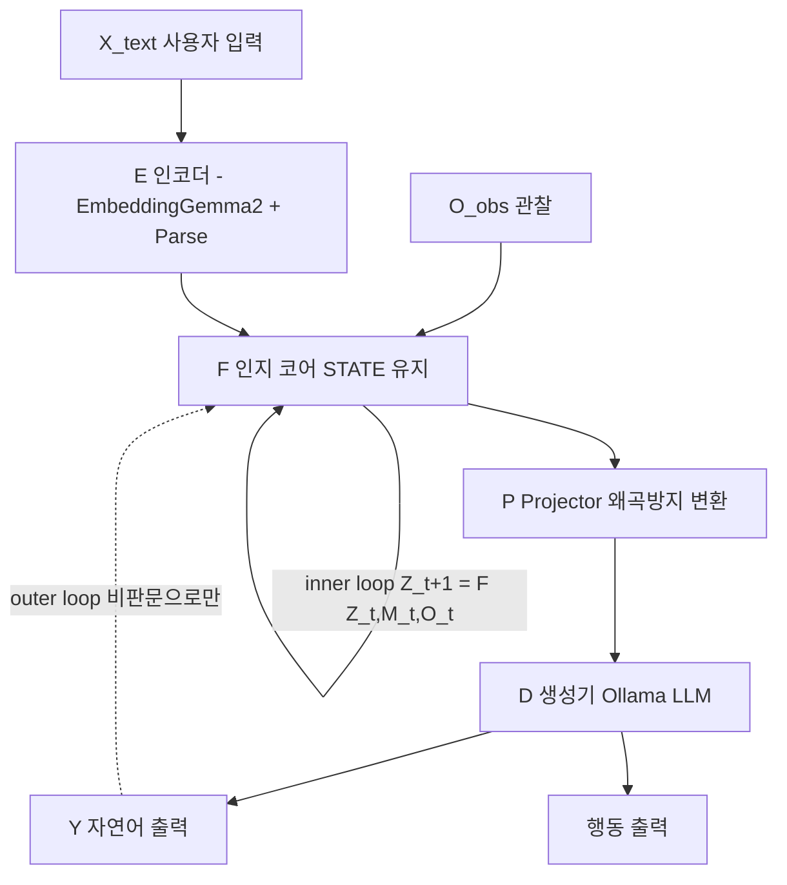

# Semantic Cognition 아키텍처

## 1. 전체 흐름



```text
[0] 입력: X_text / O_obs
        │
        ▼
[1] E 인코더 (변환만, 추론 없음)
  Z_text = E_text(X)
  F_sym  = Parse(X) -> Relation(s,p,o,src,conf)
        │
        ▼
[2] F 인지 코어 (사고 본체, STATE 유지)
  +-------------------------------+
  | STATE: concepts / relations[] |
  |  hypotheses[] + evidence[]    |
  |  confidence{}                |
  | M: vec_index + sym_store     |
  | R: 전방추론 1-2단            |
  | V: 근거부족/모순/종료판정    |
  +-------------------------------+
  inner: Z_{t+1} = F(Z_t, M_t, O_t, V(Z_t))
        │
        ▼
[3] P Projector (학습 필수)
  Z_T + F_sym -> LLM prefix
        │
        ▼
[4] D 생성기 (말만 함)
  JSON {goal, conclusion, facts, status} -> Ollama -> Y
   ├─> 행동
   └─> outer loop: Y는 증거로만 F에 반환
```

## 2. 예시 사이클

```text
"귀 뾰족하다" -> H1=고양이 conf 0.6
"개도 귀 뾰족" -> V 근거부족 -> H1 conf 0.6->0.3 유보
-> D: "귀만으로 단정 못함"
```

## 3. 원칙 3개

1. E/D는 입출력, F만 상태 보유
2. 벡터 + Relation(s,p,o) 병행 저장
3. 텍스트 되먹임은 보조, 메인은 Z 직접 갱신
