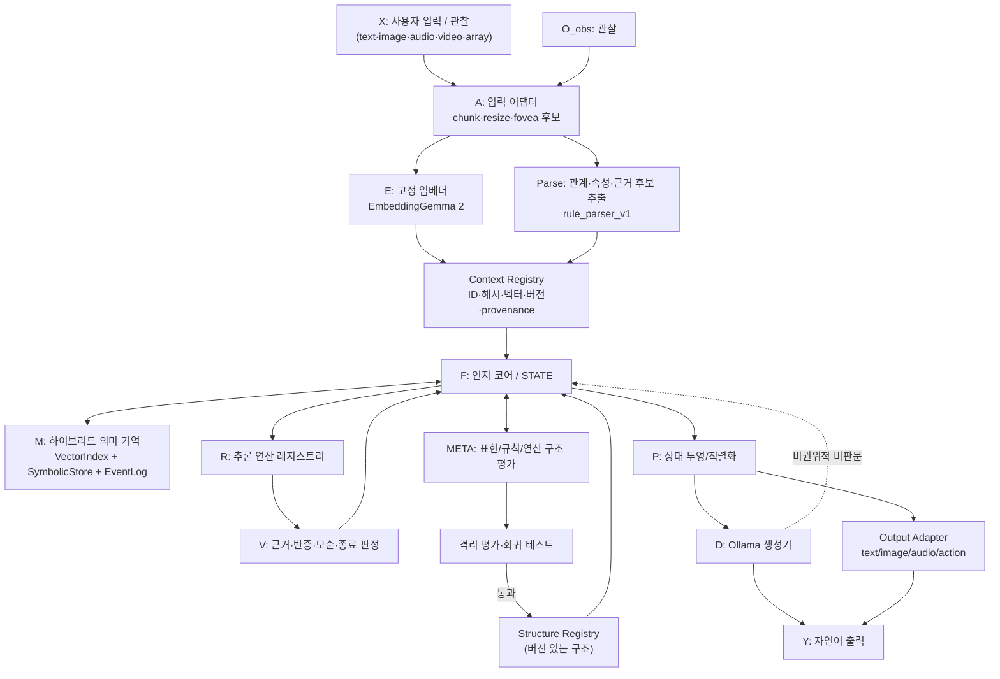

# Semantic Cognition — 통합 아키텍처 (summary_arch.md)

**문서 버전:** 1.4.0-merged
**작성일:** 2026-10-20
**상태:** 설계 확정 (구현 착수 전). Phase 0부터 순서대로 구현한다.
**개정 이력:**
- v1.0-merged — 5종 원본 문서 통합, 충돌 C1–C10 결정, Phase 0–18 로드맵 수립
- v1.1-merged — 저장소 구조 변경(`thinkstruct/` → `doc/`, 구 PoC 아카이브 삭제)에 따른 경로 참조 갱신, 오탈자 수정
- v1.2-merged — 구현 공백 37건 보완: Parse 파싱 방식·한국어 문형 규칙·라벨 데이터셋, ConceptNode(개체·속성 노드), 가설 상태 전이 표·STATE 직렬화·상태 해시, distinctiveness 연산, 목표 분류기, 세션·실행기 모델, 벡터 쓰기 경로, FailureCase 레코드, `importance` 계산식, 평가 데이터셋 계획, D 모델 지정, 교차참조·용어집 수정, §19 미결정 9건 추가
- v1.3-merged — Phase 0~5 + Phase 6 대표 예시 선행 검증(1차 목표) 착수에 따른 규범 보완: **C11–C14 충돌 해결 4건 신설**(개발자 직접 등록 경로·임베더 모델 동일성·근거 계보/실패 단계·§10.2 파싱 패턴), §7.5.1 Direct Developer Registry Path 신설, §8.4 `lineage`·§8.5 `scope`·§8.11 `failed_stage`/`diagnosis_status` 필드 신설, §8.10 `node_type` 결정 규칙, §7.7·§8.3·§11.1 **독립 근거 기준** 일괄 적용, §7.3 한국어 문형 표 확장(§10.2 입력2 지원) + `configs/attributes.yaml` 신설, §15.1.1 데이터셋 규모 확정(파싱 72 / 검색 100 / 인지 50 / 루프 30), §16 Phase 4·5 이벤트 책임 분담 및 Phase 12 이관 항목, §17 저장 구조 교정 3건, §19 미결정 9건 해소
- v1.3.1-merged — 진입점 신설에 따른 경로 참조 갱신: 루트 `README.md`·`.gitignore`·`tests/fixtures/parsing/README.md`를 §17 트리에 등록하고 교정 표에 4건을 추가, 트리에 없던 `doc/`(읽기 전용 원본)를 등록, §1.1에 **진입점(README·ARCHITECTURE)은 규범이 아니며 최종 판정 지점은 이 문서**라는 문구를 명시. **설계·스키마·게이트 변경 없음.**
- v1.4.0-merged — 3자(메인·Beam·GLM) 교차 감사 후 **문서 간 모순 정합 보완**: §7.3 술어 열 `(대응 술어)` → `is_a` (3개 표 통일) + **`not_*`는 표현용 별칭이며 `predicate`에 넣지 않는다** 명시, §7.5 **전이 사유 전역 규칙 우선 확정** + **`reason_kinds`** 코드화(`existing_evidence_retracted`/`new_evidence_added`), §7.5 전이표 `supported → rejected` 셀 정정·`rejected` 행 3셀 사유 표기 통일, **이벤트 스키마 9필드(최소)** 확정 + `event_type`별 추가 필드는 `payload` 원칙 명시, §7.6 `index_loaded` 위치 확정(embedding_refs 항목 내부), §8.1 `embedding_refs` 예시 정정(`model_id`·`digest`·`index_loaded`·`vector_ref` 경로), §8.2 술어 값 제약 명시, §7.3 라벨 **세트와 파일의 축 분리**(`subset` = `base`/`adversarial`/`out_of_scope`/`holdout`) + "파싱 라벨 fixture의 유일한 위치"로 한정, §16 Phase 6에 §10.2 픽스처 반영, §17 트리에 `retrieval/`·`e2e/` 등록(교정 표 #14), §19 #25 신설, §21 용어집 `reason_kinds` 추가. 근거는 `docs/decisions/ADR-0011.md`.
**뼈대 문서:** `doc/(gpt)SEMANTIC_COGNITION_BLUEPRINT.md` (모듈 경계·데이터 모델·단계 게이트의 뼈대로 채택)
**병합 대상:** `doc/semantic_cognition_architecture.md`, `doc/plans_last.md`, `doc/embedder_reference.md`, `doc/continue_input.md`, `doc/embeddinggemma2/*.ipynb` (4종)
**기존 실험 결과:** **무시한다.** 기존 PoC 실험 결과는 참고용 단서로만 취급하며, 모든 실험은 새로 코드를 작성해 다시 실행한다. 아래 문서의 목표 수치는 전부 **목표 제안(미실측)** 이다.

---

## 0. 한 페이지 요약

이 시스템은 "LLM 하나가 전부 하는 구조"가 아니다. **인지 코어 `F`** 가 컨텍스트를 저장하고, 기억을 검색하고, 추론·검증·상태 갱신을 수행한다. 그 바깥에 입출력 모듈과 기억 계층, 그리고 구조 자체를 실험으로 바꾸는 메타 계층을 둔다.

```
입력(X) ─▶ A 입력어댑터 ─▶ E 임베더 ─┐
   │                                ├─▶ Registry ─▶ F(인지코어/STATE) ◀── M(하이브리드메모리)
   └────────▶ Parse(관계추출) ─────┘                    │  ▲
                                    ┌───────────────────┘  │
                                    ▼                      │
                              R(추론) ─▶ V(검증) ─────────┘
                                    │
                                    ├──▶ META(진단→제안→샌드박스→승인/롤백)
                                    ▼
                            P(투영) ─▶ D(생성) ─▶ Y(자연어/행동)
                                    └─(비권위적 비판문으로만)─▶ F
```

**3개 루프**

| 루프 | 내용 | 권위 |
|---|---|---|
| 인지 루프 | 컨텍스트 생성 → 기억 검색 → 추론 → 검증 → 내부 상태 갱신 (반복) | F |
| 학습 루프 | 경험 축적 → 공통 구조/규칙 후보 추출 → 새 문제에 적용 → 성패 기록 | R + Learning |
| 메타 루프 | 구조 한계 진단 → 변경안 제안 → 격리 평가 → 승인 또는 롤백 | META |

**가장 중요한 규칙 5개**

1. E와 D는 입출력 모듈이다. **지속적 지식 상태의 권위 있는 소유자는 F뿐이다.**
2. `content_hash`(식별) · `z_raw`(의미) · `z_mrl`(차원축소) · `z_abs`(학습표현) 는 **네 개가 서로 다른 것이다.** 같은 필드·같은 인덱스에 섞지 않는다.
3. 벡터 유사성은 **검색 신호**이며 논리적 참/거짓 판정이 아니다. 판단은 관계·출처·검증(`V`)이 한다.
4. D가 만든 문장은 자동으로 사실이 되지 않는다. `llm_generated` 출처를 가진 **가설 후보**로만 저장한다.
5. 구조 변경과 파라미터 학습을 한 번에 동시에 하지 않는다. 각각 별도 버전·별도 실험으로 평가한 뒤 조합한다.

---

## 1. 문서 병합 기록 (출처 → 반영 위치)

| 출처 파일 | 이 문서로 흡수된 것 | 반영 위치 |
|---|---|---|
| `doc/(gpt)SEMANTIC_COGNITION_BLUEPRINT.md` | 모듈 경계(E/Parse/Registry/F/M/R/V/META/P/D/Eval), 데이터 모델 5종, 3루프, 기준선 B0–B7, Phase 게이트, 에러 처리 | 전체 골격, §7~§16 |
| `doc/semantic_cognition_architecture.md` | E→F→P→D 흐름도, inner/outer 루프 구분, "예시 사이클" | §5.1, §5.2, §10.2 |
| `doc/plans_last.md` | H1–H6 가설, Input/Core/Output 3박 구조, `z_raw`/`z_abs` 이중 스트림, HNSW + Hot/Warm/Cold + 페이징, Peripheral-Foveal, Fast/Episodic/Slow 지속학습, 출력 어댑터 계약, 평가 프로토콜 4요소, 미결정 관리 원칙 | §4, §6, §11, §12, §13, §14, §15 |
| `doc/embedder_reference.md` | 모델 실체, task 프롬프트 표, float16 금지, `config_kwargs` 절감, MRL 규칙, 유사도 하한 주의 | §7.2, §6.3 |
| `doc/continue_input.md` | 작업 규칙(venv, 4종 세트, 미실측 금지, 3회 제한, 시스템 비변경) | §18 |
| `doc/embeddinggemma2/*.ipynb` (4종) | 실제 ST 호출 API (`prompt_name`, `truncate_dim`, `config_kwargs`, `processing_kwargs`, 교차모달 dict 입력), 파인튜닝 패턴 | §7.2, §13 |
| `poc/README.md` (구 아카이브, 삭제됨) | 단계 폴더 4종 세트 규칙 | §18.2 |

### 1.1 문서 권위 순서 (충돌 시)

1. `summary_arch.md` (이 문서) — 구현의 유일한 기준
2. `docs/IMPLEMENTATION_PLAN.md` — 1차 목표의 단계별 실행 계획·선행 조건·게이트·작업 항목
3. `docs/DATA_MODEL.md` — §8 데이터 모델과 §9 계약의 필드·스키마 세부 (SQLite 스키마 포함)
4. `docs/EXPERIMENT_PROTOCOL.md` — 데이터셋 명세·지표 계산법·분할 규칙
5. `doc/(gpt)SEMANTIC_COGNITION_BLUEPRINT.md` — 뼈대
6. `doc/plans_last.md` — 구성요소·실험 규율
7. `doc/embedder_reference.md` / `doc/embeddinggemma2/*.ipynb` — API 사실관계
8. `doc/continue_input.md` — 작업 규칙

아래 문서들이 이 순서를 따르지 않으면 **이 문서가 이긴다.**

**2–4번 문서의 지위 (v1.3 신설)**

- 2–4번은 **이 문서로부터 파생된 실행 문서**다. 이 문서와 **충돌하면 이 문서가 이긴다.**
- 파생 문서는 이 문서를 **변경할 수 없다.** 규범 변경이 필요하면 이 문서를 버전 올려 수정하고, 그 변경을 `docs/decisions/`에 기록한다.
- `docs/EXPERIMENTS.md`는 실행 로그이므로 **규범이 아니다.** 여기에 적힌 수치는 그 시점의 실측 기록이다.

**진입점 (v1.3.1 신설)**

- **루트 `README.md`와 `docs/ARCHITECTURE.md`는 규범이 아니다.** 둘 다 요약·안내 계층이다.
- README는 읽기 순서·현재 상태·작업 규칙·다음 단계를 담고, `docs/ARCHITECTURE.md`는 설계 요약을 담는다. **둘 다 정본을 복제하지 않는다.** 정본 링크로만 연결한다.
- **규범이 아닌 문서가 규범을 설명하는 또 다른 규범 문서가 되지 않도록**, 이 문서가 최종 판정 지점이다.

---

## 2. 문서 간 충돌 해결 (C1–C14)

병합에서 반드시 결정해야 하는 지점들. 각 항목은 "결정 → 근거 → 구현 반영".

| # | 충돌 | 결정 | 근거 | 구현 반영 |
|---|---|---|---|---|
| **C1** | 인지 코어의 정체: 기호 규칙 엔진(BLUEPRINT) vs 학습형 순환 셀(plans_last) | **`F`는 기호 상태 제어기**다. `plans_last`의 "RecursiveCore"는 별도 신경망 모듈이 아니라 **F의 step 함수(=인지 루프 1스텝)**로 흡수한다. 학습형 정제 모듈은 선택적이며 기본 경로가 아니다. | BLUEPRINT을 뼈대로 채택(사용자 지시). BLUEPRINT §0 "초기 구현은 결정적이고 설명 가능한 방식으로 만든 후, 실제 평가 자료가 생긴 경우에만 학습 모듈을 추가" | §7.5, §10.1 |
| **C2** | `z_abs` 지위: 핵심 가정 H1(plans_last) vs Phase 12 연기(BLUEPRINT) | **4단 표현 체계**로 정리: `z_raw`(기본) / `z_mrl`(저비용 MRL 절단, 비교 기준선) / `z_abs`(학습형, 승격 전까지 비활성) / `z_joint`(실험). `z_abs`는 `z_raw`보다 반복적으로 이기지 못하면 기본 검색 경로에 승격하지 않는다. | 두 문서 모두 "차원 축소 ≠ 자동 추상화"를 인정. plans_last §17 "z_abs 무용→z_raw 기준선 분리 비교" | §6, §7.2 |
| **C3** | 메모리 인덱스: HNSW(plans_last, Hash 제거) vs 브루트포스 SQLite(BLUEPRINT) | **`VectorIndex` 인터페이스 1개, 구현 2개**: `BruteForceIndex`(기본, 정확 코사인) / `HNSWIndex`(규모가 커질 때). Hash는 **식별용 content_hash로만** 쓰고 유사도·버킷팅에는 쓰지 않는다. | plans_last의 "Hash 제거"는 Multi-Hash *인덱싱* 제안을 겨냥한 것. BLUEPRINT §5의 content_hash(식별)와는 직교. §7.6 | §7.6, §11 |
| **C4** | 재귀 제어: 학습형 Halting Head(plans_last) vs 결정적 종료(BLUEPRINT) | **결정적 종료 정책이 v1이자 기준선**이다(max_steps, 사이클 탐지, 근거 정체, 해결기준 충족). 학습형 halting은 **결정적 기준선을 이겨야만** 채택하는 실험이다. | plans_last §7 "기존 Stage 3은 개선 미미 + calibration 문제였으므로 재귀 이득 가정 금지". §12 재귀도 재실험 대상 | §10.3, §16 Phase 8(결정적 기준선) / Phase 18(학습형 비교) |
| **C5** | 인코더 백엔드: Ollama `/api/embed` vs Sentence Transformers | **백엔드 2종을 하나의 `Encoder` 계약 아래에 두고, Phase 0에서 기능 테스트로 실제 사용 가능한 쪽을 확정한다.** 텍스트는 둘 다 가능. 멀티모달(이미지/오디오/비디오)은 **Ollama가 실제로 받는지 확인될 때까지 ST 경로만 허용**한다. | BLUEPRINT §2.2 "EmbeddingGemma 2 자체가 멀티모달이라는 사실만으로 설치한 Ollama 버전의 /api/embed가 이미지를 받아들인다고 가정하지 않는다" | §7.2, §16 Phase 0 |
| **C6** | 이미지 경로: Peripheral-Foveal 3채널(plans_last, 정의 미확정) vs 범용 멀티모달 | **Peripheral-Foveal 처리는 Phase 14까지 보류**한다. 그때 규약을 재도출·동결하고, 그 전까지는 **단일 채널 리사이즈 이미지가 기준선**이다. 3채널 의미는 **지금 정의하지 않는다.** (기본 리사이즈 이미지의 v1 임베딩 지원은 Phase 1 텍스트 경로와 별개로, §13.1 원칙만 적용) | plans_last §18-2가 "미확정"으로 명시했고 "Experiment 02 실제 처리 방식을 확인 후 명세 고정. 임의 재정의 금지"라고 경고 | §13, §19 |
| **C7** | 신뢰도 표현: 0.6→0.3 숫자(`semantic_cognition_architecture.md`) vs 범주형/보정전(BLUEPRINT) | **범주형만 사용**(`low`/`medium`/`high`/`unresolved`) + 근거 구성요소(지지 근거 수, 반박 근거 수, 적용된 규칙 버전). 숫자 확률은 **calibration 데이터셋이 생긴 뒤에만**, 그때도 `confidence_method`를 명시하고 보정 전 값임을 표기한다. | BLUEPRINT §4.3 "첫 버전에서는 임의의 숫자를 실제 확률처럼 제시하지 않는 편이 낫다", §9.2 "이 예시에서 숫자 0.6→0.3을 임의로 적용하지 않는다" | §7.8, §10.2 |
| **C8** | D 출력의 역할: outer-loop 피드백(`architecture.md`) vs 비권위적 비판문(BLUEPRINT) | **D 출력은 비판문으로만 F에 돌아오고, 사실 저장소 승격은 없다.** 독립 파서로 후보 주장을 뽑아 `source.kind=llm_generated` + `epistemic_status=hypothesized` 로 저장한다. 사용자 확인이나 외부 관측 없이는 근거로 승격하지 않는다. | BLUEPRINT §12.2 | §7.11, §10.4 |
| **C9** | 실험 위치: `poc/`(구 규칙) vs `src/`(plans_last) | **새 프로젝트 구조**: `src/semantic_cognition/`(라이브러리) + `experiments/stageN_*/`(실행·산출물, 4종 세트). 구 PoC 아카이브는 삭제 완료이며 신규 구현은 `src/`에서만 수행한다. | plans_last §14 "신규 검증 구현은 src/ 안에서 수행, poc/는 참조용 보존" | §17, §18 |
| **C10** | 기존 PoC 결과의 지위 | **결과가 아니라 가정으로 취급.** 기존 단계에서 관측된 부정적 결과(그래프 재순위 이득 없음, RL 퇴행, LLM이 가설 추종)는 **기본 제외(ablation baseline)** 로 명시하되, 다시 실험해 확인한다. 수치를 인용하지 않는다. | 사용자 지시 + 두 문서의 "실측하지 않은 수치는 보고하지 않는다" | §15.3, §16 |
| **C11** | **META 선행 의존성 교착.** §7.3(관계 규칙 추가 = 구조 변경)·§7.9(변경 수명주기 = META 제안→샌드박스→승인)·§7.7("Phase 6 이후 연산 추가는 Phase 12 선행")이 요구하는 경로가 Phase 12 이전에는 존재하지 않음 → Phase 3~11이 구조 변경을 못 함 | **개발자 직접 등록 경로(Direct Developer Registry Path)를 Phase 3~11에 한해 허용한다.** Phase 12 완성 후에는 모든 구조 변경을 META 경로로 이관한다. | §7.3은 Phase 3 산출물로 `configs/relations.yaml`을, §7.7은 Phase 6 산출물로 5개 연산을 지정한다. META는 Phase 12다. 현행 문서대로면 Phase 3이 산출물을 만들 수 없다. | §7.5.1(신설), §7.7, §16 Phase 12, `docs/decisions/ADR-0001.md` |
| **C12** | **임베더 백엔드 간 모델 동일성 미확인.** §6.3 프로파일은 backend를 구분하지만, ST의 `google/embeddinggemma-2`와 Ollama의 로컬 태그 `embeddinggemma`가 **같은 모델인지 확인하는 절차가 없다.** | **백엔드 간 벡터는 동일 인덱스에서 비교·병합하지 않는다.** Phase 0에서 모델 동일성을 판정해, 다르면 §6.2 규칙 2에 따라 **별도 프로파일 + 별도 인덱스**를 만든다. 동일성 판정 근거를 `results.json`에 기록한다. | §6.2 규칙 2(모델 태그 변경 → 새 프로파일 + 새 인덱스, 기존 벡터 병합 금지). `doc/continue_input.md` §3의 Ollama 로컬 태그는 `embeddinggemma`이며 ST 대상(`google/embeddinggemma-2`)과 태그가 다르다. | §6.3, §19 #1, §16 Phase 0, `docs/decisions/ADR-0002.md` |
| **C13** | **근거 독립성·실패 지점 표현 부재.** §8.4 `Evidence`에 파생 계보가 없고, §8.11 `FailureCase`의 `diagnosis_category`는 근본 원인 7종만 있어 **어느 파이프라인 단계에서 실패했는지** 기록할 수 없다. | **`diagnosis_category` 7종은 유지한다**(§8.11 "임의 확장하지 않는다"). 파생 계보는 `Evidence.lineage`, 실패 지점은 `FailureCase.failed_stage`로 **별도 축**으로 추가한다. 추정 원인과 확정 원인은 `diagnosis_status`로 구분한다. | §8.11 명시 규칙(7종 고정) + §5.3의 7단계 진단 순서. ChatGPT 리뷰의 8종 제안은 근본 원인이 아닌 단계 축이므로 7종을 대체할 수 없다. 독립 근거 미표시 시 §11.1 `importance`·§8.3 `support_count`·§7.7 귀납 최소 사례 수가 모두 부풀려진다. | §8.4, §8.5, §8.11, §8.3, §11.1, §7.7, `docs/decisions/ADR-0003.md` |
| **C14** | **§10.2 대표 예시가 v1 파싱 규칙으로 파싱되지 않음.** 입력2 "개도 뾰족한 귀를 가질 수 있다"는 §7.3 문형 표의 어떤 행에도 매칭되지 않아 `unparsed`가 되고, Phase 3 게이트("§10.2 예시 재현 가능")와 Phase 6 게이트("end-to-end 재현")가 **도달 불가**가 된다. | **§7.3 표를 확장한다.** `has_property`/`possible` 행에 가능성 동사 표면형(`B를 가질 수 있다` 등)을 추가하고, 주체 조사 `도/가`를 허용한다. 문형 **행 수는 9를 유지**한다(표면형 추가이므로 새 행이 아니다). §10.2 원문은 대표 예시로 유지한다. | §7.3 "v1이 지원하는 것은 위 표뿐이다"와 Phase 3·6 통과 기준의 충돌 해소. §7.3 확장 규칙 추가 절차를 §7.5.1 개발자 경로로 수행한다(§19 #15 규모 72문장은 문형 행 수가 유지되므로 불변). | §7.3, `configs/attributes.yaml`(신설), §19 #13·#15, `docs/decisions/ADR-0004.md` |

---

## 3. 목표 / 비목표

### 3.1 목표

1. 사용자 입력과 관찰을 **컨텍스트 단위**로 표현한다(원문·해시·벡터·관계·출처 보존).
2. 고정 임베더(E)로 의미 벡터를 만들고, 별도 파서로 명시적 관계를 추출한다.
3. **벡터 기억과 기호 기억을 함께** 검색·조회한다.
4. 연역, 간단한 귀납, 가설 비교, 유추 후보 생성 등 **추론 연산을 호출**할 수 있게 한다.
5. 모든 가설과 결론에 **근거·출처·적용 규칙 버전**을 연결한다.
6. 반증, 모순, 근거 부족을 **구별**해 상태를 수정한다.
7. 추론 경험으로 규칙 후보와 추론 정책을 개선한다(실험 대상).
8. 현재 표현 체계로 풀기 어려운 문제를 **감지**하고, 메타가 변경안을 실험하게 한다.
9. 최종 상태를 LLM에 전달해 자연어로 표현하되, **LLM 출력을 권위 있는 사실로 승격하지 않는다.**
10. 이미지·오디오·비디오 임베딩을 같은 인지 코어와 연결할 수 있게 **인터페이스를 먼저 설계**한다.

### 3.2 비목표

- 첫 단계부터 인간 수준의 일반지능을 구현한다고 가정하지 않는다.
- 임베딩 벡터 자체가 추론하거나 의식을 수행한다고 가정하지 않는다.
- 처음부터 임베더 전체를 미세조정하지 않는다. (Freeze 원칙, §12.1)
- 임의의 Python 코드나 모델 가중치를 스스로 바꾸는 무제한 자기수정을 허용하지 않는다.
- LLM이 말한 내용만으로 사실 여부를 결정하지 않는다.
- 한 번의 성공 사례로 일반화 능력을 입증했다고 보지 않는다.
- **검증되지 않은 목표 수치를 달성 여부로 판정하지 않는다.** (§15.7)

---

## 4. 설계 원칙 (10개)

| # | 원칙 | 근거 |
|---|---|---|
| P1 | E·D는 입출력 모듈. 지속적 지식 상태의 권위 있는 소유자는 F | BLUEPRINT §0, architecture.md 원칙1 |
| P2 | 원본 임베딩 `z_raw`는 고정(freeze)한다 | embedder_reference §3, plans_last §3.1 |
| P3 | 벡터 유사성은 검색 신호이지 진위 판정이 아니다 | BLUEPRINT §0 |
| P4 | 컨텍스트 해시는 식별·중복 관리용이며 의미 벡터가 아니다 | BLUEPRINT §5 |
| P5 | 사실 / 가설 / 추론결과 / LLM문장은 서로 다른 상태로 저장한다 | BLUEPRINT §0, §4.3 |
| P6 | 구조 변경은 제안 → 테스트 → 승인 → 버전 기록 → 롤백이 가능해야 한다 | BLUEPRINT §0, §11.3 |
| P7 | 각 단계는 자동 테스트와 명시적 통과 기준을 갖는다 | BLUEPRINT §0, §14 |
| P8 | 초기 구현은 결정적·설명 가능하게. 학습 모듈은 평가 자료가 생긴 뒤에 추가 | BLUEPRINT §0, plans_last §15-8 |
| P9 | 벡터 + `Relation(s,p,o)`를 병행 저장한다. 어느 쪽도 단독으로 진위를 판정하지 않는다 | architecture.md 원칙2, BLUEPRINT §7 |
| P10 | 텍스트 되먹임은 보조. 메인은 내부 상태(Z)의 직접 갱신이다 | architecture.md 원칙3 |

**추가 원칙 (P11–P13, 병합에서 신설)**

| # | 원칙 |
|---|---|
| P11 | **저장 ≠ 검색 ≠ 활용**을 항상 구분한다. 검색 결과를 얻었는지와 그것이 실제로 판단에 기여했는지는 별개 이벤트로 기록한다. (plans_last §9 "저장했다≠활용해 개선했다") |
| P12 | **구조 변경과 파라미터 학습을 동시에 하지 않는다.** 성능 변화의 원인을 알 수 없게 된다. (BLUEPRINT §11.5) |
| P13 | **평가 실패는 보통 설계 결함이 아니다.** 입력 인식 오류·검색 실패·규칙 버그·근거 부족·데이터 부족 중 무엇인지 먼저 분류한다. (BLUEPRINT §11.2) |

---

## 5. 전체 아키텍처

### 5.1 컴포넌트 다이어그램



### 5.2 실행 흐름 (텍스트 관점)

```text
[0] 입력: X_text / O_obs
        │
        ▼
[1] A 입력 어댑터 (정규화·청킹·리사이즈·메타)
        │
        ├─▶ E 인코더 (변환만, 추론 없음)
        │      z_raw = E(payload, profile_id)
        │
        └─▶ Parse (변환만, 추론 없음)
               F_sym = Parse(raw) -> Relation(s,p,o,quant,polarity,span,src)
        │
        ▼
[2] Registry: ContextRecord + RelationRecord + provenance 저장
        │
        ▼
[3] F 인지 코어 (사고 본체, STATE 보유)
   ┌───────────────────────────────────────────────┐
   │ STATE                                        │
   │  current_goal / active_context_ids            │
   │  working_memory / hypotheses / evidence_map   │
   │  unresolved_questions / contradictions        │
   │  inference_traces / retrieval_trace           │
   │  structure_version / loop_count / termination │
   └───────────────────────────────────────────────┘
   M: VectorIndex + SymbolicStore + EventLog
   R: 추론 연산 (precondition/버전 보유)
   V: 근거 충족·반증·모순·불확실성 판정
        │
        │  inner: Z_{t+1} = F(Z_t, M_t, O_t, V(Z_t))
        ▼
[4] META: 한계 진단 → StructureChangeProposal → 샌드박스 → 승인/롤백
        │
        ▼
[5] P 투영 (STATE → 검증된 JSON/텍스트)
        │
        ▼
[6] D 생성기 (말만 함)  → Y 자연어 / 행동
        └─▶ outer: Y는 비판문·후보로만 F에 반환 (사실 승격 금지)
```

### 5.3 세 루프의 관계

```text
        ┌────────────────────────────────────────────┐
        │  인지 루프 (F)  ←── 권위 있는 상태 소유자     │
        │  검색→추론→검증→상태갱신 (반복, 종료조건 명시) │
        └───────┬──────────────────────────┬─────────┘
                │ 경험 로그                  │ 실패 진단
                ▼                          ▼
        ┌───────────────┐          ┌──────────────────┐
        │ 학습 루프     │          │ 메타 루프 (META)  │
        │ 규칙후보 추출 │          │ 구조변경제안→샌드박스│
        │ 적용→성패기록 │          │ →승인/롤백        │
        └───────────────┘          └──────────────────┘
```

- 세 루프는 **연결되지만 기능상 구분**한다. 일반 추론이 실패했다고 바로 내부 구조를 바꾸지 않는다.
- 진단 순서: 입력 추출 오류 → 기억 검색 오류 → 추론 규칙 오류 → 근거 부족 → 표현 체계 한계 → 정책 오류 → 데이터 부족.

### 5.4 모듈 책임과 권위

| 모듈 | 책임 | 권위 있는가? | 초기 구현 형태 |
|---|---|---|---|
| A | 임의 모달리티/크기 → 임베더 입력 정규화 | 아니요 | 청커·리사이저·(후기) fovea |
| E | 텍스트/모달리티 임베딩 생성 | 아니요. 관찰 표현 | ST 또는 Ollama 백엔드 |
| Parse | 원문에서 관계·속성·주장 후보 추출 | 검증 전에는 아니요 | 규칙 기반 + 정형 출력 파서 |
| Registry | 컨텍스트 ID·원본·해시·벡터 버전 관리 | 원본/출처의 기준 저장소 | SQLite + 파일 저장 |
| **F / STATE** | 현재 문제·활성 가설·근거 관리 | **예. 상태 전이의 기준** | Python 객체 + 저장소 |
| M | 벡터 검색과 기호 조회 | 저장은 담당, 참/거짓 판정 아님 | 브루트포스 코사인 + SQLite |
| R | 명시적 추론 연산 실행 | 추론 후보 생성 | 결정적 규칙 엔진 |
| V | 근거 충족·반증·모순·종료 판정 | 검증 결과 기록 | 명시적 검사기 |
| META | 표현·규칙·연산 구조의 변경 필요성 평가 | 변경을 직접 확정하지 않음 | 제한된 메타 제어기 |
| Structure Registry | 활성 관계유형·규칙·연산·정책 버전 관리 | 활성 구조의 기준 | 버전 있는 JSON/YAML |
| P | STATE를 안전한 표현으로 변환 | 아니요. 뷰/직렬화 | JSON schema + formatter |
| D | 최종 자연어/행동 생성 | 아니요. 출력은 자동 사실 아님 | Ollama chat API |
| Output Adapter | 잠재 → 외부 모델 입력 계약 변환 | 아니요 | 텍스트 어댑터 → 이후 확장 |
| Evaluation | 능력 측정·회귀·ablation | 실험 결과의 기록 기준 | pytest + 고정 데이터셋 + 리포트 |

---

## 6. 표현 체계: 네 개의 서로 다른 것

### 6.1 구분 표

| 표현 | 정체 | 생성 방식 | 용도 | 사용 금지 |
|---|---|---|---|---|
| **`content_hash`** | 정규화 콘텐츠의 결정적 해시 | SHA-256(canonical_content) | 식별·중복 확인·변경 감지 | 의미/유사도 계산, 검색 스코어 |
| **`z_raw`** | 고정 임베더의 원본 임베딩 | E(payload, profile) | 의미 검색·근접 사례·교차모달 | 자르지 말고(프로필별 예외), 논리 진위 판정 |
| **`z_mrl`** | `z_raw`의 MRL 절단본 | `z_raw[:N]` → L2 재정규화 (N∈{128,256,512}) | 저비용/저지연 검색 비교 기준선 | `z_abs`와 혼용, 동일 인덱스 혼합 |
| **`z_abs`** | 별도 학습 모듈이 만든 추상 표현 | `A_θ(z_raw, relation_features)` — 학습은 Abstract-CoT 방식(정보 병목 SFT → self-distillation → warm-started GRPO RL, §12.1 참조) | 도메인 특화 공통 구조 포착 | 승격 검증 전 기본 경로 사용, 임베더 재입력 |
| (`z_joint`) | `concat(normalize(z_raw), normalize(z_abs))` | 선택적 실험 (768+256=1024) | 이중 스트림 실험 | `z_raw`가 1024차원이라는 뜻으로 오해 |

**차원 주의 (6.1의 함정)**

- 임베더 출력 차원(기본 768, MRL로 128~512 절단 가능)과 `z_abs` 후보 크기(목표 256)는 **다른 것**이다.
- `z_mrl` 256차원과 `z_abs` 256차원은 의미도 학습 경로도 다르므로 **같은 필드·같은 인덱스에 섞지 않는다.**
- MRL 절단 후에는 **반드시 재정규화**한다.
- 실제 출력 차원은 **실측값**을 쓴다. 목표와 다르면 임의 절단·패딩·reshape로 맞추지 않고, 인터페이스를 고치거나 대안을 검토한 뒤 **변경 근거와 영향을 문서에 기록**한다.

### 6.2 표현 혼용 금지 규칙 (구현 검증 가능)

1. `VectorIndex`는 `(profile_id, dimension)` 쌍으로 분리된다. 인덱스에 두 프로파일의 벡터를 섞지 않는다.
2. 프로파일·모델 태그·차원·정규화·task prefix가 바뀌면 **새 프로파일 + 새 인덱스 버전**을 만들고 재색인한다. 기존 벡터와 새 벡터를 병합하지 않는다.
3. `content_hash`를 검색 스코어로 쓰는 코드가 있으면 테스트가 실패한다.
4. `z_abs`가 활성화되면 `z_raw` 프로파일과 **별도 인덱스**를 갖는다. 기본 검색 프로파일은 `z_raw`다.
5. 임베딩 프로파일 불일치는 **경고가 아니라 오류**다.

### 6.3 임베딩 프로파일 레지스트리

```yaml
# configs/embedding_profiles.yaml  (예시 형태 — 값은 Phase 0 실측으로 확정)
profiles:
  - id: text_sim_v1
    backend: sentence_transformers        # 또는 ollama
    model_id: google/embeddinggemma-2
    tag: null
    digest: "<Phase 0 실측>"
    dimension: 768                         # 실측 확정
    normalize: true                        # 실측 노름으로 확인
    task_prefix: "task: sentence similarity | query: "
    modality: [text]
    encoder_flags: {vision_config: null, audio_config: null}
    dtype: bfloat16                        # float16 금지
    created_at: "<ISO-8601>"

  - id: context_retrieval_v1
    task_prefix: "task: search result | query: "   # 질의측
    document_prefix: "title: none | text: "        # 저장측
    modality: [text]

  - id: context_similarity_v1
    task_prefix: "task: sentence similarity | query: "   # 대칭
    modality: [text]

  - id: fact_evidence_v1
    task_prefix: "task: fact checking | query: "
    document_prefix: "title: none | text: "
    modality: [text]
```

**규칙**

- `context_similarity_v1`과 `context_retrieval_v1`은 **분리**한다(대칭 vs 비대칭).
- 이 프로파일들의 벡터를 서로 직접 비교하지 않는다.
- task prefix는 **텍스트 입력에만** 적용한다. 이미지·오디오·비디오에는 적용하지 않는다.
- `z_mrl` 절단은 `truncate_dim` + `normalize_embeddings=True`로 만들고, 별도 프로파일(`..._mrl256`)로 등록한다.

### 6.4 인코더 백엔드 상세 (노트북 근거)

**Sentence Transformers 경로**

```python
from sentence_transformers import SentenceTransformer

model = SentenceTransformer(
    "google/embeddinggemma-2",
    config_kwargs={"vision_config": None, "audio_config": None},  # 텍스트 전용이면 270M
    truncate_dim=128,            # MRL
    similarity_fn_name="dot",    # 정규화 벡터에서는 dot == cosine
    device=...,
)
emb = model.encode(sentences, prompt_name="STS", normalize_embeddings=True)
```

- **float16 금지.** GPU 지원 시 `bfloat16`, 아니면 `float32`.
- 텍스트 전용: `{"vision_config": None, "audio_config": None}` / 텍스트+이미지: `{"audio_config": None}`.
- `prompt_name` / `prompt` / `default_prompt_name` 세 가지 중 하나로 프리픽스 지정.

**Ollama 경로**

- `POST {host}/api/embed`, body에 `model` + `input`(문자열 또는 리스트).
- Ollama는 L2 정규화 벡터를 반환한다고 문서화되어 있지만 **코드에서 맹목적으로 가정하지 않는다.** 실제 응답의 노름·유한성(finite)을 검사하고 기록한다.
- **멀티모달 지원은 보장되지 않는다.** 텍스트로 시작하고, 이미지·오디오·비디오 수용 여부는 기능 테스트로 확인한 뒤에만 해당 백엔드를 멀티모달에 사용한다.

**멀티모달 입력 형식 (ST 경로)**

```python
model.encode({"image": path_or_url_or_PIL})   # vision soft token budget: 70/140/280/560/1120
model.encode({"audio": path_or_url_or_waveform})  # 16 kHz 자동 리샘플
model.encode({"video": path_or_url_or_frames})    # 기본 1 fps, processing_kwargs로 max_frames/fps/overflow_strategy/add_timestamps 조정
model.encode({"text": "...", "image": [...], "audio": ...})  # 혼합
model.encode({"text": "비교: <|video|> 와 <|image|>", "video": ..., "image": [...]})  # 플레이스홀더 인터리빙
```

**유사도 해석 주의**

- 텍스트 코사인 유사도는 **하한이 높다.** 무관 문장도 0.5 아래로 거의 떨어지지 않고, 무관 문장 간 0.68 사례가 관측된다.
- 따라서 **임계값을 임의로 정하지 않는다.** 고정 검증 세트로 실측 분포를 먼저 만들고, 그 분포에서 임계값을 정한다.
- 교차모달 유사도가 높다는 것은 "관련성 신호"일 뿐, 이미지의 세부 속성이 텍스트 진술과 정확히 일치한다는 증명이 아니다.

---

## 7. 모듈 상세 설계

### 7.1 A — 입력 어댑터

**책임:** 임의 모달리티/크기의 입력을 임베더가 받아들일 수 있는 정규화 형태로 바꾸고, 그 과정의 메타데이터를 남긴다.

**공통 계약**

```python
def adapt(raw_input) -> AdaptedPayload
# AdaptedPayload = { payload, modality, metadata }
```

| 모달리티 | v1 처리 | 기록할 메타데이터 |
|---|---|---|
| text | 길이 기준 청킹 (예: 512 tokens, overlap 50) | 청크 인덱스, 총 청크 수, 문자 오프셋, 청킹 방식 |
| image | 리사이즈(단일 채널). **fovea는 Phase 14** | 원본 해시, 원본 크기, 리사이즈 크기, PIL 모드 |
| audio | 디코딩 + 16 kHz 리샘플 | 샘플레이트, 채널 수, 길이, 시작 오프셋 |
| video | 프레임 추출(기본 1 fps) | fps, 프레임 수, 구간 타임스탬프 |
| array | shape/dtype/차원/의미 메타데이터 보존 | shape, dtype, 값 범위, 단위/의미 설명 |

**설계 원칙**

- **토크나이저는 E와 동일한 임베더의 토크나이저를 쓴다.** (`google/embeddinggemma-2`의 tokenizer). 다른 토크나이저로 세면 청크 경계가 임베더의 컨텍스트 한도와 어긋난다.
- **청킹 파라미터 (v1):** 최대 512 토큰, 겹침 50 토큰. 값은 `configs/runtime.yaml`에 두고 §19 미결정으로 등록한다(실측 후 조정).
- **청크 집계는 M의 책임이다.** A는 청킹만 하고, E는 청크별 벡터를 반환하고, **M이 청크 벡터들을 컨텍스트 단위로 집계**한다. 집계 함수는 `aggregate(chunk_vectors) -> context_vector`이며 `configs/`에 방정식을 선언한다.
  - v1 집계 방식: **정규화 후 평균 → 재정규화**. (평균/가중/학습형은 §12.2와 같이 비교 실험 대상이나, v1은 평균 고정.)
  - **청크가 1개면 그대로 사용한다.**
  - 집계 벡터는 `profile_id`가 같다. 다른 프로파일의 청크를 섞지 않는다(§6.2).
- 원문은 항상 보존한다. 청킹은 원문을 대체하지 않는다.
- 긴 컨텍스트는 원문을 보존하면서 하위 컨텍스트로 나누고, 분할 경계와 부모 ID를 기록한다.
- 컨텍스트 문맥 한도는 **8,192 토큰을 안전 상한**으로 쓴다(실제 한도 확인 전).

### 7.2 E — 인코더 (고정)

**책임:** 입력을 의미 공간 벡터로 바꾼다. **추론·판정·학습을 하지 않는다.**

**E가 하지 않는 일 (명시적 금지 목록)**

- 사실과 가설을 스스로 구분하지 않는다.
- 관계 삼중항을 안정적으로 추출하지 않는다.
- 논리적 모순을 판정하지 않는다.
- 새 규칙을 자동 학습하거나 인지 코어를 변경하지 않는다.
- 벡터 차원·유사도만으로 개념의 진위·인과관계를 보증하지 않는다.
- 임베딩 벡터를 일반 채팅 LLM의 **입력 토큰 임베딩**과 같은 것으로 취급하지 않는다.

**출력 데이터 (EmbeddingResult)**

```json
{
  "vector": [ ... ],
  "dimension": 768,
  "profile_id": "context_retrieval_v1",
  "backend": "sentence_transformers",
  "model_id": "google/embeddinggemma-2",
  "digest": "...",
  "modality": "text",
  "normalization": "l2",
  "norm": 1.0000,
  "is_finite": true,
  "status": "ok",
  "input_fingerprint": "sha256:<hash>",
  "elapsed_ms": 0
}
```

`status` 값: `ok` / `input_too_long` / `modality_unsupported` / `model_error` / `invalid_dimension` / `non_finite`.

**원칙**

- 오류가 나면 **빈 벡터를 정상 결과처럼 반환하지 않는다.** 실패는 실패로 기록한다.
- `input_fingerprint`는 **벡터가 아니다.** 식별용 해시다.
- `z_raw`는 **영구 보존**한다. 후속 실험에서 새 표현을 학습해도 원본을 덮어쓰지 않는다.
- **캐싱**: 동일 `(profile_id, payload_hash)`는 재사용한다. 캐시 키에 프로파일이 포함되어야 한다.

### 7.3 Parse — 관계·속성 추출

**책임:** 원문에서 명시적 관계 후보를 뽑는다. **추론하지 않는다.**

**관계 술어 사전 (최소 집합, 초기)**

`is_a`, `instance_of`, `has_property`, `causes`, `supports`, `contradicts`, `similar_to`, `part_of`, `located_at`, `before`, `after`

- 완전한 온톨로지로 만들지 않는다. 새 관계 유형은 **META의 제안 + 검증 절차**로만 활성화한다.
- 수량사 보존: `all` / `some` / `exists` / `possible` / `typical` / `specific_instance`
- 극성 보존: `positive` / `negative`
- `validity_scope`(시간·조건·범위) 보존

**출력 규칙**

- 파싱하지 못한 문장은 `parse_status=unparsed`로 **남긴다.** 억지로 사실을 만들어내지 않는다.
- 원문 `span`(오프셋)과 출처를 항상 찾을 수 있어야 한다.
- 추출 결과는 `status=candidate`, `created_by=parse`로 저장된다. **`accepted`가 되려면 V의 검증이 필요하다.**

**평가:** 사람이 라벨링한 참조 문장 집합(anchor/positive/negative + 기대 관계)으로 precision/recall을 잰다.

**파싱 방식 (v1)**

- **v1은 규칙 기반(정규식 + 패턴 매칭)이다.** LLM을 사용하지 않는다.
- **LLM 금지의 이유:** §15.3에서 "LLM을 내부 루프에 직접 편입"을 기본 제외했다. Parse는 F의 내부 루프에 있는 모듈이므로 같은 제한을 받는다. LLM 파서는 D(출력 생성기)와 같은 통제·출처 기록 규칙을 받아야 하며, 그건 별도 Phase다.
- **형태소 분석기 도입은 선택 사항**이다. 정규식만으로 v1 문형을 처리할 수 없으면 `kiwipiepy` 같은 경량 분석기를 venv pip로 추가한다(§18.1 sudo 금지, venv만 사용). 의존성 추가는 Phase 3 착수 전에 `requirements.txt`에 명시한다.
- **규칙은 `configs/relations.yaml`에 선언적으로 둔다.** 코드 하드코딩 금지. META가 §7.9 허용 목록으로 규칙을 고칠 수 있게 한다.

**한국어 문형 → 술어 매핑 규칙 (v1 최소 집합)**

아래는 v1이 지원할 문형의 최소 규칙이다. 이 표에 없는 문형은 `parse_status=unparsed`로 남긴다.

| 문형 예시 | 술어 | 양태 | 극성 | 노드 추출 |
|---|---|---|---|---|
| "A는 B이다" / "A는 B다" | `is_a` | `typical` | positive | subject=A, object=B(class) |
| "모든 A는 B이다" / "A는 전부 B이다" | `is_a` | `all` | positive | subject=A, object=B(class) |
| "일부 A는 B이다" / "가끔 A는 B이다" | `is_a` | `some` | positive | subject=A, object=B(class) |
| "A는 B일 수 있다" / "A는 B일 가능성이 있다" / "A도 B를 가질 수 있다" / "A가 B를 가질 수 있다" | `has_property` | `possible` | positive | subject=A, attribute=B |
| "A는 B를 가진다" / "A의 B" / "A의 B가 C하다" | `has_property` | `typical` | positive | subject=A, attribute=B |
| "A는 B가 아니다" | `is_a` | `typical` | **negative** | subject=A, object=B |
| "A도 B이다" | `is_a` | `typical` | positive | — |
| "X 때문에 A가 B이다" | `causes` | `specific_instance` | positive | subject=X, object=A |
| "A는 B보다 크다" | (미지원 v1) | — | — | `unparsed` |

- **문형 행은 9개로 고정한다.** (v1.3 기준. C14에서 표면형을 추가해 확장했으나 **행 수는 늘리지 않는다.**) 규칙을 추가할 때 새 행을 만드는 것은 §7.5.1 개발자 경로의 구조 변경에 해당한다.
- **주체 조사 허용:** 주어 표시는 `는`, `은`, `도`, `가`를 모두 허용한다. `도`는 주어를 바꾸지 않고 접속 표현을 의미한다("개도 …" → subject="개").
- **가능성 동사(`…를 가질 수 있다`)는 계정 용언(`…일 수 있다`)과 같은 `possible` 양태로 표기한다.** 별도 술어를 만들지 않는다(P9).
- **형용사 서술(`A의 B가 C하다`)은 `has_property`/`typical`으로 표기한다.** attribute 원형은 "B가 C하다"이고 정규화 결과는 `configs/attributes.yaml` 규칙을 따른다.
- **대응 술어(counterpart)란:** 술어마다 부정형 쌍을 정의한다. `is_a` ↔ `not_is_a`, `has_property` ↔ `not_has_property`. 부정을 새 술어로 만들지 않고 `polarity=negative`로 표기한다(P9: 하나의 관계 구조로 양태를 보존).
- **대응 술어명은 표현용 별칭이다.** `not_is_a` 같은 `not_*` 값은 **절대로 `RelationRecord.predicate`에 넣지 않는다.** 저장되는 `predicate`는 항상 술어 사전(§7.3, 11종)의 값이고, 부정 여부는 `polarity` 필드가 담는다. 대응 술어 맵은 읽기·표시용 보조 데이터다(§8.2, `docs/DATA_MODEL.md` §3.2).
- **양태 판정 순서:** `all` → `some` → `possible` → `typical` 순으로 먼저 매칭되는 것만 적용한다 ("모든 ... 일부는" 충돌 시 명시 규칙 없음 → `unparsed`).
- **속성 표현 노이즈 제거:** "귀가 뾰족하다" → attribute canonical_label = "뾰족한 귀". **이 정규화는 `configs/attributes.yaml`에 선언된 규칙으로 구현한다**(코드 하드코딩 금지). 규칙은 `literal_normalized_match` → `alias_table` → `unresolved` 순으로 시도하고, 어느 규칙이 적용되었는지 `ConceptNode.resolution_method`에 기록한다. 정형은 §8.10 ConceptNode 규칙을 따른다.
- **v1이 지원하는 것은 위 표뿐이다.** 이 표를 넘는 문형은 억지로 추출하지 않는다(§7.3 출력 규칙).
- **확장 규칙 추가 절차:** `configs/relations.yaml`에 규칙 추가 → 참조 라벨링 집합에 예문 추가 → precision/recall 재측정 → 통과 시에만 활성. 규칙 추가 자체가 §7.9의 `add_relation_type` 구조 변경이다.

**참조 라벨링 데이터셋**

- Phase 3 통과 기준("사람이 라벨링한 참조 집합")을 위해 **수작업 라벨링 데이터셋**이 필요하다. 자동 생성하지 않는다.
- **구성:** (1) 문형 커버리지 세트 — 위 표의 각 문형별 최소 3문장 (2) 대립 세트 — 각 문형의 부정·양태 변형 (3) 비지원 세트 — `unparsed`로 가야 하는 문장 (4) 구조화 세트 — 기대 `subject/predicate/object/quantifier/polarity/span` 라벨.
- **구조화 세트(라벨):** 기대 `subject/predicate/object/quantifier/polarity/span`.
- **규모: 총 72문장 (v1.3 확정, §19 #15 해소).**

| 세트 (`subset` 값) | 문장 수 | 구성 | 사용 범위 |
|---|---|---|---|
| 개발 세트 (`base`) | **27** | 9개 문형 × 최소 3문장 | 규칙 개발·회귀 |
| 대립 세트 (`adversarial`) | **15** | 부정·수량사(모든/일부)·양태 변형 | 규칙 회귀 (개발 세트에 포함) |
| 비지원 세트 (`out_of_scope`) | **10** | `unparsed`로 가야 하는 복합문·비지원 문형 | 과적합 탐지 (개발 세트에 포함) |
| 보류 세트 (`holdout`) | **20** | 규칙에 노출되지 않음 | §15.5 일반화 + Phase 10 검증 |

- **세트와 파일은 서로 다른 축이다.** 개발·대립·비지원 3개 세트(27+15+10=**52**)는 **`parsing_dev.jsonl` 한 파일**에 담고, 보류 세트(20)는 **`parsing_holdout.jsonl`**로 분리한다. 두 파일은 `split` 값(`dev`/`holdout`)으로 구분하고, **파일 안에서 문장의 역할을 구분하는 것은 `subset` 값**이다(`base`/`adversarial`/`out_of_scope`/`holdout`). 데이터셋 ID(`parsing_dev`/`parsing_holdout`)와 세트 값(`subset`)은 **같은 문자열을 공유하지 않는다** — ID는 파일을, 세트 값은 문장 집합을 가리킨다(ADR-0011).
- **문형 행이 9개로 고정되어 있으므로(§7.3, C14) 개발 세트 27문장이 유지된다.**
- **데이터 분리:** 개발 세트와 보류 세트는 **엄격히 분리**한다. 보류 세트는 §15.5 일반화 평가와 Phase 10에서만 쓴다.
- **저장 위치:** `tests/fixtures/parsing/` (라벨 파일은 `doc/`가 아니라 리포 안의 fixtures에 둔다). **파싱 라벨 fixture의 유일한 위치다.** `src/` 하위 `fixtures/` 디렉터리를 만들지 않는다(§17 저장 구조에서 제거, v1.3). 검색·E2E fixture는 `tests/fixtures/retrieval/`·`tests/fixtures/e2e/`에 따로 둔다(§17).
- **라벨 형식:** JSONL 1문장 1행. 스키마와 예시는 `docs/EXPERIMENT_PROTOCOL.md` §2에 정의한다.
- **§10.2 대표 예시의 2문장은 개발 세트에 반드시 포함한다.** ("동물 A의 귀가 뾰족하다", "개도 뾰족한 귀를 가질 수 있다")

### 7.4 Context Registry

**책임:** 컨텍스트의 정체성·원본·출처·버전·벡터 참조를 관리한다. **M(하이브리드 의미 기억)과는 별개 모듈**이며, §5.4 모듈표와 동일하게 "Registry는 M의 한 저장 계층으로 쓰이지만 M의 검색·판정 책임은 아니다"로 구분한다. 저장된 벡터의 **실제 인덱스 적재는 M이 담당**한다(§9 `upsert_vector`).

- `context_id`는 레코드 인스턴스를 식별한다.
- `content_hash`는 정규화한 실제 콘텐츠의 해시. 내용이 바뀌면 새 버전/새 해시를 기록한다.
- **같은 해시가 발견되어도 자동 병합하지 않는다.** 원본·출처·시점이 다른 관찰은 별도 provenance로 연결한다.
- 상위/하위 컨텍스트를 만들 때 원본과 분해 기록을 보존한다.
- `provenance`는 **리스트**다. 단일 출처를 가정하지 않는다.

### 7.5 F — 인지 코어 / STATE

**F의 역할**

- 현재 목표와 하위 질문 관리
- 관련 컨텍스트 검색 요청
- 추론 연산 선택·실행
- 가설과 근거의 상태 변경
- 모순과 미확정 사실 추적
- 추가 관찰이 필요한지 판단
- 반복/정지 조건 검사
- META로 구조 변경이 필요한 사례 전달

**STATE 최소 항목**

```text
STATE
├── current_goal
├── active_context_ids[]
├── working_memory
├── hypotheses[]
├── evidence_map
├── unresolved_questions[]
├── contradictions[]
├── inference_traces[]
├── retrieval_trace[]        # P11: 무엇을 검색했고, 사용했는지
├── current_structure_version
├── loop_count
├── step_budget
└── termination_status (+ termination_reason)
```

- `STATE`는 **전체 장기 기억을 메모리에 복제하지 않는다.** 현재 문제에 필요한 참조 ID와 임시 결과만 유지하고, 영속 원본·관계·벡터는 M/Registry에 둔다.

**가설 상태 전이 표 (허용 경로)**

전이 가능한 상태 조합을 명시한다. 표에 없는 전이는 **거부**하고 이벤트로 남긴다.

| From \ To | candidate | supported | weakened | unresolved | rejected |
|---|---|---|---|---|---|
| candidate | — | ✅ | ✅ | ✅ | ✅ |
| supported | — | — | ✅ | ✅ | — |
| weakened | — | ✅ | — | ✅ | ✅ |
| unresolved | — | ✅ | ✅ | — | ✅ |
| rejected | — | (사유 필수) | (사유 필수) | (사유 필수) | — |

- **`supported → rejected` 직행 금지.** 반드시 `weakened` 또는 `unresolved`를 거친다.
- **`rejected`에서 되돌아오는 전이는 사유 필수**다 (기존 근거 철회·신규 근거 발생).
- 각 전이는 `apply_transition(state, transition, reason)`을 통과하며 `reason`이 비어 있으면 거부한다.
- **전이 표는 `configs/structure_registry.yaml`에 선언적으로 두고** 버전 관리한다. META가 §7.9 허용 목록 안에서 표를 바꿀 수 있다.
- **사유 규칙의 우선순위 (v1.4 신설):** **전역 규칙이 우선한다.** 모든 전이는 `reason`이 비어 있으면 거부된다(§9 `apply_transition(state, transition, reason)`의 `reason`은 선택 인수가 아니다). **개별 전이 규칙은 전역을 완화하지 못한다. 강화만 할 수 있다.**
  - 개별 규칙이 표현하는 것은 **사유의 존재 여부가 아니라 내용의 종류**다. `rejected`에서 되돌아오는 전이는 사유가 `existing_evidence_retracted`(기존 근거 철회) 또는 `new_evidence_added`(신규 근거 발생) **중 하나를 명시해야 한다.** 이 조건이 곧 "재검토 시에만"의 판정 기준이다.
  - 판정 순서: (1) `reason`이 비면 거부 → (2) 개별 전이에 `reason_kinds`가 있으면 사유가 그중 하나를 명시해야 함 → (3) 그 외는 통과.
  - `reason_kinds`의 **인정 조건(어떤 사건이 두 종류에 해당하는가)은 §19 #25로 미결**이다. Phase 5에서 확정한다.

**STATE 직렬화 스키마**

STATE는 JSON으로 직렬화해 저장·복원한다. 필드 순서는 무의미하며 키 정렬로 직렬화한다(§8.8 정규화 규칙 준수).

```json
{
  "state_version": "state_v1",
  "structure_version": "structure_v1",
  "session_id": "sess_...",
  "current_goal": {"goal_text": "...", "goal_type": "feature_identification", "sub_goals": []},
  "active_context_ids": ["ctx_1"],
  "working_memory": {"items": [{"key": "...", "value": "...", "added_at": "<ISO-8601>"}]},
  "hypotheses": ["hyp_..."],
  "evidence_map": {"hyp_...": {"supporting": ["ev_1"], "counter": ["ev_2"]}},
  "unresolved_questions": ["..."],
  "contradictions": ["ctx_2|ctx_3"],
  "inference_traces": ["trace_..."],
  "retrieval_trace": ["rt_..."],
  "loop_count": 0,
  "step_budget": 0,
  "termination_status": "running",
  "termination_reason": null
}
```

- `hypotheses`·`inference_traces`·`retrieval_trace`는 **ID 리스트**다. 본체는 M(SymbolicStore)에 있고 STATE는 참조만 보유한다.
- `working_memory`은 `{key, value}`의 **사전형 리스트**다 (순서·중복 허용).
- `evidence_map`의 키는 `hypothesis_id`, 값은 지지/반박 evidence ID 리스트다.
- `termination_status`: `running` / `resolved` / `unresolvable` / `budget_exhausted` / `cycle_detected` / `contradicted` / **`awaiting_observation`** / **`timeout`**
  - **`awaiting_observation`** (v1.3 신설): 시스템이 더 진행할 수 없고 사용자 입력을 기다리는 상태다. §18.1.1의 `session.pending_observation` 대기와 1:1 대응한다. **종료가 아니라 대기**이므로, 다음 관찰이 제출되면 같은 세션이 재개된다.
  - **`timeout`** (v1.3 신설): 실행 시간 예산 초과에 의한 강제 중단. §12.3의 Watchdog와 동일한 수준의 안전장치이며, 학습형 종료 정책과 무관하게 **항상 존재**한다.
  - v1은 Phase 5에서 **enum과 저장·직렬화만** 구현한다. 판정 동작은 Phase 8(종료 정책)에서 구현한다.
- **저장 경로:** 전이마다 `state` 스냅샷을 `data/sqlite/state/<session_id>/<step>.json`에 기록한다. 마지막 스냅샷이 복원 지점이고, 이벤트 로그가 재현 경로다.

**상태 해시 (사이클 탐지용)**

- 상태 해시는 **결정적 상태 스냅샷**의 SHA-256이다. 스냅샷은 위 직렬화 스키마에서 `loop_count`·`retrieval_trace`·`inference_traces`를 **제외**한 필드만 직렬화한다(순환 참조와 비결정적 필드 배제).
- 해시는 `hash_version`과 함께 기록한다. 해시 규칙이 바뀌면 기존 해시와 섞지 않는다.
- 같은 상태 해시가 `N`회 연속 나타나면 사이클로 판정한다 (`N`은 §19 미결정, 기본값은 §10.3 기준선에서 확정).
- **제외 필드의 정합성 규칙 (v1.3 신설):** 제외되는 3개 필드는 **파생·부수 필드**여야 한다. 그 외 필드가 바뀌면 해시가 반드시 달라져야 한다. 검증 항목: (1) `inference_traces`만 추가되면 **동일 상태**로 판정 (2) `hypotheses`·`evidence_map`·`contradictions` 중 하나라도 변경되면 **상이한 상태**로 판정.

**이벤트 기반 상태 갱신**

```text
ContextAdded            RelationExtracted        EvidenceLinked
HypothesisCreated       HypothesisWeakened       HypothesisRejected
InferenceDerived        ContradictionDetected    RetrievalPerformed
SearchResultUsed        SearchResultIgnored      ObservationRequested
StructureChangeProposed StructureVersionActivated OutputGenerated
StepTerminated
```

**추가 이벤트 (실패·철회·노드·세션)**

```text
EncoderFailed           ParseFailed              RetrievalFailed
RelationRetracted       EvidenceRetracted        NodeMerged
NodeRetracted           FailureRecorded          StateSaved
SessionStarted          SessionResumed           SessionEnded
TransitionRejected
```

- **실패 이벤트 필수:** E·Parse·검색이 실패하면 반드시 이벤트로 남긴다. §10.3의 종료 사유("명시적 추가 정보 없이는 해결 불가")와 §7.8의 `invalid_inference`를 구분하려면 실패 원인 기록이 필수다.
- **철회 이벤트 필수:** §7.6(기억의 갱신과 폐기)의 `retracted` 상태 변경과 §8.10의 노드 철회에 대응한다. 철회되지 않은 `retracted` 변경은 허용하지 않는다.
- **`TransitionRejected`:** §7.5 전이 표에서 거부된 전이를 기록한다. 잘못된 전이 시도가 드러나야 한다.
- **이벤트 스키마 (최소 9필드):** `event_id`, `event_type`, `session_id`, `step`, `actor`(모듈명), `subject_ids`, `reason`, `payload`, `created_at`(UTC ISO-8601).
- **`event_type`별 추가 필드는 `payload`에 넣는다.** 이벤트 테이블의 컬럼은 늘리지 않는다(§9 계약이 고정한다). `payload`의 타입별 스키마는 Phase 5에서 정의한다(`docs/DATA_MODEL.md` §3.11).

- 상태를 **직접 조용히 덮어쓰지 않는다.** 모든 상태 변경은 이벤트로 남긴다.
- 최초 구현은 SQLite 이벤트 로그면 충분하다. 이벤트로 어떤 입력·규칙이 상태 변화를 일으켰는지 재현·디버그할 수 있어야 한다.
- 모든 상태 변경은 **승인된 전이 경로**(`apply_transition`)를 통한다.

**개방세계 가정**

정보가 없다는 이유만으로 거짓이라고 판단하지 않는다. "고양이는 야행성이다"는 정보가 없다 → "고양이는 야행성이 아니다"로 결론 내리지 않는다. **근거 없음 / 명시적 반대 증거 / 논리적 모순**을 다른 상태로 관리한다.

**목표 분류 (Goal Classification)**

F.step 2단계가 자유 텍스트 관찰에서 `current_goal`을 도출하고 연산 선택 정책을 고르기 위해, **질문 유형을 먼저 분류**한다. 분류기는 규칙 기반이다(LLM 미사용, §7.3과 동일 이유).

- **분류 결과 (`goal_type`):**
  - `fact_query` — "X는 Y인가?" → 기호 조회 + 연역 우선
  - `feature_identification` — "이 특징의 동물은?" → 가설 생성 + 대안 비교 (§10.2 예시)
  - `relation_query` — "A와 B의 관계는?" → 기호 조회 우선
  - `generalization` — "여러 사례에서 공통된 것은?" → 귀납 규칙 후보 생성
  - `unknown` — 분류 불가 → **결정적 기본 정책** (사실 조회 → 연역 → 근거 부족 반환)
- **분류 규칙:** `configs/goal_rules.yaml`에 선언적으로 둔다(코드 하드코딩 금지). 규칙은 질문 문형 패턴 + 키워드로 구성한다.
- **우선순위 규칙:** 사용자가 목표를 명시적으로 준 경우 그 목표가 우선한다. 자동 분류는 **추정**이며, `current_goal.goal_source`에 `explicit` / `inferred`를 기록한다.
- **분류 실패 시:** `unknown`으로 두고 **결정적 기본 정책**(사실 조회 → 연역 → 근거 부족 반환)을 적용한다. 억지 분류를 하지 않는다.
  - **사용자에게 되묻는 것은 `unknown` 분류의 처리 방법이 아니다.** §10.1 DECIDE 단계에서 판단이 `needs_observation`으로 나올 때만 `ObservationRequested` 이벤트를 남기고 입력을 기다린다. 분류기(`unknown`)와 관찰 요청(`needs_observation`)은 **서로 다른 축**이다.
- **§19 #13 (v1.3 해소):** v1이 커버할 질문 문형 범위는 위 5개 `goal_type`에 대응하는 표면 패턴으로 고정한다. §19에 "미정"으로 남기지 않는다.

### 7.5.1 Direct Developer Registry Path (개발자 직접 등록 경로) — v1.3 신설

**문제 (C11):** §7.3은 관계 규칙 추가를 §7.9의 `add_relation_type` 구조 변경으로 분류하고, §7.9의 변경 수명주기는 META의 제안을 전제로 한다. 그러나 `configs/relations.yaml`은 Phase 3 산출물이고 5개 기본 연산은 Phase 6 산출물이다. **META는 Phase 12다.** 현행 문서대로면 Phase 3~11이 산출물을 만들 수 없다.

**결정:** Phase 3~11 개발 기간에는 **개발자가 선언적 구조를 직접 변경**할 수 있다. 단, 아래 4개 게이트를 **모두** 통과해야 한다.

**적용 대상 (선언적 구조만)**

| 대상 | 파일 | §7.9 `change_type` |
|---|---|---|
| 관계 유형 사전·문형 규칙 | `configs/relations.yaml` | `add_relation_type` |
| 속성 정규화 규칙 | `configs/attributes.yaml` | `add_relation_type` |
| 목표 분류 규칙 | `configs/goal_rules.yaml` | `adjust_retrieval_policy` (분류 정책) |
| 가설 상태 전이 표·구조 버전 | `configs/structure_registry.yaml` | `revise_threshold` / 기타 |
| 추론 연산 등록·비활성화 | `src/semantic_cognition/reasoning/registry.py` | `add_operator` / `disable_operator` |

**게이트 4조건 (모두 필수)**

1. **버전 bump** — 변경 대상에 버전 식별자를 부여하고 올린다. 예: `relations_version: 1.0.0 → 1.1.0`. 동일 버전의 다른 값과 섞지 않는다.
2. **회귀 green** — `tests/regression/` 전체와 해당 모듈의 단위 테스트가 통과한다. 실패 시 변경은 **완료된 것으로 취급하지 않는다.**
3. **ADR 기록** — `docs/decisions/`에 변경 사유·영향·측정 결과를 기록한다. 결정 기록 없이는 변경이 없다.
4. **버전 전파** — 변경된 구조 버전이 `STATE.structure_version`과 모든 `InferenceTrace.rule_version`에 **기록**된다. 어느 추론이 어느 규칙 버전으로 실행됐는지 재현 가능해야 한다.

**변경 레코드 형식**

개발자 경로로 수행된 변경도 §8.6 `StructureChangeProposal` 레코드로 남긴다. META 제안과 **구분 가능해야 한다.**

```json
{
  "proposal_id": "meta_dev_0007",
  "proposed_by": "developer",
  "change_type": "add_relation_type",
  "proposed_change": {"relation": "has_property", "surface_forms_added": ["A도 B를 가질 수 있다"]},
  "status": "accepted",
  "approved_structure_version": "structure_v1.2.0",
  "regression_suite": "regression_v1",
  "gate_evidence": {"version_bump": "relations_version 1.0.0→1.1.0", "regression": "passed", "adr": "ADR-0004"}
}
```

- `proposed_by`: `developer` | `meta` (기본값 `developer`)
- `status` 값은 §8.6 그대로 사용한다.

**Phase 12 이후**

- Phase 12(META-v1) 완성 후에는 **모든 구조 변경을 META 샌드박스 경로로 이관**한다. 개발자 경로는 **폐기**한다.
- **이관 작업 자체가 Phase 12의 산출물이다.** Phase 12에서 개발자 경로로 생성된 모든 `StructureChangeProposal` 레코드를 `proposed_by=meta` 이력으로 **재현 가능한 형태로 변환**하고, 그 변환 과정을 회귀 테스트로 남긴다. 되돌릴 수 있어야 한다(롤백).
- **이관 전까지** 개발자 경로와 META 경로가 동시에 활성화되지 않는다. META 경로는 Phase 12 게이트를 통과한 뒤에만 생긴다.

**원칙 유지**

- 이 경로는 META의 권한을 대체하지 않는다. META는 **Phase 12 이후** 유일한 구조 변경 제안자가 된다.
- 이 경로도 **임의의 소스 코드 수정이나 모델 재학습을 허용하지 않는다.** (§7.9와 동일)
- 이 경로도 **P12(구조 변경과 파라미터 학습 분리)**를 적용한다. 한 변경에서 구조와 가중치를 동시에 바꾸지 않는다.
- 이 경로도 **승인 → 버전 기록 → 롤백 가능**해야 한다(P6). 롤백 대상은 이전 `approved_structure_version`이다.

### 7.6 M — 하이브리드 의미 기억

**저장 계층**

| 계층 | 내용 | 백엔드 |
|---|---|---|
| Vector Index | `z_raw`(프로필별)로 의미 검색 | `BruteForceIndex`(기본) / `HNSWIndex` |
| Symbolic Store | 개념, 관계, 주장, 출처, 수량사, 상태 | SQLite |
| Context Registry | 원문·해시·버전·모달리티·부모/자식 | SQLite + 파일 |
| Event Store | 상태 변화·추론·메타 변경 이력 | SQLite |

**벡터 쓰기 경로 (v1.3 신설)**

벡터 저장과 인덱스 적재를 **분리**하고, 각 단계의 성공 여부를 개별 기록한다. 중간 단계가 실패했을 때 **부분적으로 저장된 데이터가 정상 데이터처럼 검색되어서는 안 된다.**

| # | 단계 | 산출물 | 실패 시 |
|---|---|---|---|
| 1 | 컨텍스트 등록 | `ContextRecord` (레코드만 존재, 벡터 없음) | 여기서 실패하면 레코드 자체를 만들지 않는다 |
| 2 | 임베딩 생성 | `EmbeddingResult` | `status != ok`면 중단. **빈 벡터를 만들지 않는다**(§7.2) |
| 3 | 벡터 파일 저장 | `data/vectors/<profile_id>/<context_id>.bin` | 파일 미생성 → 인덱스 적재 **안 함** |
| 4 | 인덱스 적재 | `VectorIndex` 내 벡터 | 적재 실패 → 파일은 남되 인덱스 미적재. **재시도 가능** |
| 5 | 기호 관계·출처 연결 | `RelationRecord`·`provenance` | 기록 실패 → 검색 대상이 아니므로 **검색에 안 나온다** |

- **정합성 보장:** 단계 3~4가 모두 성공한 컨텍스트만 검색에 나온다. 파일만 있고 인덱스에 없는 벡터는 **orphaned**로 기록하고, 인덱스 재적재 대상에 포함한다.
- **기록 필드:** 각 레코드의 `embedding_refs` **항목 안**에 `vector_ref`·`norm`·`is_finite`·`dimension`·`profile_id`·`index_loaded`를 저장한다. `index_loaded`는 `embedding_refs` 항목의 내부 필드다(별도 테이블·별도 컬럼이 아니다).
- **오류 시 반환:** `upsert_*`는 예외를 던지지 않고 실패 레코드를 반환한다(§9). 호출자는 상태 전이를 진행하지 않는다.

**검색 절차**

1. 질의를 적절한 embedding profile로 인코딩한다.
2. 벡터 인덱스에서 상위 K개 후보를 가져온다.
3. 각 후보의 기호 관계·출처·상태를 조회한다.
4. 현재 목표와 직접 관련 있는 후보를 **규칙 기반**으로 재정렬한다.
5. 중복 컨텍스트와 같은 출처의 반복 기록을 정리한다.
6. 근거의 **지지/반박 방향을 보존한 채** F에 전달한다.

**인덱스 정합성 검사 (v1.3, Phase 4 통과 기준)**

아래 5개 상황은 **모두 오류로 검출**되어야 한다. 예외 없이 통과로 취급하지 않는다.

| 상황 | 기대 동작 |
|---|---|
| 레코드는 있지만 벡터 파일이 없음 | `index_loaded=false`, 검색 제외, 재적재 대상 |
| 벡터 파일은 있지만 인덱스 미적재 | `orphaned` 기록, 재적재 대상 |
| 프로파일 또는 차원이 인덱스와 불일치 | **오류** (§6.2 규칙 5: 불일치는 경고가 아니라 오류) |
| 같은 컨텍스트의 벡터가 중복 적재 | 멱등 처리(갱신 없음) |
| 새 프로파일로 전환 후 이전 벡터 참조 | **오류** (§6.2 규칙 2: 병합 금지) |

**중복 정리 기준 (v1)**

- **저장 단계에서는 병합하지 않는다.** 같은 `content_hash`라도 출처·시점이 다르면 별도 레코드 + provenance로 보존한다(§7.4, §8.8).
- **검색 결과 단계에서만 축약한다.** 같은 `context_id`가 중복 등장하거나, `(content_hash, source_id)`가 동일한 항목이 여러 번 나오면 하나로 접는다.
- **축약은 제거가 아니라 표시다.** `RetrievalTrace`에 `hits_not_used`로 남겨 "검색은 됐으나 쓰이지 않음"을 기록한다(P11). 삭제·무시 두 가지 중 하나로 표기하지 않는다.
- **서로 다른 출처의 동일 해시는 축약하지 않는다.** §7.4의 원칙이 우선한다.

**검색 원칙**

- 검색 유사도 점수만으로 사실을 선택하지 않는다. 가장 가까운 컨텍스트가 **반박 근거**일 수도 있다.
- 검색기는 "관련 후보"를 반환한다. **근거 역할과 논리적 관계는 V가 판정**한다.
- `MemoryHit`는 score만이 아니라 `context_id`, `profile_id`, `dimension`, `source`, `epistemic_status`, `tier`, `snippet`를 반환한다.

**기억의 갱신과 폐기**

- 원본 관찰은 삭제하지 않고 상태·시효·수정 관계를 추가한다.
- 잘못된 추출은 `retracted`로 표시하고, 그 근거로 만들어진 추론을 재평가한다.
- 새 임베딩 모델/차원을 쓰면 새 인덱스 버전을 만들고 재색인한다.
- 새 규칙·컨텍스트를 확정하기 전 원래 근거와 추론 내역을 유지한다.

**계층(Hot/Warm/Cold) + 페이징 (plans_last 편입, §11에서 상세)**

### 7.7 R — 추론 연산 레지스트리

R은 거대 신경망으로 시작하지 않는다. **실행 가능한 작은 연산들**을 등록하고 F가 호출한다. 각 연산은 입력·출력 형식, 전제조건, 실패 유형, 버전을 가진다.

| 연산 ID | 역할 | 첫 버전 구현 | Phase |
|---|---|---|---|
| `deduction.is_a_transitivity.v1` | A is_a B, B is_a C ⇒ A is_a C | 결정적 규칙 | 6 |
| `deduction.instance_class.v1` | 인스턴스가 분류의 속성을 상속 | 범위가 명시된 규칙 | 6 |
| `hypothesis.generate_from_feature.v1` | 관찰 속성 + 관련 후보 개념으로 가설 후보 생성 | 기억 검색 + 후보 생성 규칙 | 6 |
| `hypothesis.compare_evidence.v1` | 각 가설에 지지·반박 근거 연결 | 증거 맵 | 6 |
| `attribute.distinctiveness_check.v1` | 속성이 특정 분류에 고유한지 검사 (반증 가능성 판정) | ConceptNode + 속성 공유 탐색 | **6** |
| `induction.common_relation.v1` | 여러 독립 사례의 공통 관계를 **규칙 후보**로 제안 | 최소 사례 수 + 예외 기록 (v1.3: **독립 출처 기준**, §8.4 `lineage`) | 11 |
| `analogy.graph_match.v1` | 두 관계 그래프의 대응 구조 후보 | 작은 그래프의 명시적 매칭 | 11 |
| `causal.what_if.v1` | 관찰된 인과 주장과 조건 변경 비교 | 인과가 이미 확인된 경우만 | **연구 백로그** |
| `planning.subgoal.v1` | 목표를 중간 목표로 나눔 | 선언적 계획 규칙 | **연구 백로그** |

**`attribute.distinctiveness_check.v1` (대표 사례 실행에 필수)**

§10.2 예시에서 "뾰족한 귀가 고양이만의 구분 특징이라는 전제 부재"를 판정하는 연산이다. **이 연산이 없으면 V는 반증 가능성을 재현할 수 없고, 문서의 대표 사례가 자체 아키텍처로 실행되지 않는다.**

- **입력:** 대상 속성 노드(§8.10), 후보 분류 노드
- **판정:** 그 속성을 가진(또는 가질 수 있는) 분류가 **대상 분류 외에 존재하는가?**
- **출력:** `distinctive` / `not_distinctive` / `unknown`(속성 보유 정보를 찾지 못한 경우) + 근거로 사용된 relation·node ID
- **`unknown`은 `not_distinctive`와 다르다.** 정보를 못 찾은 것과 정보가 없다는 것은 다른 상태다(개방세계 가정, §7.5).
- **검사 범위 명시 (v1.3):** `distinctive`는 **명시된 검사 범위에서** 고유성을 뒷받침하는 근거가 있을 때만 반환한다. 전 세계 모든 개체에 대한 보편적 증명이 아니다. 따라서 결과에는 **검사 범위**가 포함되어야 한다. 검사 범위는 §8.5 `InferenceTrace.scope`에 기록한다.
  - **v1 검사 범위:** 현재 SymbolicStore에 존재하는 주어(subject) 전체. **주어 타입(`class`/`entity`)에 의존하지 않는다.** `node_type` 판정이 불확실한 v1 환경에서도 동작하기 위함이다(§8.10 `node_type` 결정 규칙 참조).
  - 결과에 `scope`가 없으면 `distinctive`는 **허용되지 않는다.** `not_distinctive`·`unknown`은 scope 없이도 유효하다.
- **근거 탐색:** 벡터 검색이 아니라 **기호 조회**를 쓴다. 동일 속성 노드를 가진 관계(`has_property`)를 ConceptNode 그래프에서 찾고, 그 주어가 어떤 분류인지 확인한다. 대상 분류 외 분류가 하나라도 나오면 `not_distinctive`.
- **연산은 DB를 변경하지 않는다.** 결과는 `InferenceTrace`로 남고 V가 검증한다.

**연산 ↔ Phase 규칙**

- Phase 6은 **판정에 필요한 최소 연산 집합**만 포함한다. 위 표에서 Phase 6의 5개 연산이 v1의 최소 연산 세트다.
- **연산 추가가 구조 변경이다.** 새 연산은 §7.9의 `add_operator`으로 META가 제안하고, §7.9의 변경 수명주기(샌드박스 → 회귀 → 승인)를 따른다. Phase 6 이후에 연산을 추가하려면 Phase 12(META)가 먼저 완료돼야 한다.
  - **예외 (v1.3, C11):** Phase 6~11 개발 기간에는 **§7.5.1 개발자 직접 등록 경로**로 연산을 추가·비활성화할 수 있다. 게이트 4조건(버전 bump / 회귀 green / ADR 기록 / 버전 전파)을 모두 충족해야 한다. Phase 12 완성 후 META 경로로 이관한다.
  - **Phase 6의 초기 5개 연산은 이 경로의 최초 적용 사례다.** Phase 6 산출물로 최초 등록하며, `proposed_by=developer`로 기록한다.
- 연구 백로그 연산(`causal.what_if`, `planning.subgoal`)은 **로드맵에 Phase로 배정하지 않는다.** 어느 Phase에서 필요해지는지에 따라 그 시점에 §16에 Phase를 추가하고 §19에 미결정으로 등록한다.

**규칙**

- 연산 결과는 **바로 사실이 되지 않는다.** `InferenceTrace`를 만들고 V의 검증을 통과하거나 잠정 상태로 남긴다.
- 연산은 **데이터베이스를 임의 변경하지 않는다.** 승인된 상태 전이 경로로만 기록한다.
- 연산은 **버전과 전제조건**을 갖는다. 전제조건 미충족 시 `invalid_inference`로 실패한다(무조건 추론 금지).
- **수량사/양태를 보존**한다. "모든" / "일부" / "일반적으로" / "가능성이 있다"를 관계에 남긴다.
- 규칙 후보와 개별 사례는 데이터 스키마에서 구분한다. **규칙 후보의 스키마는 §8.12 `RuleCandidate`다.**
- **근거 독립성 (v1.3, C13):** "여러 사례"는 **독립 사례**를 뜻한다. §8.4 `Evidence.lineage`의 `source_group_id`가 서로 다른 것만 독립으로 센다. 같은 원본을 복사·패러프레이즈한 변형은 1건이다. 이 기준은 §8.3 `support_count`, §11.1 `evidence_weight`, §8.12 `independent_case_count`에 **동일하게** 적용한다.

**연산 선택 정책 (v1, 결정적)**

- 사실 관계 확인 질문 → 기호 조회 + 연역 먼저
- 특징에서 대상 추정 → 가설 생성 + 대안 비교
- 여러 사례 제시 → 귀납 규칙 후보 생성 가능, 단 **전부 일반 규칙으로 승격하지 않음**
- 근거 부족 → 억지 추론 대신 `insufficient_evidence` 또는 관찰 요청 반환

나중에 어떤 연산이 어떤 문제에서 성공했는지 데이터가 쌓이면 **연산 선택 정책을 학습**할 수 있다. 학습 정책은 처음에는 결정적 정책과 **비교 실험 대상**이다.

### 7.8 V — 검증·반증·종료 판정

**검증 결과 상태**

| 상태 | 의미 |
|---|---|
| `supported` | 기록된 규칙과 근거가 주장을 지지한다 |
| `counterevidence_found` | 반대 방향의 근거가 있다 |
| `contradiction` | 같은 범위·조건에서 양립할 수 없는 주장이 확인됐다 |
| `insufficient_evidence` | 현재 정보로 결정할 수 없다 |
| `scope_mismatch` | 겉으로 유사하지만 대상·시간·범위·조건이 다르다 |
| `needs_observation` | 추가 관찰이 판단에 실질적으로 도움이 될 수 있다 |
| `invalid_inference` | 규칙의 전제조건이 충족되지 않았다 |

**`supports` / `contradicts` 2중 장부 해소**

술어 사전의 `supports`/`contradicts`와 `Evidence.direction`(supports/counters/neutral)이 별도 필드로 존재해 이중 관리될 위험이 있다. **권위를 하나로 정한다.**

- **`RelationRecord.predicate`가 권위다.** 관계 자체가 "A가 B를 지지한다 / 반박한다"를 나타낼 때만 `supports`/`contradicts` 술어를 쓴다.
- **`Evidence.direction`은 파생값이다.** `EvidenceRecord.direction`은 해당 관계가 가설을 **지지/반박하는지**를 나타내는 파생 필드이고, 저장 시점에 규칙으로 계산한다(직접 수정 금지).
- **파생 규칙 (v1):** 근거 관계의 술어가 `supports` → `supports` / `contradicts` → `counters` / 그 외(`has_property`·`is_a` 등) → `neutral`. **이 파생 규칙만으로는 반증이 나오지 않는다.** "개도 뾰족한 귀"는 `has_property` 관계이므로 `neutral`이다. 실제 반증 판정은 `attribute.distinctiveness_check.v1`이 `not_distinctive`을 낸 뒤 V가 가설에 연결하면서 `counters`로 승격한다.
- **즉 `Evidence.direction`이 `counters`가 되는 경로는 두 가지뿐이다:** (1) 관계 술어가 `contradicts` (2) distinctiveness 검사 결과가 V에 의해 반증으로 판정됨. **이 두 경로 외에 `counters`를 만들지 않는다.**
- 술어 사전에서 `supports`/`contradicts`를 쓰지 않으려면 §7.9의 `add_relation_type` 변경 절차를 따른다.

**판정 순서 (v1.3 신설)**

7종 상태가 **상호 배타적이지 않다**(예: 반대 근거가 있으면서 동시에 범위가 다르다). 그래서 **순서가 필요하다.** 아래 순서로 검사하고 **처음 확정된 상태**를 결과로 삼는다.

| # | 검사 | 확정 상태 |
|---|---|---|
| 1 | 근거 관계·전제의 유효성 | `invalid_inference` |
| 2 | 근거와 주장의 **범위** 일치 | `scope_mismatch` |
| 3 | **모순** 판정 (같은 범위·조건에서 양립 불가) | `contradiction` |
| 4 | 지지 근거 존재 | `supported` |
| 5 | 반대 근거 존재 | `counterevidence_found` |
| 6 | 어느 쪽도 아님 | `insufficient_evidence` |
| 7 | 추가 관찰이 실질적으로 도움 | `needs_observation` |

- **순서는 제안이며 확정 규칙이 아니다.** 실제 데이터에서 충돌 사례가 발견되면 §7.5.1 개발자 경로로 순서를 개정한 뒤, `configs/structure_registry.yaml`의 `verification_precedence`에 선언한다. **코드 하드코딩 금지.**
- **7번(`needs_observation`)은 예외다.** 다른 상태가 확정되면 함께 기록할 수 있으나, 그 경우에도 `needs_observation`이 우선하지 않는다. 1~6이 모두 미확정일 때만 단독으로 나온다.
- **`unsupported` 상태를 새로 만들지 않는다.** "지지 근거가 없다"는 `insufficient_evidence`로 표현한다.

**`counters` 경로 전용 검사 (v1.3)**

- §7.8의 "counters가 되는 경로는 두 가지뿐"이라는 규칙은 **테스트로 강제**한다. `Evidence.direction == counters`인 모든 레코드를 열어, (1) 술어가 `contradicts`이거나 (2) `distinctiveness` 판정에서 승격되었는지를 확인한다. **둘 다 아니라면 테스트 실패다.**
- 이 검사는 `tests/regression/`에 두어, §7.5.1 개발자 경로의 게이트 2(회귀 green)에서도 항상 실행된다.

**신뢰도 표현 (C7)**
- v1은 **범주형만** 사용한다: `low` / `medium` / `high` / `unresolved`.
- 근거 구성요소를 함께 기록: 지지 근거 수, 반박 근거 수, 적용 규칙 ID·버전, 전제 충족 상태.
- **근거 수는 독립 근거 기준이다 (v1.3, C13).** §8.4 `lineage.source_group_id` 기준. 원시 개수도 함께 기록한다(§8.3 `confidence_components`).
- 숫자 확률은 **calibration 데이터셋이 생긴 뒤에만**. 그때도 `confidence_method`를 명시하고 "보정 전"임을 표기한다.
- **임의 숫자를 넣지 않는다.** (예: 0.6 → 0.3 패턴 금지)

**결과 의존성 추적**

- 결론은 전제와 연결된다. 전제가 철회되면 의존 그래프를 통해 재검토 대상 결론을 찾는다. v1은 그래프 탐색으로 충분.
- **장기적으로는 변경에 영향을 받는 하위 결론만 재평가**해 비용을 줄인다.

**종료 정책**

- 종료 조건의 전체 목록과 `termination_status` 값은 **§10.3**에 있다. 여기는 요약이다.
- 해결 기준 충족 / 명시적 추가 정보 없이는 해결 불가 / 반복 횟수 한도 도달 / 동일 상태·동일 연산 반복 탐지 / 근거 변화가 일정 횟수 동안 없음 / 모순이 해결 불가능한 채 남음 / **추가 관찰 대기(`awaiting_observation`)** / **실행 시간 초과(`timeout`)**
- 종료 조건을 **숨기지 않는다.** `termination_status`와 이유를 기록한다.

### 7.9 META — 구조적 자기확장

**바꿀 수 있는 대상 (허용 목록)**

1. 관계 유형 사전 추가/수정
2. 컨텍스트 분해·결합 규칙 추가/수정
3. 추론 연산 등록/비활성화
4. 특정 문제 유형의 연산 우선순위 변경
5. 검색 K, 후보 재정렬 방식 등 검색 정책 변경
6. 반복·종료 임계값 변경
7. 하위 컨텍스트의 생성 단위 변경
8. `z_abs` 학습 실험의 파라미터/목표 제안 (샌드박스 한정)

- **임의의 소스 코드 수정이나 모델 전체 재학습은 하지 않는다.** 버전으로 관리되는 선언적 구조만 변경 대상이다.
- META는 곧바로 적용하지 않고 **변경 제안 레코드**를 만든다.

**변경 수명주기**

```text
문제 사례 누적
   ↓
원인 분류(입력/검색/규칙/표현/정책/데이터)
   ↓
StructureChangeProposal 작성
   ↓
격리된 branch 또는 temporary config 생성
   ↓
단위 테스트 + 과거 회귀 세트 + 신규 사례 테스트
   ↓
비교 평가(성능·오류·지연·리소스)
   ├─ 기준 미달 → rejected
   └─ 기준 통과 → 승인된 구조 버전 생성
                 ↓
            작은 범위에서 활성화
                 ↓
         이후 회귀 감지 시 롤백
```

**평가 기준 (§15.6에서 수치 확정)**

- 기존 테스트의 정답률/성공률 저하 없음
- 목표 문제 세트에서 측정 가능한 개선
- 반례에서 악화 없음
- 무한 루프 / 출처 손실 / 알 수 없는 관계를 확정 사실로 승격하는 새 오류 없음
- 메모리·지연 비용이 허용 범위 안

**구조 vs 가중치 분리 (P12)**

- **구조 변경**: 관계 유형, 연산, 분해 규칙, 검색 정책, 제어 흐름
- **파라미터 학습**: `A_θ` 가중치, 연산 선택 모델 파라미터

두 변경을 동시에 수행하지 않는다. 각각 별도 버전·별도 실험으로 평가한 뒤 조합한다.

### 7.10 P — 상태 투영

**P-v1 (기준선, 먼저 구현)**

F의 현재 판단을 **고정된 JSON 스키마**로 만든다.

```json
{
  "goal": "동물 A의 종류 추정",
  "conclusion": "현재 정보만으로 종을 확정할 수 없음",
  "facts": [
    {"claim": "동물 A의 귀가 뾰족하다", "source_ids": ["ctx_1"]},
    {"claim": "개도 뾰족한 귀를 가질 수 있다", "source_ids": ["ctx_2"]}
  ],
  "hypotheses": [
    {"claim": "동물 A는 고양이다", "status": "unresolved",
     "confidence": "unresolved", "confidence_method": "ordinal_v1"}
  ],
  "counter_evidence": [
    {"claim": "개도 뾰족한 귀를 가질 수 있다", "source_ids": ["ctx_2"]}
  ],
  "missing_information": ["귀 이외의 구분 가능한 특징"],
  "status": "insufficient_evidence",
  "structure_version": "structure_v1",
  "termination_reason": null
}
```

- D는 이 JSON을 읽어 자연어로 표현한다. **D는 표현만 한다.**
- 누락/모순이 있으면 출력 검사에서 잡힌다.

**P-v2 (연구, 후순위)**

- 학습 가능한 projector/adaptor가 목표 생성 모델의 **입력 공간에 실제로 연결되는 실행 경로**를 선택한다.
- 임베딩 벡터를 Ollama의 일반 채팅 메시지 API에 직접 넣는 것은 **가정하지 않는다.**
- "학습된 Projector 구현 완료"로 표시하려면 **별도 테스트와 P-v1과의 정량 비교**가 있어야 한다. 단순 텍스트 직렬화는 "벡터 주입"으로 보고하지 않는다.

### 7.11 D — 생성기

- **Ollama chat API** 사용. D의 역할은 문장을 잘 만드는 것이지 내부 추론 결과를 다시 결정하는 게 아니다.
- **v1 기본 모델: `qwen3:8b`** (continue_input.md에 기재된 환경의 메인 모델). **출력 언어는 한국어 기본**이다.
- 모델 태그·digest는 `configs/runtime.yaml`에 기록하고, Phase 9에서 실측해 확정한다. **§19 미결정.**
- D의 자연어 문장은 **자동으로 사실 저장소에 추가하지 않는다.**
- 출력 검증이 필요하면 **독립된 parser**로 주장 후보를 추출한 뒤 `source.kind=llm_generated` 출처와 함께 가설/후보로만 저장한다.
- D가 F의 결론과 다른 사실을 말하면 **그 답변을 그대로 채택하지 않고** 스키마/출력 검사에서 오류로 표시한다.
- 사용자 수정이나 외부 관측이 추가된 경우에도 **provenance를 별도로 기록**한다.
- **D 호출은 결정적이지 않다.** 같은 입력에도 출력이 달라질 수 있으므로, D 출력은 **재현 불가한 비권위 정보**로 취급한다. Phase 9 검증에서는 시드·temperature 고정 여부와 변동폭을 함께 기록한다.
- **D의 프롬프트는 버전 관리한다.** 프롬프트 템플릿은 `configs/`에 두고 변경 시 `prompt_version`을 함께 기록한다.

### 7.12 Output Adapter (plans_last 편입)

**역할:** 잠재 표현 → 외부 모델이 요구하는 입력 계약.

```python
class OutputAdapter:
    def forward(self, z_combined) -> dict: ...
    @property
    def target_modality(self) -> str: ...
```

| 어댑터 | 대상 | v1 |
|---|---|---|
| `text_adapter` | LLM 프롬프트/메시지 | **구현** |
| `image_adapter` | 확산 모델 조건 | Phase 16 |
| `audio_adapter` | TTS 조건 | Phase 16 |
| `action_adapter` | 정책/행동 표현 | Phase 16 |

**평가는 두 항목을 분리한다.**

1. **계약 적합성**: 출력 형식·차원·타입·필수 필드가 유효한가?
2. **작업 성능**: 어댑터를 썼을 때 외부 모델의 실제 결과가 기준선보다 개선되는가?

유효한 외부 입력을 생성했다는 사실만으로 외부 모델의 결과 품질이 향상되었다고 판단하지 않는다.

### 7.13 Evaluation

- 능력 측정·회귀 테스트·ablation. **실험 결과의 기록 기준.**
- 모든 실험은 고정 시드 + 고정 데이터 분할 + 재현 가능한 설정을 갖는다.
- 결과는 **실측만** 기록한다. 실패·미실행은 명시한다. (§18)

---

## 8. 데이터 모델

### 8.1 ContextRecord

```json
{
  "context_id": "ctx_01J...",
  "content_hash": "sha256:<canonical-content-hash>",
  "canonicalization_version": "canon_v1",
  "context_type": "observation | statement | rule | hypothesis | inference | composite",
  "modality": "text | image | audio | video | mixed",
  "raw_content": "고양이는 뾰족한 귀를 가질 수 있다.",
  "canonical_content": "고양이는 뾰족한 귀를 가질 수 있다.",
  "parent_context_ids": [],
  "child_context_ids": [],
  "embedding_refs": [
    {
      "profile_id": "context_retrieval_v1",
      "dimension": 768,
      "backend": "sentence_transformers",
      "model_id": "google/embeddinggemma-2",
      "digest": "<sha256:...>",
      "vector_ref": "data/vectors/context_retrieval_v1/ctx_01J....bin",
      "norm": 1.0,
      "is_finite": true,
      "index_loaded": false
    }
  ],
  "relation_ids": ["rel_..."],
  "provenance": [
    {"kind": "user_input", "source_id": "session_...", "span": null, "observed_at": "<ISO-8601>"}
  ],
  "adapter_meta": {"adapter": "text_v1", "chunk_index": 0, "chunk_total": 1, "char_span": [0, 24]},
  "parse_status": "parsed | partial | unparsed",
  "epistemic_status": "observed | extracted | hypothesized | inferred | verified | rejected | uncertain",
  "confidence": null,
  "created_at": "<ISO-8601>",
  "revision": 1
}
```

**규칙**

- `context_id`는 레코드 인스턴스를 식별한다.
- `content_hash`는 정규화된 실제 콘텐츠의 해시. 내용이 바뀌면 새 버전/새 해시.
- `embedding_refs`에는 벡터 자체나 외부 저장 위치와 프로필 정보가 들어간다.
- 출처와 상태는 **벡터 유사도로 덮어쓰지 않는다.**
- 같은 해시라도 출처가 다르면 **별도 레코드 + provenance**로 보존한다.

### 8.2 RelationRecord

```json
{
  "relation_id": "rel_...",
  "subject_context_id": "ctx_subject",
  "predicate": "has_property",
  "object_context_id": "ctx_property",
  "polarity": "positive | negative",
  "quantifier": "possible | typical | all | exists | some | specific_instance",
  "validity_scope": null,
  "source_context_ids": ["ctx_source"],
  "extraction_method": "rule_parser_v1",
  "status": "candidate | accepted | disputed | retracted",
  "created_by": "parse | inference | meta",
  "span": [0, 12],
  "revision": 1
}
```

- **`predicate`는 §7.3 술어 사전(11종)의 값만 넣는다.** `not_is_a` 같은 대응 술어명은 **넣지 않는다** — 부정 여부는 `polarity=negative`로만 표현한다(§7.3 대응 술어 규칙).

### 8.3 Hypothesis (주장 + 근거)

```json
{
  "hypothesis_id": "hyp_...",
  "claim": "동물 A는 고양이다",
  "supporting_evidence_ids": ["ev_1"],
  "counter_evidence_ids": ["ev_2"],
  "derived_from_context_ids": ["ctx_1", "ctx_2"],
  "inference_trace_id": "trace_...",
  "status": "candidate | supported | weakened | unresolved | rejected",
  "confidence": "unresolved",
  "confidence_method": "ordinal_v1",
  "confidence_components": {
    "support_count": 1, "counter_count": 1, "applied_rule": "hypothesis.generate_from_feature.v1"
  },
  "open_questions": ["귀 외에 구분 가능한 특징이 있는가?"],
  "revision": 2
}
```

- 가설은 **관계 하나와 동일하지 않다.** 주장·지지 근거·반대 근거·생성 방법·상태·확실성 측정이 모두 필요하다.
- `confidence`는 v1에서 범주형이다. (§6, C7)
- **독립 근거 기준 (v1.3, C13):** `confidence_components.support_count`·`counter_count`는 **§8.4 `lineage.source_group_id`가 서로 다른 근거만** 센다. 같은 원본의 복사본·패러프레이즈·파생 근거는 1건으로 센다. 이 기준은 §11.1 `evidence_weight`·§8.12 `independent_case_count`와 **완전히 동일**해야 한다(세 값이 서로 어긋나면 안 된다).
- `confidence_components`에 **원시 개수와 독립 개수를 함께** 기록한다: `support_count`(독립) / `counter_count`(독립) / `support_count_raw`(전체). 어느 값을 사용했는지 구분 가능해야 한다.

### 8.4 Evidence

```json
{
  "evidence_id": "ev_...",
  "context_id": "ctx_2",
  "relation_id": "rel_...",
  "direction": "supports | counters | neutral",
  "source_kind": "user_input | observation | llm_generated | external",
  "strength": "weak | moderate | strong",
  "scope_match": true,
  "lineage": {
    "source_group_id": "srcgrp_...",
    "derivation_kind": "direct | copy | paraphrase | derived",
    "derived_from_evidence_ids": []
  },
  "created_at": "<ISO-8601>"
}
```

**`lineage` (v1.3 신설, C13)**

- **목적:** 근거의 **파생 계보**와 **독립성**을 표현한다. "몇 개나 있는가"를 "몇 개나 **독립으로** 있는가"와 구분하기 위해 필요하다.
- `source_group_id`: **독립 출처 그룹 식별자.** 같은 원본에서 파생된 근거는 **같은 ID**를 갖는다. 서로 독립인 출처는 다른 ID를 갖는다.
- `derivation_kind`:
  - `direct` — 원본 관측 자체 (독립 1건)
  - `copy` — 동일 원본의 복사 (같은 그룹)
  - `paraphrase` — 동일 원본의 표현 변형 (같은 그룹)
  - `derived` — 다른 근거에서 파생 (적어도 하나의 `derived_from_evidence_ids` 필요)
- `derived_from_evidence_ids`: 직접 파생된 근거 ID 리스트. 비어 있으면 `derived`가 아니다.
- **독립 개수 계산:** `source_group_id`의 서로 다른 값 개수. §8.3 `confidence_components`·§11.1 `evidence_weight`·§8.12 `independent_case_count`가 **모두 이 값**을 쓴다.
- **v1에서 `source_group_id`를 정하는 규칙:** `provenance.source_id`가 같으면 같은 그룹이다. 서로 다른 `source_id`는 기본적으로 다른 그룹이다. **단, 사용자가 같은 출처임이 확인된 경우에만 수동으로 합칠 수 있다.**
- **`direction`은 파생값이다.** §7.8의 파생 규칙으로 계산하며 직접 수정하지 않는다. `counters`가 되는 경로는 §7.8이 정한 2개뿐이다.

### 8.5 InferenceTrace

```json
{
  "trace_id": "trace_...",
  "operator_id": "deduction.is_a_transitivity.v1",
  "premise_ids": ["ctx_1", "ctx_2"],
  "conclusion_context_id": "ctx_3",
  "rule_version": "1.0.0",
  "validation_status": "pending | passed | failed | needs_more_evidence",
  "scope": null,
  "created_at": "<ISO-8601>"
}
```

**`scope` (v1.3 신설, C13)**

- **목적:** 연산이 **어떤 범위 안에서** 성립했는지 기록한다. 전역적 진술로 오해되는 것을 막는다.
- **`distinctive` 판정의 검사 범위**를 담는다(§7.7). `not_distinctive`·`unknown`은 `scope=null`이어도 유효하다. **`distinctive`는 `scope`가 없으면 허용되지 않는다.**
- 다른 연산도 범위 제한이 있으면 기록한다. 예: `deduction.is_a_transitivity.v1`은 전제 관계의 `validity_scope`를 담을 수 있다.
- `scope`는 **자유 형식**이되, `scope_type`(`store` / `validity_scope` / `explicit`)과 `scope_refs`를 갖는다.
- `rule_version`은 §7.5.1 게이트 4조건(버전 전파)에 따라 **반드시 채워진다.** 빈 값은 허용하지 않는다.

### 8.6 StructureChangeProposal

```json
{
  "proposal_id": "meta_...",
  "trigger_cases": ["case_14", "case_29"],
  "diagnosis": "existing_relation_schema_cannot_represent_scope",
  "diagnosis_category": "representation_limit",
  "proposed_by": "developer | meta",
  "change_type": "add_relation_type | split_context_rule | add_operator | adjust_retrieval_policy | revise_threshold | disable_operator | change_hierarchy_policy",
  "proposed_change": {},
  "expected_benefit": "...",
  "regression_suite": "meta_regression_v1",
  "status": "proposed | sandbox_testing | accepted | rejected | rolled_back",
  "before_metrics": {},
  "after_metrics": {},
  "approved_structure_version": null
}
```

- **`proposed_by` (v1.3 신설, C11):** `developer`(Phase 3~11, §7.5.1 개발자 직접 등록 경로) 또는 `meta`(Phase 12 이후 META 제안). **기본값 `developer`.** 두 경로의 이력을 구분하기 위해 반드시 기록한다.
- `proposed_by=developer`인 레코드는 §7.5.1 게이트 4조건의 증빙(`gate_evidence`)을 함께 담는다.
- Phase 12에서 개발자 경로 이관 시, `proposed_by=meta` 이력으로 **재현 가능한 형태로 변환**한다(변환 전 레코드도 보존).

### 8.7 RetrievalTrace (P11 신설)

```json
{
  "retrieval_id": "rt_...",
  "step": 3,
  "query_context_ids": ["ctx_1"],
  "profile_id": "context_retrieval_v1",
  "top_k": 8,
  "hits": [
    {"context_id": "ctx_2", "score": 0.81, "rank": 1, "used": true, "use_reason": "counter_evidence"}
  ],
  "hits_not_used": ["ctx_9"],
  "latency_ms": 2.1
}
```

### 8.8 정규화와 해시 정책

- **원문을 삭제하지 않는다.**
- `canonicalize()`는 **문서화된 규칙만** 적용한다. 예: Unicode NFC, 줄바꿈 통일, 앞뒤 공백 정리.
- **문장부호·대소문자·숫자 표기를 무조건 제거하지 않는다.** 의미를 바꿀 수 있다.
- 구조화된 컨텍스트는 JSON key 정렬, 안정적인 숫자/문자 인코딩 등 정규화 절차를 고정한다.
- `canonicalization_version`을 저장한다. 규칙이 바뀌면 기존 해시와 섞지 않고 새 버전을 기록한다.
- 같은 해시가 발견되면 **자동 병합하지 않고** 원본·출처·시점이 다른 관찰을 별도 provenance로 연결한다.
- **해시 숫자로 의미나 유사성을 계산하지 않는다.**

### 8.9 컨텍스트의 분해와 결합

한 문장은 단일 벡터 하나로 완전히 표현되지 않을 수 있다. 그래서 두 수준을 유지한다.

- **전체 컨텍스트 벡터**: 문장 전체의 맥락과 관계 보존
- **원자 주장/하위 컨텍스트 벡터**: 문장에서 뽑은 개별 주장·관찰을 검색·검증

예: "고양이는 동물이며, 일부 고양이는 귀가 뾰족하다" → 전체 컨텍스트 + 하위 관계 `고양이 is_a 동물`, `일부 고양이 has_property 뾰족한 귀`. **하위 관계만 남기고 원문 컨텍스트를 버리지 않는다.**

합성 컨텍스트는 부모 ID·하위 ID·생성 이유를 가진다. 서로 다른 사례를 하나의 일반 규칙으로 결합할 때 **예외와 수량사(모든/일부/가능성)를 잃지 않는다.**

### 8.10 ConceptNode (개체·속성 노드)

관계는 **컨텍스트**를 가리키지만, 판단은 **개체와 속성** 단위로 이뤄진다. "동물 A의 귀가 뾰족하다"와 "개도 뾰족한 귀를 가질 수 있다"는 서로 다른 컨텍스트지만, **공유 속성 "뾰족한 귀"** 로 연결돼야 반증 관계가 성립한다. 그 연결점을 명시하기 위해 노드 계층을 둔다.

```json
{
  "node_id": "node_...",
  "node_type": "entity | class | attribute | attribute_value",
  "canonical_label": "뾰족한 귀",
  "surface_forms": ["뾰족한 귀", "귀가 뾰족하다"],
  "aliases": [],
  "node_kind": "literal | mention",
  "context_ids": ["ctx_1", "ctx_2"],
  "resolution_method": "literal_normalized_match | alias_table | manual | unresolved",
  "resolution_confidence": "high",
  "status": "active | merged | retracted",
  "revision": 1
}
```

**규칙**

- **개체 동일성(v1 최소안):** `resolution_method = literal_normalized_match`. 정규화된 문자열이 같으면 동일 노드로 본다. 대명사·의역 대치 등 복잡한 코리퍼런스는 v1에서 미지원이며 `status=unresolved`로 남긴다.
- **속성 공유가 판단의 전제다.** §10.2 예시에서 "동물 A" 관찰과 "개" 지식이 반증 관계로 연결되려면, 양쪽의 속성 노드("뾰족한 귀")가 **같은 노드 ID**를 가져야 한다. Parse는 이 노드 후보를 함께 만든다.
- **노드 병합은 자동이되 기록된다.** 동일 표면형이 반복되면 같은 노드로 묶되, 병합 근거를 `resolution_method`로 남긴다. 모호한 경우 자동 병합하지 않는다.
- 노드는 **삭제하지 않는다.** 오해석은 `status=retracted`로 표시하고, 그 노드에 묶인 관계·근거를 재평가한다.
- `node_type`이 `attribute` / `attribute_value`인 노드에만 **고유성(distinctiveness) 검사**가 적용된다. (§7.7 `attribute.distinctiveness_check.v1`)
- **§19 #16 (v1.3 해소):** 노드 스키마의 최종 형태를 Phase 3에서 확정한다는 미결정을 **없앤다.** v1 최소안(아래 `node_type` 결정 규칙 + `literal_normalized_match`)으로 Phase 3에 들어간다. 스키마 변경이 필요하면 §7.5.1 개발자 경로를 따른다.

**`node_type` 결정 규칙 (v1.3 신설)**

`node_type`은 **표면형에서 추론하지 않고, 관계에서의 위치로 결정한다.** §10.2 대표 예시가 `node_type` 판정 불확실성에도 재현 가능해야 하기 때문이다.

| 노드가 등장한 위치 | `node_type` |
|---|---|
| `has_property`의 attribute 위치 | `attribute` |
| `has_property`의 subject 위치 | `entity` (기본값) |
| `is_a`의 object(상위 분류) 위치 | `class` |
| `is_a`의 subject 위치 | `entity` (기본값) |
| `attribute_value` 위치 (v1에서 규칙으로 만들지 않음) | `attribute_value` |
| 그 외 / 판정 불가 | `entity` (기본값) |

- **사전 우선순위 (선택):** `configs/node_types.yaml`에 알려진 분류 어휘가 등록되어 있으면 **사전이 관계 위치 규칙보다 우선**한다. 등록된 표면형 → 사전의 `node_type`. 어휘 사전이 없으면 관계 위치 규칙만 쓴다.
- **모호한 경우:** `node_type=entity` 기본값을 쓰고 `resolution_confidence`를 낮게(`low`) 기록한다. 추측을 `high`로 표시하지 않는다.
- **distinctiveness 연산은 `node_type`에 의존하지 않는다**(§7.7 v1 검사 범위). 따라서 `node_type` 판정이 틀려도 §10.2 재현에는 영향이 없다.

### 8.11 FailureCase (실패 사례 기록)

META 루프의 입력이다. "실패"란 시스템이 **잘못된 결론을 냈거나**, **정답을 내지 못했거나**, **종료 조건에 걸렸거나** 하는 케이스다.

```json
{
  "failure_id": "fail_...",
  "session_id": "sess_...",
  "step": 3,
  "failure_kind": "wrong_conclusion | no_answer | premature_stop | loop_stuck | contradiction_unresolved | parse_miss | retrieval_miss",
  "expected": "...",
  "actual": "...",
  "failed_stage": "adapter | encoder | parser | registry | retriever | reasoner | verifier | policy | store | runtime",
  "context_ids": ["ctx_1", "ctx_2"],
  "hypothesis_ids": ["hyp_..."],
  "trace_ids": ["trace_..."],
  "diagnosis_category": "input_error | retrieval_error | rule_error | evidence_missing | representation_limit | policy_error | data_missing",
  "diagnosis_status": "suspected | confirmed",
  "diagnosis": "...",
  "status": "new | diagnosed | proposed | resolved | dismissed",
  "created_at": "<ISO-8601>"
}
```

- 실패 사례는 **삭제하지 않는다.** §15.7에 따라 재현 가능한 설정과 함께 남긴다.
- `diagnosis_category`는 §7.9의 원인 분류와 **동일한 7종**을 쓴다. 임의 확장하지 않는다.
- `status=proposed`인 사례는 `StructureChangeProposal.trigger_cases`로 참조된다.

**`failed_stage` (v1.3 신설, C13)**

- **목적:** 실패가 **어느 파이프라인 단계에서** 발생했는지 기록한다. `diagnosis_category`(근본 원인)와 **서로 다른 축**이다.
- **두 축의 관계:** `failed_stage`는 **관측 사실**(어디서 빠졌는가)이고, `diagnosis_category`는 **판단**(왜 그런가)이다. 한 실패가 두 축에서 다른 값을 가질 수 있다. 예: `failed_stage=parser`, `diagnosis_category=rule_error`.
- **축을 분리한 이유:** 7종 분류는 META의 원인 분석에 쓰인다. 파이프라인 단계 정보는 오류 처리·재시도·회귀 테스트 설계에 쓰인다. 7종을 확장하면 §8.11 "임의 확장하지 않는다"를 위반하고, META의 원인 분류语义가 흐려진다.
- **`diagnosis_status`:** 원인이 확정되었는지를 구분한다. `suspected`는 추정, `confirmed`는 재현·검증으로 확정. META가 제안할 때 `suspected`를 `confirmed`로 올릴 수 있다.

**`diagnosis_category` 7종과 `failed_stage` 10종의 관계**

| `diagnosis_category` | 대략 대응하는 `failed_stage` |
|---|---|
| `input_error` | `adapter` / `encoder` / `parser` |
| `retrieval_error` | `retriever` / `store` |
| `rule_error` | `parser` / `reasoner` |
| `evidence_missing` | `verifier` |
| `representation_limit` | `reasoner` / `verifier` |
| `policy_error` | `policy` / `runtime` |
| `data_missing` | (해당 없음 — 데이터 자체 부재) |

- 이 표는 **참고용 대응**이며 **일대일 매핑이 아니다.** `failed_stage`만으로는 원인을 확정할 수 없고, `diagnosis_category`만으로는 발생 지점을 특정할 수 없다. **둘 다 기록한다.**

### 8.12 RuleCandidate (규칙 후보) — v1.3 신설

§10.4 학습 루프가 만드는 **규칙 후보**의 데이터 모델이다. §8에 이 모델이 없어 Phase 11에서 스키마가 임의로 만들어질 위험을 제거한다. (Phase 11 전에 확정하지만, Phase 5까지 스키마 계약을 고정한다.)

```json
{
  "candidate_id": "rc_...",
  "rule_form": "A has_property B => C has_property B",
  "relation_pattern": {"predicate": "has_property", "quantifier": "typical"},
  "source_case_ids": ["ctx_10", "ctx_11", "ctx_12"],
  "independent_case_count": 3,
  "independent_source_count": 2,
  "applicability_scope": {"description": "포유류", "node_refs": ["node_mammal"]},
  "exception_case_ids": ["ctx_13"],
  "counter_case_ids": ["ctx_14"],
  "algorithm_version": "induction.common_relation.v1",
  "min_case_threshold": 3,
  "status": "candidate | validated | rejected | promoted",
  "validated_on_case_ids": [],
  "created_at": "<ISO-8601>"
}
```

**규칙**

- **`independent_case_count`는 §8.4 `lineage.source_group_id` 기준**이다(§7.7 규칙, §8.3와 동일 기준).
- **적용 범위와 예외를 잃지 않는다.** §8.9와 동일하게, 서로 다른 사례를 하나의 일반 규칙으로 결합할 때 예외와 수량사(모든/일부/가능성)를 보존한다.
- **검증 전에는 일반 사실로 승격되지 않는다.** `status=promoted`가 되려면 §10.4의 일반화 검사(학습에 사용하지 않은 데이터)를 통과해야 한다.
- **`counter_case_ids`가 있으면 `status=promoted`로 갈 수 없다** (반례 있음). `rejected`로 기록한다.
- `min_case_threshold`는 §19에 등록된 값(미정)을 Phase 11에서 확정한다. v1 제안값 3.
- **Phase 11 산출물:** 이 스키마에 규칙 후보를 저장·조회·검증하는 기능. Phase 5까지는 **스키마 계약만 확정**하고 구현하지 않는다.

---

## 9. 내부 인터페이스 계약

```python
# ---------- Encoder ----------
def encode_context(input_payload, profile_id) -> EmbeddingResult
# EmbeddingResult: vector, dimension, profile_id, backend, model/digest,
#                  modality, normalization, norm, is_finite, status,
#                  input_fingerprint, elapsed_ms
# 오류 시 빈 벡터를 정상 결과로 반환하지 않는다.

# ---------- Context Registry ----------
def register_context(raw_content, source, modality, context_type) -> ContextRecord
def get_context(context_id) -> ContextRecord
def link_parent_child(parent_id, child_id, relation) -> None
def canonicalize(raw) -> str
def content_hash(canonical, canonicalization_version) -> str

# ---------- Reasoner ----------
def run_operator(operator_id, state, evidence_refs) -> InferenceResult
# InferenceResult: conclusion_candidates, premise_ids, trace, status, uncertainty
# 연산이 DB를 임의 변경하지 않는다. 승인된 전이 경로로만 기록.

# ---------- Verifier ----------
def verify_claim(claim_id, evidence_refs, structure_version) -> VerificationResult
# VerificationResult: status, confidence(범주형), confidence_method,
#                     components, contradicting_refs, needs_observation

# ---------- Memory ----------
def search_similar(query, profile_id, top_k, filters=None) -> list[MemoryHit]
def get_relations(context_id) -> list[RelationRecord]
def find_dependents(context_id) -> list[InferenceTrace]
def write_event(event) -> None
# MemoryHit: context_id, score, profile_id, dimension, source,
#            epistemic_status, tier, snippet

# ---------- Memory 쓰기 (v1 필수) ----------
def upsert_vector(context_id, profile_id, vector, vector_ref) -> None
#   VectorIndex에 벡터를 적재한다. 프로파일·차원이 인덱스와 다르면 오류.
#   호출 순서(§7.6 벡터 쓰기 경로, v1.3):
#     register_context → E.encode → 벡터 파일 저장 → upsert_vector → 기호 관계·출처 연결
#   단계 3(파일 저장)이 실패하면 인덱스 적재는 수행하지 않는다.
#   파일만 있고 인덱스 미적재인 벡터는 orphaned로 기록한다.
def upsert_relation(relation) -> None
def upsert_hypothesis(hypothesis) -> None
def upsert_evidence(evidence) -> None
def upsert_node(node) -> None            # ConceptNode (§8.10)
def upsert_failure(failure) -> None      # FailureCase (§8.11)
def append_trace(trace) -> None
def save_state(session_id, step, state_snapshot) -> None
def load_state(session_id, step=None) -> State
#   쓰기 경로는 승인된 전이 경로(apply_transition)에서만 호출한다.

# ---------- Cognition ----------
def step(state, observation) -> StepResult   # 인지 루프 1스텝
def apply_transition(state, transition, reason) -> State
def terminate(state) -> TerminationResult

# ---------- Session Runner (시스템 진입점) ----------
def start_session(session_id, goal_text) -> Session
def submit_observation(session, text) -> Session
def run_cognition_loop(session, max_steps) -> Session
def resume_session(session_id) -> Session
#   run_cognition_loop이 §10.1 스텝을 반복 호출하고 종료 조건에서 멈춘다.
#   needs_observation이 발생하면 관찰 요청을 session.pending_observation에 남기고
#   사용자의 다음 입력을 기다린다.

# ---------- Parse ----------
def parse_context(context_id, raw_text) -> ParseResult
# ParseResult: relation_candidates, node_candidates, parse_status
#              (parsed | partial | unparsed), spans

# ---------- Meta ----------
def propose_structure_change(diagnostic_case) -> StructureChangeProposal
def evaluate_proposal(proposal_id, sandbox_config) -> EvaluationReport
def activate_structure(proposal_id) -> StructureVersion
def rollback_structure(version_id) -> None
# activate_structure는 승인·회귀 통과·변경 이력 기록이 충족되지 않으면 실패한다.

# ---------- Output ----------
def project(state) -> dict           # P-v1 JSON 스키마
def generate(projection, prompt) -> str
def validate_output(projection, generated_text) -> OutputValidation
```

**메서드 반환 규칙**

- `upsert_*` 계열은 **멱등**이다. 같은 ID·같은 revision으로 재호출하면 갱신하지 않는다(기존 결과 덮어쓰기 금지, §18.2).
- 모든 `upsert_*`는 실패 시 예외를 던지지 않고 **실패 레코드를 반환**한다. 호출자는 상태 전이를 진행하지 않는다.
- `search_similar`는 **검색 신호만** 반환한다. 사실 판정을 하지 않는다(P3).

---

## 10. 실행 흐름

### 10.1 인지 루프 1스텝 (F.step)

```text
step(state, observation):
  1. REGISTER   관찰을 ContextRecord로 등록 (원문·해시·provenance·벡터·관계 후보)
  2. GOAL       current_goal 확인/갱신, 하위 질문 파생
  3. RETRIEVE   M.search_similar → 후보 + M.get_relations → 기호 정보
                retrieval_trace 기록 (무엇을 검색했고 무엇을 썼는지)
  4. REASON     R.run_operator → InferenceResult + InferenceTrace
                (선택은 결정적 정책)
  5. VERIFY     V.verify_claim → supported / counterevidence / contradiction /
                insufficient_evidence / scope_mismatch / needs_observation /
                invalid_inference
  6. UPDATE     apply_transition (사유·출처·이벤트 남기고 상태 갱신)
                가설 상태·근거 맵·모순 목록·미해결 질문 갱신
  7. DECIDE     계속 / 관찰 요청 / 종료 판정
```

### 10.2 예시 사이클 (C7 반영)

```text
입력1: "동물 A의 귀가 뾰족하다"
  → H1 = "동물 A는 고양이다"   status=candidate, confidence=unresolved
  → 근거 ev_1: 귀가 뾰족하다 (supports, 방향성만 기록)

입력2: "개도 뾰족한 귀를 가질 수 있다"
  → V: 뾰족한 귀가 고양이만의 구분 특징이라는 **전제 부재** 확인
  → 결과: counterevidence_found / insufficient_evidence
  → H1: status=unresolved 유지, confidence=unresolved
  → open_questions += "귀 이외의 구분 가능한 특징이 있는가?"

출력(D): "귀의 뾰족함만으로는 고양이라고 단정할 수 없습니다.
         개도 뾰족한 귀를 가질 수 있어, 추가 특징이 필요합니다."
```

> 이 예시에서 **숫자 0.6 → 0.3을 임의로 적용하지 않는다.** 확률값은 calibration 데이터가 있는 뒤에만.

**이 예시의 실행 전제 (v1.3 추가)**

이 예시가 end-to-end로 재현되려면 다음 조건이 모두 성립해야 한다. Phase 6의 통과 기준은 아래 조건으로 판정한다.

| # | 전제 | 근거 |
|---|---|---|
| 1 | **입력 2문장이 v1 파싱 규칙으로 파싱된다.** | C14에서 §7.3 표를 확장했다. 입력2는 `has_property`/`possible` 행의 표면형 "A도 B를 가질 수 있다"로 매칭된다 |
| 2 | **"동물 A의 귀가 뾰족하다"와 "개도 뾰족한 귀를 가질 수 있다"의 속성이 같은 ConceptNode가 된다.** | §7.3 속성 정규화 규칙(`configs/attributes.yaml`)이 둘을 "뾰족한 귀"로 정규화하고, §8.10 `literal_normalized_match`로 동일 노드가 된다. **이것이 반증 관계 성립의 전제**다 |
| 3 | **후보 분류 "고양이"가 존재한다.** | `hypothesis.generate_from_feature.v1`은 "해당 속성을 가진 주어"를 찾는다. 그러려면 시드 지식("고양이는 뾰족한 귀를 가질 수 있다" 등) 또는 등가 사전이 필요하다. **시드 컨텍스트 집합을 픽스처로 명시한다** |
| 4 | **`attribute.distinctiveness_check.v1`가 `not_distinctive`을 낸다.** | 대상 속성 "뾰족한 귀"을 가진 주어로 "개"가 존재한다. `scope`에는 검사 범위가 기록된다(§7.7·§8.5) |
| 5 | **V가 `counters` 방향을 만든다.** | §7.8의 counters 2-경로 중 두 번째(distinctiveness 판정 → V가 반증으로 판정)로만 승격된다. §7.8의 두 경로 외에 새 경로를 만들지 않는다 |

**기대 결과 단언 (Phase 6 통과 기준, v1.3 추가)**

- H1 "동물 A는 고양이다"의 `status == unresolved`, `confidence == unresolved`.
- **어떤 가설도 `supported`가 아니다.** (`supported` 상태는 이 예시에 존재하지 않는다)
- **"고양이"가 사실로 승격되지 않는다.** `epistemic_status`가 `observed`/`verified`인 컨텍스트가 새로 생기지 않는다.
- `counter_evidence`에 "개도 뾰족한 귀를 가질 수 있다"가 포함된다.
- `open_questions`에 "귀 이외의 구분 가능한 특징이 있는가?"가 추가된다.
- **`uncertain`/`unknown`과 `not_distinctive`은 구분된다.** 개방세계 가정(§7.5) 위반이 없어야 한다.
- **여러 가설이 생성되어도 무방하다.** `hypothesis.generate_from_feature.v1`가 "동물 A는 개다"도 생성할 수 있다. **H1의 상태와 반증 연결만 단언한다.**

### 10.3 종료 정책

| 조건 | 판정 |
|---|---|
| 해결 기준 충족 | V가 supported + 목표 달성 |
| 명시적 추가 정보 없이는 해결 불가 | `insufficient_evidence` + 관찰 요청이 답 없음 |
| 반복 횟수 한도 도달 | `step_budget` 초과 |
| 동일 상태/동일 연산 반복 탐지 | 사이클 탐지 (상태 해시 비교) |
| 근거 변화가 일정 횟수 동안 없음 | 근거 정체 카운터 |
| 모순이 해결 불가능한 채 남음 | `contradiction` 미해결 상태 |
| **추가 관찰 대기** (v1.3) | `awaiting_observation` — `needs_observation` 판정 후 `ObservationRequested` 이벤트. **종료가 아니라 대기.** 다음 관찰 제출 시 같은 세션이 재개된다 |
| **실행 시간 예산 초과** (v1.3) | `timeout` — 시스템 레벨 강제 중단 + 상태 저장/복구. §12.3 Watchdog와 동일 수준의 안전장치이며 **학습형 정책과 무관하게 항상 존재**한다 |

- 종료 조건을 **숨기지 않는다.** `termination_status`와 이유를 기록한다.
- v1 종료는 **결정적**이다. 학습형 halting은 §12.3 실험으로 분리한다.
- **`awaiting_observation`과 `resolved`/`unresolvable`은 구분한다.** 전자는 세션이 살아 있고 입력을 기다리는 상태이고, 후자는 세션이 판단을 마친 상태다. §18.1.1의 `session.pending_observation`과 1:1 대응한다.

### 10.4 학습 루프

```text
1. 경험 축적    (추론 트레이스 + 검증 결과 + 종료 사유)
2. 후보 추출    공통 구조/규칙 후보 (최소 사례 수, 독립 출처, 예외 기록)
3. 적용        새로운 문제에 후보 적용
4. 성패 기록    적용 성공/실패, 어떤 규칙이 어떤 문제에서 worked
5. 일반화 검사  학습 사례와 분리된 평가 세트에서 검증
```

- 후보 규칙은 **검증 전까지 일반 사실로 승격되지 않는다.**
- **테스트 데이터가 규칙 추출 과정에 누출되지 않는다.** 데이터 분리 규칙을 사전에 정의한다.

### 10.5 메타 루프

```text
1. 실패 사례 누적
2. 원인 분류 (입력/검색/규칙/표현/정책/데이터)
3. StructureChangeProposal 작성
4. 격리 샌드박스 생성
5. 단위 + 회귀 + 신규 사례 테스트
6. 비교 평가 → 승인 / 거절
7. 승인 시 구조 버전 생성 → 작은 범위 활성화
8. 이후 회귀 감지 시 롤백
```

---

## 11. 메모리 계층 (Hot/Warm/Cold + ANN + 페이징)

### 11.1 벡터 저장 항목

- 직렬화 벡터
- 원본/에피소드 참조 ID
- 모달리티·작업 유형
- 생성 시각·최근 접근 시각
- 중요도·신뢰도·검증 상태
- trace (있으면)
- 버전·체크포인트 연결

**미검증 추측을 정답과 동등 신뢰도로 저장하지 않는다.**

**`reward` 항목에 대한 결정**

- v1 인지 루프에는 **보상 신호가 존재하지 않는다.** F는 보상 없이 판단한다(§10.1 스텝에 보상 없음).
- 따라서 v1에서는 **`reward`를 저장하지 않는다.** `trace`만 저장한다.
- 보상은 §12.4의 RL 계열(L1 Fast Plasticity의 neuromodulator) 실험에서 도입하며, 그때 `reward` 항목을 추가하고 산출 규칙을 정의한다.
- **§19 미결정:** 보상 신호의 출처와 산출 규칙.

**`importance` 계산 (v1)**

`importance`는 §11.2 계층 승강·강등과 §11.4 검색 필터가 함께 쓰는 값이다. **계산식이 없으면 두 기능 모두 구현 불가**이므로 여기서 정의한다.

- **범위:** 0.0 ~ 1.0. 클수록 중요하다.
- **산출 (정규화 가중합, 모든 항은 0~1로 정규화 후 가중):**

```text
importance(ctx) =
      w_e * evidence_weight(ctx)      # 지지 근거 수 + 반박 근거 수 (포화, **독립 근거 기준**)
    + w_h * hypothesis_weight(ctx)    # 이 컨텍스트가 지지하는 가설의 최대 상태값
    + w_v * verification_weight(ctx)  # 검증 상태 (verified > inferred > extracted > hypothesized)
    + w_r * recency_weight(ctx)       # 최근 접근 경과시간 (감쇠)
    + w_f * frequency_weight(ctx)     # 접근 빈도 (포화)
```

- **독립 근거 기준 (v1.3, C13):** `evidence_weight`의 "근거 수"는 **§8.4 `lineage.source_group_id`가 서로 다른 근거만** 센다. 같은 원본의 복사본·패러프레이즈·파생 근거가 여러 개 있어도 1건이다. §8.3 `confidence_components.support_count`·§8.12 `independent_case_count`와 **동일 기준**이다. 이 셋이 서로 어긋나면 안 된다.
- **가중치 합 1.0 정규화:** 다섯 가중치의 합은 1.0이어야 한다. 어긋나면 `configs/runtime.yaml` 로드 시 오류다.

- **기본 가중치 (v1, `configs/runtime.yaml`):** `w_e=0.30, w_h=0.20, w_v=0.25, w_r=0.15, w_f=0.10`. 합 1.0.
- **포화 함수:** `min(1, count / 3)` — 근거 3개 이상이면 1.0.
- **감쇠 함수:** `recency_weight = exp(-Δt / τ)`, `τ`는 §19 미결정(기본 7일).
- **계산 시점:** 컨텍스트 접근·갱신 시점에만 계산해 저장한다. 검색마다 재계산하지 않는다(비용).
- **v1은 학습하지 않는다.** 가중치는 고정값이다. 학습은 §15.4 프로토콜에 따라 별도 실험으로만 시도한다.
- **§19 미결정:** 최종 가중치·τ·포화 상수는 Phase 10 이후 실측으로 재검토한다.

### 11.2 계층

| 계층 | 기준 | 보관 위치 |
|---|---|---|
| Hot | 최근 접근 빈번 + 중요 | RAM |
| Warm | 중간 | SSD/메모리 캐시 |
| Cold | 장기·저빈도 | 디스크 |

- 승격·강등 기준: **중요도 + 최근성 + 접근 빈도** (가중합). 임계값은 **실험으로 확정**한다(§19 미결정).
- **Cold도 삭제하지 않는다.** 접근 시 page-in 한다.

### 11.3 ANN 인덱스

- v1: `BruteForceIndex` (정확 코사인, 소규모에서 충분)
- v2: `HNSWIndex` (FAISS 또는 hnswlib 중 환경 호환 확인 후 선택 — §19 미결정)
- **ANN은 근사이므로 recall 손실이 있다.** 평가 시 exact 대비 recall 차이를 측정한다.
- **Hash 버킷 페이징은 구현하지 않는다.** 페이징 단위는 **벡터 청크 + 메타데이터**다.
- HNSW 미구현 시에는 **모의 인터페이스로 정책만 검증**하고, 그 결과를 실제 ANN 성능으로 보고하지 않는다. REPORT에 "참고용, 실측 아님"으로 표기한다.

### 11.4 필터

`importance` / `recency` / `modality` / `epistemic_status` / `source_kind` 로 검색 결과 필터링.

- **반대 방향 근거가 검색 결과에서 사라지지 않는지** 점검한다. (BLUEPRINT Phase 4 통과 기준)

---

## 12. 재귀·지속학습 실험 영역 (plans_last 편입)

이 절의 내용은 **전부 실험 대상**이며, 기본 경로가 아니다. Phase 매핑은 다음과 같다.

| 절 | 내용 | 대응 Phase |
|---|---|---|
| §12.1 | `z_abs` 추상화 | Phase 13 |
| §12.2 | 재귀 코어·검색 정책 A/B/C 비교 | **Phase 10** (평가 하네스에서 3조건 대조) |
| §12.3 | 종료 제어 (결정적 vs 학습형) | Phase 8(기준선) / Phase 18(학습형 비교) |
| §12.4 | 지속학습 L1/L2/L3 | Phase 17 |

모두 **결정적 기준선과 비교**한 뒤에만 채택한다.

### 12.1 추상화 모듈 `z_abs`

```text
z_raw  = EmbeddingGemma2(context)          # 768D, frozen
r_feat = encode_symbolic_relations(ctx)    # 구조화된 관계 특징
z_abs  = A_theta(z_raw, r_feat)            # 후보 256D, trainable
z_joint= concat(normalize(z_raw), normalize(z_abs))   # 선택적, 1024D
```

- `A_θ`: 2-layer MLP (`linear → GELU → layer_norm → linear`). 너비·정규화·dropout은 실험 설정.
- **`z_raw`를 임베더에 다시 넣지 않는다.** (임베딩 벡터는 원문 입력 형식이 아님)
- **학습 데이터**가 없으면 `z_abs`를 생성해도 의미가 학습됐다고 보지 않는다. 초기 랜덤 가중치의 출력은 유용한 의미 공간이 아니다.

#### z_abs 학습 레시피 (Abstract-CoT 방법론 적용, arXiv:2604.22709)

`z_abs` 학습은 세 단계로 진행된다. 이전 단계 성능이 다음 단계의 전제 조건이다. 모든 단계는 별도 인덱스(`z_abs` 전용 프로파일, §6.2 규칙 4)를 사용하며 `z_raw` 인덱스와 혼합하지 않는다.

**Step 1 — Bottlenecked SFT (정보 병목 지도 학습).**

학습 데이터: `(x, c, y)` 트리플. `x`=사용자 입력, `c`=gold verbal CoT(관계·속성 추출 결과), `y`=정답/응답.

단일 연결 학습 시퀀스 `s = [x; c; z~; y]`를 구성하고, 블록 구조 어텐션 마스크 `A`로 정보 병목을 강제한다.

- 인덱스 분할: `X`(prompt), `C`(verbal CoT), `Z`(abstract 시퀀스), `Y`(answer)
- `Z` 토큰은 `X ∪ C ∪ Z≤i`에 어텐션 가능 (프롬프트와 verbal CoT와 자기까지)
- `Y` 토큰은 `X ∪ Z ∪ Y≤i`에만 어텐션 가능. **`Y`는 `C`(verbal CoT)에 직접 접근 불가**
- 의존성 마르코프 구조: `C → H_Zabs → Y` (조건부 X, Z 하에서)

이를 데이터 처리 부등식으로 정당화: `I(C; Y | X, Z) ≤ I(C; H_Zabs | X, Z)`. 즉 answer가 verbal CoT에 의존하는 모든 정보는 abstract 세그먼트를 통과해야 하므로, abstract 표현이 정보를 압축·전달하도록 학습된다.

손실:
```
L_SFT(θ; x, c, z~, y) = -Σ_{j∈(Z_abs ∪ Y)} log π_θ(s_j | s_<j; A)
```

추상 시퀀스 `z~` 생성:
- 제1 라운드: verbal CoT 단계당 랜덤 수의 추상 토큰(uniform sampling from reserved codebook)
- t≥2 라운드: on-policy constrained decoding (`φ_t = π_θ^{abs}`)

**Step 2 — Self-Distillation (언어 CoT 제거).**

verbal CoT `c`를 버리고, on-policy 생성된 추상 시퀀스만으로 학습한다.

제한 디코딩으로 `z~ ~ π_θ^{abs}(· | x)`를 생성 (m ≤ m_max), 금 답변 `y`와 짝을 이룬다.
훈련 시퀀스 `[x; z~; y]`에 대해 표준 인과 SFT:
```
L_Distill(θ; x, z~, y) = -Σ_{j∈(Z_abs ∪ Y)} log π_θ(s_j | s_<j)
```

Step 1과 Step 2를 T=3 라운드 반복(Policy Iteration Warm-up). 각 라운드마다 데이터셋을 분할(𝒟_{t,1}은 병목 SFT용, 𝒟_{t,2}는 증류용).

**Step 3 — Warm-started RL (GRPO).**

워밍업 완료 후, GRPO로 추상 토큰 생성 정책을 최적화한다.

각 프롬프트 `x`에 대해 K개의 트러젝토리 `{(z~_k, y_k)}`를 샘플:
1. `z~_k ~ π_θ^{abs}(· | x)` (제한 디코딩, 허용 토큰 집합 = 추상 코북 + `<endabstract>`)
2. `y_k ~ π_θ(· | x, z~_k)` (비제한 디코딩)
3. 보상 `R̂_k = R̂(x, z~_k, y_k)` (generative reward model 또는 검증 함수)

이점 `A_k = (R̂_k - mean(R̂_{1:K})) / (std(R̂_{1:K}) + ε)`

목적 함수:
```
J(θ) = E_x [ (1/K) Σ_k A_k ( Σ_{t∈Z_abs} log π_θ^{abs}(z_{k,t} | ...) + Σ_{t∈Y} log π_θ(y_{k,t} | ...) ) ] - β KL(...)
```

KL 정규화는 참조 정책(워밍업 완료 모델) 대비 abstract trace와 answer 양쪽에 적용. constrained decoding 하에서만 abstract 토큰을 생성.

- Cold-start RL(워밍업 없이 시작)은 baseline 미만 성능을 보이며, 반드시 워밍업 후 적용한다.
- abstract 코북 크기 M=64, 최대 추상 토큰 수 m_max=128을 기본으로 한다(ablation에서 M=64가 최적).

- 학습 데이터 종류: 같은 사실을 다른 표현으로 쓴 쌍 / 의미적으로 유사하지만 논리적으로 다른 쌍 / 지지-반박 표시 쌍 / 동일 관계 구조의 다른 도메인 예시 / 규칙 성공·실패 사례
- **의미 유사도만 학습하면 논리적 차이를 놓친다.** "모든 새는 날 수 있다" vs "어떤 새는 날 수 없다"는 의미적으로 연관되도 논리적으로 같은 주장이 아니다. **의미 유사도 학습 데이터와 관계/논리 학습 데이터를 분리해 평가**한다.
- 학습/검증/테스트 분리를 유지하고, **기억해 맞히는 현상과 진짜 일반화를 구분**한다.
- **인코더 미세조정은 하지 않는다.** 충분한 데이터와 비교 결과가 있을 때만 별도 실험 브랜치에서 검토. 도메인 적응이 필요하면 LoRA 1–2층만 허용.
- `z_abs` 활성화 전후를 같은 데이터 분할에서 비교(raw embedding baseline / trained `z_abs` / MRL 절단 / joint). 성능 개선이 반복적으로 없으면 기본 경로에 승격하지 않음(§16 Phase 13 통과 기준).

### 12.2 재귀 코어와 메모리 검색 정책 비교

동일한 데이터 분할·평가 조건으로 세 조건을 비교한다.

| 조건 | 정의 |
|---|---|
| A. Memory Disabled | 메모리 검색 없이 인지 루프만 |
| B. Single Retrieval | 지정된 스텝에서 메모리 1회 검색 |
| C. Repeated Retrieval | 여러 스텝에서 메모리 반복 검색 |

- 공통 평가: 작업 성능, 평균 스텝 수, 메모리 검색 횟수, 검색 지연, 전체 지연, 메모리 사용량.
- **검색 결과의 저장 여부와 실제 활용 여부를 trace에 기록**한다.
- 반복 검색이 더 우수하다고 **사전 가정하지 않는다.**
- 기존 결과(재귀가 이득 없음으로 보고된 바)는 **가정이며 재실험 대상**이다.

### 12.3 종료 제어 비교

- **결정적 정책**(max_steps + 사이클 탐지 + 근거 정체)이 v1이고 기준선이다.
- **학습형 Halting Head**는 단계별 종료 확률을 예측한다. Min/Max 단계를 강제하고, 정확도·평균 단계·지연·조기/지연 종료를 측정한다.
- **신뢰도 보정이 나쁘면 임계값만으로 채택하지 않는다.**
- **Watchdog**: 지연 예산 초과 시 시스템 레벨 강제 중단 + 상태 저장/복구.

### 12.4 지속 학습 (Fast → Episodic → Slow)

| 수준 | 내용 | 검증 |
|---|---|---|
| **L1 Fast Plasticity** | Cell 일부에 제한적 빠른 가중치. Hebbian + neuromodulator. clipping/bounded/EMA/baseline으로 안정화 | 기준선 대비 성능·안정성 비교 |
| **L2 Episodic Memory** | 입력→종료 에피소드 저장(z_raw/z_abs/상태/halt/행동/reward/맥락/중요도). 대표 z_abs 대안(평균/마지막) 비교 | 중요도 스코어러 + prioritized replay. 검색 사용 여부 trace |
| **L3 Slow Consolidation** | Replay + EWC(Fisher + 기준 파라미터). fast 일부를 slow에 통합 | 체크포인트에 모델·optimizer·plasticity·EWC·메모리 메타 포함. 백그라운드 학습이 추론 방해하는지 평가 |

**공통 규칙**

- 평가 시 **`learn=False`**로 테스트 누출을 막는다.
- 학습 전후 + 망각을 분리 측정한다.
- **"저장했다" ≠ "활용해 개선했다"** — 검색 사용 여부 대조로 입증한다. (P11)

### 12.5 가설 정리 (H1–H6 대응)

| 가설 | 위치 | 상태 |
|---|---|---|
| H1 이중 잠재 표현 (`z_raw`+`z_abs`) | §12.1 | 검증 대상. `z_raw`가 기본, `z_abs`는 승격 전 비활성 |
| H2 의미 메모리 | §7.6, §11 | 검증 대상. 브루트포스→HNSW, Recall@K·지연 측정 |
| H3 재귀적 정제 | §10.1, §12.3 | 검증 대상. 단일 스텝 기준선과 반드시 비교 |
| H4 Peripheral-Foveal | §13 | **Phase 14에서 규약 동결 후** 검증. 그전 미검증 |
| H5 지속적 경험 축적 | §12.4 | 검증 대상. 단계별 독립 검증 후 통합 |
| H6 모달리티 인터페이스 | §13, §14 | 검증 대상. 텍스트→이미지→오디오/비디오 순 |

> 위 항목은 **검증 대상이며 입증된 결론이 아니다.**

---

## 13. 멀티모달 / Peripheral-Foveal

### 13.1 이미지 처리 (v1 원칙)

1. 원본 파일 해시와 메타데이터를 기록한다.
2. 지원 경로로 이미지/혼합 입력 임베딩을 얻는다.
3. 필요하면 **별도 시각 인식기**(VLM/객체 인식기)로 객체·속성·관계 후보를 추출한다.
4. 추출된 후보에 `machine_perception` 출처, 모델 버전, confidence/uncertainty를 기록한다.
5. **검증되지 않은 객체·관계는 확정 사실이 아니라 관찰 후보**로 저장한다.
6. F가 텍스트 컨텍스트와 시각 컨텍스트를 함께 검색·추론한다.

- 임베딩 모델이므로 **벡터만 얻었다고 해서 객체 목록이나 관계 삼중항이 자동으로 나오지 않는다.** 시각 임베딩과 구조화된 시각 관찰은 별도 경로다.

### 13.2 Peripheral-Foveal (Phase 14에서 동결)

`plans_last`가 제안한 개요(원본 보존 + 전체 평균풀링 저해상도 주변부 + 원본 직접 crop 100×100 최대 3개 + 좌표 결합)는 **참고 설계**로 채택하되, 아래는 **지금 확정하지 않는다.**

- **3채널의 정확한 의미는 미확정이다.** (원본 유지 / 초점은 원본 / 배경은 평균풀링이라는 개요는 있으나, 각 채널 정의와 실제 처리 방식은 Phase 14에서 확정 전까지 임의 재정의하지 않는다.)
- 한 변이 100 미만이면 100×100으로 업스케일하고 이미지 밖 영역은 0으로 채운다.
- 검은색·패딩 구분용 마스크는 두지 않는다.
- 해상도·좌표·경계 처리 검증이 필요하다.
- **기준선**: 전체 이미지 임베딩(리사이즈) 단일 채널이 기본 비교 대상이다.

### 13.3 교차모달 해석 주의

텍스트와 이미지의 임베딩이 같은 768차원 공간이라는 점은 교차모달 검색의 출발점일 뿐이다. "이미지의 벡터가 텍스트 벡터와 가깝다"는 것은 **관련성 신호**이며, 이미지의 세부 속성이 텍스트 진술과 정확히 일치한다는 증명이 아니다. **최종 판단은 관계·출처·검증에 의해 이루어진다.**

### 13.4 오디오·비디오

- **초기 계획에서 구현하지 않는다.** 지원 API와 전처리 요구사항을 검증한 뒤 확장한다.
- 오디오: 16 kHz mono 처리. 소스 타임스탬프와 잘라낸 구간 정보를 출처 메타데이터에 보존.
- 비디오: 프레임 샘플링(기본 1 fps). 구간 메타데이터 보존.

### 13.5 파인튜닝 (기본 제외)

- 임베더 파인튜닝(contrastive triplet, `MultipleNegativesRankingLoss`)은 **Freeze 원칙(P2)과 충돌**하므로 **기본 경로에서 제외**한다.
- 도메인 적응이 실제로 필요해질 경우 **LoRA 1–2층만** 허용하고, 별도 브랜치·별도 평가로 분리한다.
- 참고: 교차모달 파인튜닝은 `prompts={"anchor": ...}` 컬럼별 매핑으로 텍스트 컬럼에만 프리픽스를 적용한다.

---

## 14. 출력 어댑터와 외부 모델

- 외부 LLM·이미지 생성·음성 모델 자체를 **구현하거나 파인튜닝하지 않는다.** 입력 변환만 한다.
- v1은 `text_adapter`만 구현한다.
- 계약: `forward(z_combined) -> 외부 입력 dict`, `target_modality` 속성.
- 외부 프롬프트·토큰·조건·메타데이터 구성은 **미결정이므로 임의 확정하지 않는다.**
- 학습 후보: Distillation / Task-driven / Contrastive. 학습을 수행하려면 정답 데이터 또는 명시적 학습 신호를 정의하고, 학습 데이터·손실·평가 데이터·기준선을 기록한다.

---

## 15. 평가 프레임워크

### 15.1 기준선 (B0–B7)

| ID | 구성 |
|---|---|
| B0 | 임베더 의미 검색만 |
| B1 | 벡터 검색 + 기호 저장소 |
| B2 | B1 + 명시적 연역 규칙 |
| B3 | B2 + V의 반증/모순 검사 |
| B4 | B3 + 반복 인지 루프 |
| B5 | B4 + 규칙 후보 학습 |
| B6 | B5 + META 구조 변경 |
| B7 | B6 + 학습된 `z_abs` |

- 고급 버전의 성능이 낮아지면 **어느 구성요소가 원인인지 알 수 있게 각 기준선을 유지**한다.
- **평가 실패는 설계 결함이 아니다.** 진단 분류를 먼저 수행한다.
- **단일 변인 통제 (v1.3):** B0–B7은 누적 스택이므로 B(k)와 B(k-1)의 차이는 **바뀐 구성요소 하나에 귀속되어야 한다.** 이를 위해:
  1. **데이터·시드·설정·결정적 정책은 B0~B7 전부에서 동일**하게 고정한다(§15.4).
  2. 각 B(k)는 **자기 이전 단계에서 추가된 구성요소만** 켠 상태로 실행한다. 다른 구성요소를 동시에 바꾸지 않는다.
  3. **leave-one-out 대조를 함께 기록**한다. 누적 스택만으로는 "B3가 좋아졌다"가 반증 검증 때문인지 검색 변화 때문인지 구분되지 않는다. B(k)에서 **추가된 구성요소 하나만 제거한 조건**의 지표를 함께 남긴다.
  4. 성능이 떨어진 경우 **누적 스택에서 어느 B(k)부터 떨어졌는지**를 지표별로 표시한다. (예: 검색 지표는 B4에서 유지, 반증 탐지율만 B3에서 하락 → §5.3 진단 순서대로 검색 오류가 아님을 우선 의심)

- **B0–B4 측정 순서 (v1.3):** B0은 §15.2의 검색 지표만, B1은 +저장소 조회, B2는 +연역, B3은 +반증/모순, B4는 +반복 루프. **B4에서는 §12.2의 A/B/C 3조건(메모리 미사용 / 단일 검색 / 반복 검색)을 직접 대조**한다. 반복 검색이 정확도를 올리는 대신 비용을 크게 늘리면 그 결과도 그대로 기록한다.

### 15.1.1 평가 데이터셋 (기준선이 측정되는 대상)

B0–B7은 **무엇으로** 측정되는지가 정의돼 있지 않으면 비교가 불가능하다. v1의 데이터셋 계획을 명시한다.

| 데이터셋 | 대상 | 용도 | Phase | 규모 (v1.3) |
|---|---|---|---|---|
| `parsing_dev` | §7.3 한국어 문형 라벨링 세트 (27+15+10) | 관계 추출 precision/recall (규칙 개발용) | 3 | **52** |
| `parsing_holdout` | 위와 독립, 규칙 미노출 | 일반화 + 규칙 과적합 탐지 | 3, 10 | **20** |
| `cognition_core` | 단일 스텝 판단 세트 (결론·근거·반증 연결) | B2–B4 정확도, 근거 부족 판단, 반증 탐지율/오경보율 | 6, 10 | **50** |
| `cognition_loop` | 다단계 종료 케이스 세트 (근거 부족·반복 고착·모순 미해결) | B4 종료율·루프 고착 비율·평균 스텝 수 | 8, 10 | **30** |
| `retrieval_pairs` | (질의, 정답 컨텍스트) 쌍 | Recall@K·MRR@K·nDCG@K | 4, 10 | **100** |
| `evidence_linking` | (근거, 가설, 방향) 라벨 세트 | 지지/반박 출처 연결 정확도 | 7, 10 | **미정** (§19 #18에 등록) |
| `generalization_*` | §15.5의 5종 변환 세트 | 전이 성능·반례 처리 | 10 | 미정 |
| `image_eval` | 이미지 검색·사실 연결 세트 | 텍스트/이미지 retrieval (분리 측정) | 14 | 미정 |
| `ablation_*` | §15.3의 4종 제외 항목 대조 세트 | ablation 효과 측정 | 10 | 미정 |

- **§19 #18 (v1.3 해소):** `cognition_core` 50, `cognition_loop` 30, `retrieval_pairs` 100. 파싱 세트는 §7.3에서 72(27/15/10/20)로 확정했다.
- **`parsing_dev` 52 = 개발 27 + 대립 15 + 비지원 10.** 보류 세트 20은 `parsing_holdout`로 분리한다.
- **1차 목표(Phase 0~5 + Phase 6 대표 예시) 범위에 들어가는 라벨링 부담:** 파싱 52(개발·대립·비지원) + 보류 20 + 검색 100 = **172문장/쌍**. `cognition_core` 50과 `cognition_loop` 30은 Phase 10 산출물이라 1차 범위 밖이다.
- **라벨링은 사람이 한다.** §7.3 "자동 생성하지 않는다"는 gold label에 대한 규정이다. 초안 작성(예: 언어 모델이 라벨 초안을 제안) + **사람이 검수**하는 절차는 허용되지만, **검수되지 않은 라벨은 gold로 사용하지 않는다.** 검수자·검수일·검수 결과는 `data/data_manifest.yaml`에 기록한다.

- **모든 데이터셋은 고정 시드 + 고정 분할**을 갖는다(§15.4).
- **`cognition_core`·`cognition_loop`의 정답은 사람이 라벨링한다.** 자동 생성하지 않는다.
- **데이터셋 규모는 §19에 등록한다.** 파싱·검색·인지·루프 규모는 v1.3에서 확정했다(위 표). 나머지(`evidence_linking`, `generalization_*`, `image_eval`, `ablation_*`)는 해당 Phase 착수 전에 확정한다.
- **분리 규칙:** 같은 문장을 패러프레이즈한 변형이 서로 다른 분할에 들어가지 않도록 **문군(cluster) 단위로** 분할한다. 문장 단위 분할은 금지(§15.5).
- 데이터셋 자체는 `data/raw/` 또는 `tests/fixtures/`에 두고, **버전과 생성 절차를 `data/data_manifest.yaml`에 기록**한다.
- **데이터셋 명세 형식 (v1.3):** 각 데이터셋은 §15.4의 4요소 외에 ① 평가 목적 ② 입력 형식 ③ 정답 라벨 형식 ④ 데이터 출처 ⑤ 개발/검증/테스트 분할 ⑥ 분할 기준과 난수 시드 ⑦ 지표와 계산 방법 을 **명시**한다. 명세는 `docs/EXPERIMENT_PROTOCOL.md`에 둔다.

### 15.2 측정 항목

- 관계 추출 precision / recall
- 검색 `Recall@K`, `MRR@K`, `nDCG@K`
- 연역 결론 정확도
- 근거 부족 판단 정확도
- 반증 탐지율과 **오경보율**
- 지원/반박 출처 연결 정확도
- 새로운 조합/새로운 도메인으로의 전이 성능
- 구조 변경의 회귀율
- 평균 추론 스텝 수, 종료율, 루프 고착 비율
- 평균 지연, VRAM/RAM 사용량
- 생성 텍스트의 F 상태 충실도
- **검색 미사용 조건 대비 성능 차이** (P11, 저장≠검색≠활용)

### 15.3 ablation 기본 제외 목록 (재실험 대상)

다음은 **기본 경로에서 제외**하고, 필요 시 ablation으로만 켠다. 단, **현재는 가정이며 재실험으로 확인**한다.

- **적용 시점 (v1.3):** 이 목록은 **Phase 10 이후** 평가 하네스에서 ablation 대조로 적용한다. **Phase 0~9의 기본 경로에는 이미 제외되어 있어야 한다.** Phase 10 이전에 이 4개 항목 중 하나가 실용 코드 경로에 포함되어 있으면 해당 Phase의 게이트 위반이다.
- **검출 방법:** Phase 9까지의 코드에서 아래 4개 항목을 **grep으로도 금지**한다. 테스트로 자동 검사한다.

| 항목 | 사유 (가정) |
|---|---|
| 그래프 기반 재순위 | 이득 없음·지연 증가로 보고된 바. ANN 기준선부터 |
| RL 기반 인지 제어 | 규칙 대비 퇴행·답 회피로 보고된 바 |
| LLM을 내부 루프에 직접 편입 | LLM이 가설을 그대로 추종해 개선 없음으로 보고된 바 → **외부 인터페이스(D)로 제한** |
| 학습형 projector 즉시 채택 | P-v1과 정량 비교 전에는 "벡터 주입"으로 보고하지 않음 |

### 15.4 평가 프로토콜 (모든 주요 평가에 명시)

1. 데이터셋 및 데이터 분할
2. 비교 기준선
3. 측정 지표 및 계산 방법
4. 난수 시드와 반복 조건

- 데이터셋과 측정법이 정의되지 않은 목표 수치는 **잠정 목표**로만 취급한다. 조건을 확정하기 전에는 달성 여부를 판정하지 않는다.

### 15.5 일반화 평가 설계

- 동일 문장 패러프레이즈
- 엔티티 이름 교체 조합
- 관계 유형은 같고 표면 내용이 다른 **교차 도메인**
- 알려진 규칙의 반례/예외
- 학습에 등장하지 않은 컨텍스트 조합
- 분리된 검증/테스트 세트에서 META 변경과 `z_abs` 평가

**데이터 분리 규칙은 사전에 정의**한다. 학습과 테스트가 문장 표현만 바뀐 거의 동일한 예시로 중복되지 않게 한다.

### 15.6 META 승인 기준

처음에는 각 구조 변경 종류마다 최소 승인 조건을 정한다. 예시:

- 기존 회귀 세트 정확도를 사전 정의된 허용 범위 이상 떨어뜨리지 않을 것
- 목표 문제 세트에서 측정 가능한 개선
- 반례에서 악화되지 않을 것
- 무한 루프 / 출처 손실 / 알 수 없는 관계를 확정 사실로 승격하는 새 오류를 만들지 않을 것
- 메모리·지연 비용이 허용 범위 안

**수치 기준은 테스트 데이터를 만든 뒤 개발자가 사전에 정한다. 결과를 본 뒤 유리하게 기준을 바꾸지 않는다.**

### 15.7 목표 수치 취급 (전부 목표 제안, 실측 아님)

Phase별 목표는 §16의 각 Phase 통과 기준에 둔다. 단, **다음 원칙이 항상 우선**한다.

- 수치 목표를 달성 여부 판정으로 쓰지 않는다.
- 측정법이 정의되지 않으면 "측정 불가"로 기록한다.
- 실패한 실험도 **삭제하지 않고** 재현 가능한 설정과 함께 남긴다.

---

## 16. 구현 로드맵 (Phase 0–18)

> 각 단계는 **코드 · 테스트 · 실측 results.json · REPORT.md**가 모두 끝나야 다음으로 넘어간다. 단계를 건너뛰지 않는다. 통과 기준은 "코드 작성 여부"가 아니라 **자동 테스트와 실험 기록**으로 판정한다.

| Phase | 이름 | 산출물 | 통과 기준 |
|---|---|---|---|
| **0** | 환경·임베더 실체 확인 | **프로젝트 골격, venv 생성, requirements.txt, pyproject.toml, pytest, 설정, 시드, 로그, `docs/EXPERIMENTS.md`, `docs/ARCHITECTURE.md`, `configs/embedding_profiles.yaml`** | 백엔드 2종(ST/Ollama) **기능 테스트로 사용 가능 여부 확정**. 실측 차원·노름·finite·digest 기록. 768-d 가정 금지. 모델 API 오류·잘못된 차원을 자동 감지. **환경 메타데이터 기록(Python·OS·패키지 버전·CPU/GPU 실행 여부·GPU 메모리·소요 시간)**. **백엔드 간 모델 동일성 판정(C12)** — 다르면 별도 프로파일·별도 인덱스로 분리하고 **동일 인덱스 비교·병합 금지**를 명시. digest를 확인할 수 없는 백엔드는 **임의 문자열로 대체하지 않고 확인 불가로 기록** |
| **1** | E 모듈 (임베더) | 모델 클라이언트, 프로파일 레지스트리, 배치, 오류 처리, 캐싱, `adapters/base.py`·`adapters/text_adapter.py`(텍스트 청킹) | 반복 호출 시 **CPU에서는 동일 결과**(GPU는 허용 오차 내 일치), 올바른 차원, NaN/Inf 없음, 프로파일·프리픽스 기록, 캐시 동작. **캐시 키에 프로파일 포함**(프로파일 변경 시 자동 무효화). **유사도 분포를 고정 세트로 기록**(동일·의미유사·주제유사-관계다름·무관·지지-반박 5범주)하고 임계값은 실측 후 결정. **오류 시 빈 벡터를 정상 결과로 반환하지 않음**. 청크는 E가 벡터만 반환하고 **집계는 M의 책임**(§7.1) |
| **2** | 컨텍스트 스키마·정규화·해시 | **`docs/DATA_MODEL.md`**(§8 확장 + SQLite 스키마), `ContextRecord`, `RelationRecord`, `Evidence`(`lineage`), `InferenceTrace`(`scope`), `FailureCase`(`failed_stage`·`diagnosis_status`), `ConceptNode`, canonicalize/hash, provenance, revision, parent/child, modality | 동일 정규화 입력 → 동일 해시. 의미가 달라질 수 있는 문장 차이가 제거되지 않음(모든/일부/어림). 동일 문장·다른 출처 → 별도 source 보존. 수정이 revision으로 남음. **해시를 유사도 계산에 쓰는 코드가 없음**(grep + 테스트로 검사). **`docs/DATA_MODEL.md`에 필드별 생성 모듈·수정 권한 명시** |
| **3** | Parse·기호 관계·목표 분류 | 관계 스키마, `rule_parser_v1`, `configs/relations.yaml`, **`configs/attributes.yaml`**, `configs/goal_rules.yaml`, ConceptNode 생성(`node_type` 결정 규칙), 양태/극성/수량사/span, **`tests/fixtures/parsing/` 라벨링 참조 세트 72문장(27/15/10/20)** | 사람이 라벨링한 참조 집합에서 추출 결과 비교(**술어·주어/목적어·극성·수량사·양태·span·unparsed 판정**을 분리해 precision/recall 기록). **추출 못 하는 문장을 억지로 사실로 만들지 않음.** 원문 span·출처 추적 가능. **속성 노드가 공유되어 §10.2 예시가 재현 가능**("뾰족한 귀" 1개 노드). **§10.2 2문장이 파싱됨**(C14) |
| **4** | Registry + M | SQLite symbolic store, 파일 벡터 저장, `BruteForceIndex`, **벡터 쓰기 경로(5단계·부분 실패 격리)**, **인덱스 정합성 검사 5케이스**, 청크 집계, **이벤트 스토어 인프라(테이블·CRUD·멱등) + 기억/검색 이벤트**, 심볼릭 store API, **`retrieval_pairs` 100쌍** | 검색 결과에 `context_id`·score·profile·source·epistemic status 포함. **벡터 버전 불일치 감지(오류)**. **부분 실패한 데이터가 검색에 나오지 않음.** 관련 컨텍스트 top-K 포함율 측정, **반대 근거가 검색에서 사라지지 않음**. **이벤트 스토어는 여기까지가 인프라다**(상태 전이·스냅샷·replay는 Phase 5) |
| **5** | F/STATE + 이벤트 | STATE dataclass, **전이 표**, **상태 해시**, **직렬화 스키마**, **STATE 전이 이벤트 + 스냅샷 + 복원·replay**(Phase 4 인프라 위에 완성), 영속 저장·복원, 세션 관리, **§7.5.1 개발자 직접 등록 경로 구현**, `configs/structure_registry.yaml` | 임의 텍스트가 곧바로 사실이 되지 않음. 모든 상태 변경에 사유·출처 남음. **상태 전이와 이벤트 기록이 원자적**(부분 반영 없음 — 실패 시 완료로 취급하지 않음). 재시작 후 복원, 이벤트 replay 가능. **불법 전이가 거부되고 `TransitionRejected`로 기록됨**. **상태 해시 결정성 + 제외 필드 정합성**(추론 로그만 추가 → 동일, 가설/근거 변경 → 상이). `termination_status` enum에 `awaiting_observation`·`timeout` 포함(판정 동작은 Phase 8) |
| **6** | R 기본 연산 | `deduction.is_a_transitivity`, `deduction.instance_class`, `hypothesis.generate_from_feature`, `hypothesis.compare_evidence`, **`attribute.distinctiveness_check`**(`scope` 포함), **`tests/fixtures/e2e/case_10_2/`**(§10.2 시드 컨텍스트 + 기대 결과 단언) | 결론이 `InferenceTrace`를 갖고 실행 경로 재현 가능. 잘못된 전제·부정·범위 차이·예외 케이스 포함. **§10.2 대표 예시가 end-to-end로 재현됨**. **검증 전 상태 전이 없음**(R은 DB를 바꾸지 않는다). `rule_version`이 모든 trace에 기록됨(§7.5.1 게이트 4) |
| **7** | V 검증·반증 | 검증 상태 7종, 범주형 신뢰도, 근거 연결 | 부재 정보를 거짓으로 취급하지 않음. 반대 근거가 관련 가설에 연결. 모순/범위 불일치 구분. **숫자 확률 없음** |
| **8** | 재귀 인지 루프 + 종료 | step 함수, max_steps, 사이클 탐지, 근거 정체, 종료 사유 | 무한 루프 없음. 각 스텝이 이전과 다른 상태/결정/종료 사유 기록. 근거 부족·반복 고착·모순 미해결 케이스 종료 |
| **9** | P-v1 / D + 실행기 | STATE→JSON 직렬화, Ollama 생성, 출력 검증, **`runtime/` 세션·CLI·배선** | D 표현이 달라도 F의 원본 판정 불변. 출력 JSON 스키마 유효성, F 상태와 D 표현의 일치성, 불확실성·반대 증거 누락 여부 확인. **CLI에서 한 세션이 입출력 루프를 완주하고 종료 사유가 기록됨** |
| **10** | 평가 하네스 + B0–B4 | 지표 모듈, 고정 데이터셋, 회귀 세트, 리그레션 러너 | 전 단계 통과 기준이 **자동으로** 재검증 가능. 실패 시 원인과 어느 구성요소인지 식별 가능 |
| **11** | 귀납·규칙 후보 (B5) | `induction.common_relation`, **§8.12 `RuleCandidate` 저장·조회·검증**, 후보 규칙 저장, 최소 사례 수(**독립 출처 기준**)·예외 기록 | 학습 사례와 분리한 새 사례에서 적용 성공/실패 기록. **후보 규칙이 검증 전 일반 사실로 승격되지 않음**. 테스트 데이터 누출 없음. **반례가 있으면 `promoted` 불가** |
| **12** | META-v1 (B6) | 허용 변경 타입 registry, proposal workflow, 샌드박스, 구조 버전·롤백, **개발자 직접 경로 이관** | META가 승인 없이 코드/가중치 수정하지 않음. 정상 변경 채택, 회귀 실패 시 거절, 롤백, 과거 구조 버전 재현. **전·후 측정 기록**. **개발자 경로 이관 완료**(Phase 3~11의 `proposed_by=developer` 레코드가 `proposed_by=meta` 이력으로 **재현 가능하게** 변환되고, 변환 전 레코드가 보존되며, 되돌릴 수 있음) |
| **13** | 추상화 `z_abs` 학습 + MRL 비교 (B7) | `A_θ` 모듈, 관계 특징 추출, Abstract-CoT 3단계 학습 파이프라인(병목 SFT → self-distillation → warm-started GRPO RL) | **(1) Bottlenecked SFT:** `[x;c;z~;y]` 시퀀스, answer가 verbal CoT에 직접 접근 불가(정보 병목 마스크). **(2) Self-Distillation:** verbal CoT 제거, `[x;z~;y]`로 on-policy SFT. **(3) Warm-started GRPO:** constrained decoding, K-트러젝토리 샘플링, generative reward model 보상. raw embedding baseline / trained `z_abs` / MRL 절단 / joint 를 **같은 데이터 분할**에서 비교. **성능 개선이 반복적으로 없으면 기본 경로에 승격하지 않음** |
| **14** | 멀티모달 이미지 | ST 이미지 경로, 별도 시각 구조 추출기, provenance, **Peripheral-Foveal 규약 동결** | 텍스트/이미지 retrieval과 사실 연결을 **따로 측정**. 임베딩만으로 객체/관계를 얻었다고 간주하지 않음. fovea 규약·해상도·좌표·경계 테스트 |
| **15** | 오디오·비디오 | 오디오/비디오 임베딩, 16kHz 처리, 프레임 샘플링, 구간 메타 | 전처리·구간 메타 보존 확인. 교차모달 유사도가 개별 관찰과 논리적 사실 연결에 어느 정도 도움인지 **측정**(가정 금지) |
| **16** | 출력 어댑터 확장 + P-v2 연구 | image/audio/action 어댑터, 계약 테스트, 학습 projector 연구 | **계약 적합성과 작업 성능을 분리 측정**. P-v2가 P-v1 대비 구체적 개선을 입증해야 채택. 단순 텍스트 직렬화를 "벡터 주입"으로 보고하지 않음 |
| **17** | 지속학습 L1/L2/L3 | Fast plasticity, Episodic, Slow consolidation(EWC) | 학습/평가 분리(`learn=False`). 학습 전후 + 망각 분리 측정. **검색 사용 여부 대조**로 "활용" 입증 |
| **18** | 종료 제어 학습 비교 | Halting Head, 연산 선택 정책 학습 | 결정적 정책과 학습 정책을 고정 테스트 세트에서 비교. 정확률 + 불확실성 처리 + 계산 비용 + 회귀 오류가 함께 평가 |

**Phase 진행 규칙**

- 각 Phase는 이전 Phase 통과 없이 시작하지 않는다.
- 실패한 Phase는 실패 상태로 기록하고, 원인을 진단 분류한 뒤 수정한다.
- **오류당 최대 3회 수정 시도**, 그 이상이면 기록하고 멈춘다. (§18)

**Phase 판정 상태 (v1.3 신설) — 통과 / 실패 / 보류**

| 판정 | 의미 | 다음 행동 |
|---|---|---|
| **통과** | 사전에 정의한 통과 기준을 모두 충족했다. | 다음 Phase 착수 가능 |
| **실패** | 기준을 충족하지 못했다. | §5.3 진단 순서로 원인 분류 → §18.4 수정 시도(최대 3회) |
| **보류** | 환경·데이터 부족·측정 불가 등 **판정 자체가 불가능**했다. | 기준을 임의로 낮추지 않는다. 해소 조건을 명시하고 남겨 둔다 |

- **보류를 통과로 취급하지 않는다.** 보류는 "아직 판단할 수 없다"의 기록이며, 다음 Phase의 착수를 막는다.
- **보류 ≠ 정지.** §18.4의 "3회 소진 후 정지"는 **수정 시도가 실패한 경우**다. 보류는 원인이 환경·데이터에 있어 수정으로 해결되지 않는 경우이며, 해소 조건을 명시한다.
- **실패 ≠ 설계 결함.** §4 P13에 따라 입력 인식·검색·규칙·근거 부족·데이터 부족 중 무엇인지 먼저 분류한다.
- **판정 근거는 항상 기록한다.** 통과/실패/보류 어느 것이든 `experiments/stageN_*/results.json`에 판정·근거·미해결 항목을 남긴다.
- **각 Phase의 4종 세트 (v1.3 명시):**
  1. `<주제>.py` — 실험 본체. 실행하면 `results.json`을 스스로 쓴다.
  2. `test_<주제>.py` — pytest 단위 테스트.
  3. `results.json` — 실제 실행 산출물(명령·시드·수치·소요시간·**판정 상태** 포함).
  4. `REPORT.md` — 사람이 읽는 요약(결과·실패 원인·통과 여부·**미해결 사항**).
  - **단위 테스트** = 정상·오류·경계 조건. **통합 테스트** = 이전 Phase와의 연결 확인. **회귀 테스트**(`tests/regression/`) = 기준선 유지 확인.

---

## 17. 저장 구조

```text
semantic_cognition/
├── README.md                       # 진입점 (규범 아님)
├── doc/                            # 원본 참고 문서 5종 + 노트북 4종 (읽기 전용)
├── docs/
│   ├── ARCHITECTURE.md            # 이 문서의 파생 요약 + 링크 (요약만. 규범 아님)
│   ├── IMPLEMENTATION_PLAN.md     # 1차 목표의 단계별 실행 계획 (v1.3 신설)
│   ├── DATA_MODEL.md
│   ├── EXPERIMENT_PROTOCOL.md
│   ├── EXPERIMENTS.md             # 실행 로그(실측만)
│   └── decisions/                 # 결정 기록(ADR)
├── configs/
│   ├── embedding_profiles.yaml
│   ├── structure_registry.yaml
│   ├── relations.yaml             # 술어 사전 + 문형 규칙 (§7.3)
│   ├── attributes.yaml            # 속성 정규화 규칙 (v1.3 신설, §7.3)
│   ├── goal_rules.yaml            # 목표 분류 규칙 (§7.5) (v1.3 신설)
│   ├── node_types.yaml            # 선택적: 알려진 분류 어휘 (v1.3 신설, §8.10)
│   └── runtime.yaml
├── src/semantic_cognition/
│   ├── contracts/                 # dataclass / Protocol (전 모듈 공용 계약)
│   │   ├── embedding.py
│   │   ├── context.py
│   │   ├── memory.py
│   │   ├── reasoning.py
│   │   ├── verification.py
│   │   └── meta.py
│   ├── runtime/                   # 시스템 진입점 (§9 Session Runner)
│   │   ├── session.py             # start/submit/resume/run_loop
│   │   ├── cli.py                 # REPL 진입 (인자·파일 입력)
│   │   └── pipeline.py            # A→E→Parse→Registry→F→P→D 배선
│   ├── adapters/                  # 입력 어댑터 (A)
│   │   ├── base.py
│   │   ├── text_adapter.py
│   │   ├── image_adapter.py
│   │   ├── audio_adapter.py
│   │   └── array_adapter.py
│   ├── encoder/                   # E
│   │   ├── base.py
│   │   ├── st_embed.py            # sentence-transformers
│   │   ├── ollama_embed.py
│   │   └── profiles.py
│   ├── context/                   # Registry / 정규화 / 해시
│   │   ├── canonicalize.py
│   │   ├── hashing.py
│   │   ├── schemas.py
│   │   └── registry.py
│   ├── parsing/                   # Parse
│   │   ├── parser.py
│   │   ├── relation_schema.py
│   │   ├── goal_rules.py          # 목표 분류 (§7.5)
│   │   └── nodes.py               # ConceptNode 생성 (§8.10) (v1.3 신설)
│   ├── memory/                    # M
│   │   ├── vector_index.py        # VectorIndex 인터페이스
│   │   ├── brute_force.py
│   │   ├── hnsw.py
│   │   ├── symbolic_store.py
│   │   ├── tiers.py               # Hot/Warm/Cold
│   │   ├── paging.py
│   │   ├── aggregate.py           # 청크 집계 (§7.1)
│   │   ├── importance.py          # importance 계산 (§11.1)
│   │   └── retrieval.py
│   ├── cognition/                 # F
│   │   ├── state.py
│   │   ├── events.py
│   │   ├── loop.py
│   │   ├── transitions.py         # 가설 상태 전이 표 (§7.5)
│   │   ├── state_hash.py          # 상태 해시 (§7.5)
│   │   └── termination.py
│   ├── reasoning/                 # R
│   │   ├── registry.py
│   │   ├── deduction.py
│   │   ├── hypothesis.py
│   │   ├── distinctiveness.py     # attribute.distinctiveness_check.v1
│   │   ├── induction.py
│   │   └── analogy.py
│   ├── verification/              # V
│   │   ├── evidence.py
│   │   ├── contradictions.py
│   │   └── confidence.py
│   ├── meta/                      # META
│   │   ├── diagnosis.py
│   │   ├── proposals.py
│   │   ├── sandbox.py
│   │   └── rollback.py
│   ├── learning/
│   │   ├── abstraction_model.py
│   │   ├── datasets.py
│   │   └── train_eval.py
│   ├── output/                    # P / D
│   │   ├── projector_json.py      # P-v1
│   │   ├── generator_ollama.py    # D
│   │   └── output_validation.py
│   └── evaluation/
│       ├── datasets.py
│       ├── metrics.py
│       └── ablations.py
├── experiments/
│   ├── stage0_probe/
│   ├── stage1_encoder/
│   ├── ...
│   └── reports/
├── tests/
│   ├── unit/
│   ├── integration/
│   ├── regression/
│   └── fixtures/
│       ├── parsing/                # 파싱 라벨 세트 72문장 (파싱 라벨의 유일한 위치)
│       │   └── README.md           # 라벨링 안내 (스키마는 EXPERIMENT_PROTOCOL.md §2)
│       ├── retrieval/              # 검색 라벨 세트 100쌍 (retrieval_pairs)
│       └── e2e/
│           └── case_10_2/          # §10.2 대표 예시 픽스처 (시드 3 + 기대 결과 단언)
├── data/
│   ├── raw/ processed/ vectors/ sqlite/
│   └── data_manifest.yaml         # 데이터셋 버전·생성 절차·검수 기록 (v1.3 신설)
├── requirements.txt
├── pyproject.toml
└── .gitignore
```

- 이 트리는 **최종 목표의 논리적 구조**다. **첫날에 모든 파일을 만드는 지시가 아니다.** 각 파일은 해당 단계가 필요해졌을 때 생성한다.
- **루트 `README.md`는 진입점이다. 규범이 아니다.** 읽기 순서·현재 상태·작업 규칙·다음 단계를 담는다. **현재 실제 상태(무엇이 있고 무엇이 아직 없나)**를 알려주는 층은 §17이 맡지 않으므로 README가 그 역할을 한다. §17은 **목표** 구조만 설명한다.
- **폴더 구분:** `doc/` = 원본 참고 문서(읽기 전용, 수정·이동·삭제 금지) / `docs/` = 이 프로젝트가 생성하는 산출물 문서. 이름이 비슷하지만 역할이 다르다.
- `doc/`의 원본 참고 문서는 읽기 전용으로 보존한다. **이동·삭제 금지.**
- **SQLite 테이블 스키마는 이 문서에서 정의하지 않는다.** §9의 인터페이스 계약과 §8의 데이터 모델을 만족하도록 `docs/DATA_MODEL.md`에서 정의한다(Phase 2 산출물).
- 벡터 저장 경로는 `data/vectors/` 아래 **프로필별 디렉터리**로 분리한다.
- **트리에서 생략한 항목:** (1) 각 패키지 디렉터리의 `__init__.py` (Python 패키징 관례) (2) `data/` 하위의 `.gitkeep` (빈 디렉터리 유지용) (3) `experiments/stageN_*/` 의 4종 세트 파일 — Phase마다 생성된다 (§18.2). **위 생략 항목은 트리에 없는 것이 아니라 "나중에 만들어진다"는 뜻이다.**

**v1.3 저장 구조 교정 (M3)**

| # | 교정 | 사유 |
|---|---|---|
| 1 | `configs/goal_rules.yaml` 추가 | §7.5·Phase 3이 요구하는데 트리에 없었음 |
| 2 | `configs/attributes.yaml` 추가 | §7.3 속성 정규화 규칙의 선언 위치(C14·M9) |
| 3 | `configs/node_types.yaml` 추가 | §8.10 `node_type` 결정 규칙의 선택적 사전 |
| 4 | `data/data_manifest.yaml` 추가 | §15.1.1이 요구하는데 트리에 없었음 |
| 5 | `src/semantic_cognition/parsing/fixtures/` **제거** | §7.3은 fixture 위치를 `tests/fixtures/parsing/`로 지정. 두 곳이 갈라져 있었음. **`tests/fixtures/parsing/`이 유일한 위치다** |
| 6 | `src/semantic_cognition/parsing/nodes.py` 추가 | §8.10 ConceptNode 생성 코드 위치 명시 |
| 7 | `docs/IMPLEMENTATION_PLAN.md` 추가 | 1차 목표 실행 계획 문서 |
| 8 | `requirements.txt` 추가 | §18.1 "의존성 추가" 기록 위치 |
| 9 | `docs/ARCHITECTURE.md` 성격 명시 | "파생/갱신본" → **요약 + 링크만. 규범이 아니다.** |
| 10 | 루트 `README.md` 추가 | **진입점 부재.** 규범 문서(21절·2,300줄)에 대한 읽기 순서·현재 상태·작업 규칙 안내가 없었다 |
| 11 | `.gitignore` 추가 | 이전까지 트리에 미등록이었다. venv·데이터·`results.json` 제외 규칙의 위치 명시 |
| 12 | `tests/fixtures/parsing/README.md` 추가 | 라벨링 담당자가 여는 폴더. 문형 ID 9개 표 + 검수 절차(ADR-0007) 안내. **스키마는 복제하지 않고 `docs/EXPERIMENT_PROTOCOL.md` §2로 링크** |
| 13 | 트리에 `doc/` 등록 | 원본 참고 문서가 실제로 존재하는데 트리에 없었음. **읽기 전용**임을 트리에도 표시 |
| 14 | 트리에 `tests/fixtures/retrieval/`·`tests/fixtures/e2e/case_10_2/` 등록 | 두 픽스처 경로가 §15.1.1·`docs/EXPERIMENT_PROTOCOL.md` §9.2·`docs/IMPLEMENTATION_PLAN.md`에 이미 규정돼 있었는데 트리에 없었음. **§7.3:537의 "유일한 fixture 위치"도 "파싱 라벨 fixture의 유일한 위치"로 한정** (ADR-0011) |

**테스트 파일 위치 규칙 (v1.3 신설 — 중복 해소)**

- **세 종류의 테스트를 구분한다.**
  1. `experiments/stageN_*/test_<주제>.py` — 해당 Phase 실험의 **동반 단위 테스트**. §18.2의 4종 세트 규칙이 요구하는 자리다.
  2. `tests/unit/` — 모듈 단위 테스트 (Phase 산출물과 무관하게 유지되는 것)
  3. `tests/integration/` — Phase 간 연결 확인
  4. `tests/regression/` — **기준선 유지 확인.** §7.5.1 개발자 경로의 게이트 2(회귀 green)는 이 디렉터리를 실행한다.
- **중복 금지:** 같은 테스트를 두 곳에 복사하지 않는다. `experiments/stageN_*/test_<주제>.py`는 그 Phase의 실험이 **직접 검증하는** 테스트만 담고, 공통 회귀는 `tests/regression/`에 한 번만 둔다.

---

## 18. 작업 규칙

### 18.1 환경·시스템

- 가상환경은 **프로젝트 로컬 venv만** 사용한다. 시스템 CUDA·드라이버·Ollama 서비스를 **손대지 않는다.**
- 의존성 추가는 **venv pip로만.** sudo 금지.
- 전역 설정(`~/.config` 등) 변경은 **사용자 명시 요청이 있을 때만**, 백업 후 수행.
- 가상환경은 **이 저장소 루트에 새로 만든다.** (구 `poc/.venv`는 삭제됨) 생성 경로는 사용자 승인을 받는다. (— §19)
- **venv 생성과 의존성 기록은 Phase 0 산출물이다.** (§16 Phase 0)

### 18.1.1 세션·시간·동시성

- **세션 모델:** 한 세션 = 하나의 `current_goal`을 가진 작업 단위. `session_id`로 식별하고 `data/sqlite/state/<session_id>/` 아래 스냅샷을 저장한다(§7.5).
- **세션 흐름:** `start_session` → `submit_observation` → `run_cognition_loop` (내부에서 §10.1 스텝 반복) → `terminate`. `needs_observation`이 발생하면 `session.pending_observation`에 요청을 남기고 입력을 기다린다 → `submit_observation` 재개. `resume_session`으로 재시작 후 복원한다.
- **다중 세션:** v1은 **단일 세션 단일 스레드**를 전제로 한다. 동시 세션은 지원하지 않는다.
- **SQLite 락:** 단일 쓰기 스레드 전제이므로 `journal_mode=WAL` + busy_timeout으로 처리한다. 파일 잠금은 쓰기 경로에서만 잡는다.
- **타임스탬프:** 모든 `created_at`·`observed_at`·`accessed_at`은 **UTC ISO-8601**(`Z` 접미사)로 기록한다. 로컬 시간은 쓰지 않는다. 재현성 확보 목적.
- **시드:** 모든 난수 발생 지점(샘플링·셔플·분할)은 명시적 시드를 받는다. 기본 시드를 하드코딩하지 않는다.

### 18.2 산출물 규칙

- 각 실험 폴더(`experiments/stageN_*/`)에 **4종 세트**를 둔다.
  1. `<주제>.py` — 실험 본체. 실행하면 `results.json`을 스스로 쓴다.
  2. `test_<주제>.py` — pytest 단위 테스트.
  3. `results.json` — 실제 실행 산출물(명령·시드·수치·소요시간 포함).
  4. `REPORT.md` — 사람이 읽는 요약.
- **기존 결과 덮어쓰기 금지.** 검증 전 다음 단계 금지.
- 작고 단계적 변경.

### 18.3 보고 규칙

- **실측하지 않은 수치는 보고하지 않는다.** 실패·미실행은 **명시한다.**
- `REPORT.md`에는 **실측 수치만** 기록하고, 실행하지 않은 것은 적지 않는다.
- **목표 수치와 실측 수치를 구분**해서 적는다.
- **단위 테스트 통과 ≠ 가설 입증.**

### 18.4 수정 규칙

- **오류당 최대 3회 수정 시도.** 그 이상이면 로그를 남기고 멈춘다.
- 오류 원인은 **진단 분류**(입력/검색/규칙/표현/정책/데이터) 후 보고.

---

## 19. 미결정 사항 (임의 확정 금지)

**v1.3 상태 요약:** 22건 중 **7건 해소**(#1 일부, #12, #13, #14, #15, #16, #18 일부), **15건 유지.**

| # | 항목 | 해소 시점 | 현재 상태 |
|---|---|---|---|
| 1 | 임베더 백엔드 실제 사용 가능 조합(ST vs Ollama, 텍스트/멀티모달) | Phase 0 | 기능 테스트로 확정 |
| 1b | **백엔드 간 모델 동일성** (ST `google/embeddinggemma-2` vs Ollama 로컬 태그 `embeddinggemma`) | Phase 0 | **v1.3 신설(C12).** 판정 후 다르면 별도 프로파일·별도 인덱스로 분리. **동일 인덱스 비교·병합 금지** |
| 2 | 실측 임베딩 차원·노름·정규화 여부·digest | Phase 0 | 실측 필수. **digest 확인 불가 시 임의 문자열로 대체하지 않는다** |
| 3 | 유사도 임계값 | Phase 1 | 실측 분포 후 (Phase 1이 5범주 분포를 기록) |
| 4 | 3채널(Peripheral-Foveal) 정확한 의미 + 구현 방식 | Phase 14 | **지금 정의하지 않음** |
| 5 | `z_abs` 학습 목표·손실 | Phase 13 | 미정 |
| 6 | FAISS vs hnswlib | Phase 10 이후 | 환경 호환 확인 후 |
| 7 | Hot/Warm/Cold 매체·용량·승강 기준 | Phase 10 이후 | 미정 |
| 8 | 학습형 halting의 목표·종료 정답 | Phase 18 | 미정 |
| 9 | 온라인 정답·보상·피드백 신뢰 기준 | Phase 17 | 미정 |
| 10 | 출력별 외부 입력 계약 | Phase 16 | 미정 |
| 11 | 목표 수치 현실성·측정 프로토콜 | 각 Phase | 미정 |
| 12 | venv 경로 | Phase 0 | **✅ 확정 (v1.3):** 저장소 루트 `.venv` (구 아카이브 재사용 불가) |
| 13 | Parse가 커버할 한국어 문형 범위 | Phase 3 | **✅ 확정 (v1.3):** §7.3 표 **9개 행 고정**. 행 추가는 §7.5.1 개발자 경로의 구조 변경 |
| 14 | **Parse 파싱 방식 확정** (정규식만 / 형태소 분석기 추가) | Phase 3 | **✅ 확정 (v1.3):** 정규식 우선. `kiwipiepy`는 정규식만으로 9개 행을 처리하지 못할 때만, **Phase 3 착수 전에** `requirements.txt`에 명시해 추가 |
| 15 | **라벨링 참조 데이터셋 규모·구성** | Phase 3 | **✅ 확정 (v1.3):** 총 72문장 (개발 27 / 대립 15 / 비지원 10 / 보류 20), `tests/fixtures/parsing/` |
| 16 | **ConceptNode 스키마 최종 형태** (개체 동일성 v1 최소안 승인) | Phase 3 | **✅ 확정 (v1.3):** v1 최소안 승인. `literal_normalized_match` + 관계 위치 기반 `node_type` 결정 (§8.10) |
| 17 | **D 모델 태그·digest·temperature** | Phase 9 | `qwen3:8b` 기본 제안, 실측 확정 |
| 18 | **평가 데이터셋 규모·구성** | Phase 10 | **✅ 부분 확정 (v1.3):** `cognition_core` 50, `cognition_loop` 30, `retrieval_pairs` 100. **`evidence_linking`은 미정 — Phase 7 착수 전에 확정** |
| 19 | **`importance` 최종 가중치·τ·포화 상수** | Phase 10 이후 | v1 기본값 제안됨, 실측 재검토. **v1.3: 근거 수는 독립 근거 기준(C13)** |
| 20 | **청킹 파라미터** (max 512 tok / overlap 50 tok) | Phase 1 | 제안값, 실측 조정 |
| 21 | **사이클 판정 연속 횟수 N** | Phase 8 | 제안값, 실측 조정 |
| 22 | **보상 신호 출처·산출 규칙** | Phase 17 | v1 미도입 (`reward` 미저장) |
| 23 | **`configs/node_types.yaml` 어휘 사전 수록 범위** | Phase 3 | 선택 사항. 없어도 v1 동작 (§8.10 `node_type`은 관계 위치 규칙으로 결정) |
| 24 | **독립 출처 그룹(`source_group_id`) 자동 판정 규칙** | Phase 7 | v1.3: `provenance.source_id` 동일 → 같은 그룹(§8.4). **수동 병합 절차는 미정** |
| 25 | **`reason_kinds`의 인정 조건** — 어떤 사건이 `existing_evidence_retracted` / `new_evidence_added`에 해당하는가 | Phase 5 | v1.4: §7.5의 "재검토 시에만"을 `reason_kinds` enum으로 코드화. **두 종류의 인정 조건 자체는 미정** — Phase 5에서 확정한다 |

- **구현 정확도에 영향을 주는 항목은 코드 전 보고한다.** 그 외는 미결정 기록을 유지한다.
- **✅ 표시는 v1.3에서 해소된 항목**이며, 해소 근거는 `docs/decisions/`의 ADR에 있다.

---

## 20. 리스크와 완화

| 리스크 | 완화 |
|---|---|
| 임베더 불일치(차원·정규화·백엔드) | Phase 0 실측 확정. 임의 절단/패딩/reshape 금지. 인터페이스 수정 근거 기록 |
| `z_abs` 무용 | `z_raw` 기준선과 분리 비교. 승격 조건 미달 시 비활성 유지 |
| 재귀 무익 | 단일 스텝 기준선과 정확도·지연 비교 필수 |
| halting 부정확 | calibration + Min/Max 단계 + 결정적 정책 병행 |
| 메모리 팽창 | 용량 제한 + pruning + 계층 정책 |
| 망각 | EWC + replay + 재평가 (Phase 17) |
| plasticity 발산 | clipping / bounded / EMA / baseline |
| 학습-평가 누출 | `learn=False` 분리 + 데이터 분할 규칙 사전 정의 |
| 출력 불일치 | 계약 테스트 + 충실도 검사 |
| 모순·반박 근거 소실 | 검색 필터에 반대 방향 근거 보존 검증 |
| 실측 없는 수치 유입 | results.json은 실행 산출물만. REPORT 작성 규칙 |
| 파일 유실 | `doc/` 원본 참고 문서 읽기 전용 보존, 이동·삭제 금지 |
| META 선행 교착 (Phase 3~11이 구조 변경 불가) | §7.5.1 개발자 직접 등록 경로 + Phase 12 이관 (C11) |
| 백엔드 간 벡터 오염 (ST vs Ollama 다른 모델) | Phase 0 모델 동일성 판정 + 프로파일·인덱스 분리 (C12) |
| 근거 독립성 미표시 → importance·confidence·귀납 부풀림 | §8.4 `lineage` + §8.3·§11.1·§8.12 동일 기준 적용 (C13) |
| §10.2 대표 예시 파싱 불가 | §7.3 표 확장 + `configs/attributes.yaml` (C14) |
| 저장 구조 트리 불일치 | v1.3에서 9건 교정 (§17 "저장 구조 교정" 표) |

---

## 21. 용어집

| 용어 | 뜻 |
|---|---|
| `X` | 사용자 입력 텍스트 |
| `O_obs` | 관찰 (텍스트/이미지/오디오/비디오) |
| `A` | 입력 어댑터 |
| `E` | 고정 임베더 (EmbeddingGemma 2) |
| `Parse` | 관계·속성·근거 후보 추출기 |
| `Registry` | 컨텍스트 ID·원본·해시·벡터 버전 관리자 |
| `F` | 인지 코어 / STATE 소유자 |
| `STATE` | F가 보유하는 활성 상태(가설·근거·모순·질문·트레이스) |
| `M` | 하이브리드 의미 기억 (벡터 + 기호 + 이벤트) |
| `R` | 추론 연산 레지스트리 |
| `V` | 검증·반증·모순·종료 판정 |
| `META` | 구조 진단·변경 제안·샌드박스 평가 |
| `P` | 상태 투영/직렬화 (P-v1 JSON, P-v2 학습 projector) |
| `D` | 생성기 (Ollama). 말만 한다 |
| `Y` | 자연어/행동 출력 |
| `Z` | **F가 보유한 내부 상태** (= `STATE`). §5.2의 `Z_{t+1} = F(Z_t, M_t, O_t, V(Z_t))`에서 `Z_t`는 스텝 시작 시점의 STATE를 뜻한다. `Z`와 `STATE`는 같은 것 |
| `F_sym` | **Parse가 산출한 기호적 사실 집합** (= `RelationRecord`의 리스트). §5.2의 `F_sym = Parse(raw) -> Relation(s,p,o,quant,polarity,span,src)`에서 쓰이는 표기. 벡터 표현 `Z`와 **대체 관계가 아니라 병행 관계**다 (P9) |
| `z_raw` | 고정 임베더의 원본 임베딩 (768-d 목표, 실측 필수) |
| `z_mrl` | MRL 절단 + 재정규화 벡터 |
| `z_abs` | 학습형 추상 표현 (승격 전 비활성) |
| `content_hash` | 정규화 콘텐츠의 식별 해시 (의미 아님) |
| `lineage` | 근거의 파생 계보와 독립성 (§8.4). `source_group_id`로 독립 출처를 구분 |
| `source_group_id` | 독립 출처 그룹 ID. 같은 원본에서 파생된 근거는 같은 ID를 가진다 |
| `failed_stage` | 실패가 발생한 파이프라인 단계 (§8.11). `diagnosis_category`(근본 원인)와 **별도 축** |
| `diagnosis_status` | 원인 확정 여부 (`suspected` / `confirmed`, §8.11) |
| `Direct Developer Registry Path` | Phase 3~11에서 개발자가 선언적 구조를 직접 변경하는 경로 (§7.5.1). 게이트 4조건 필요. Phase 12에서 META 경로로 이관 |
| `awaiting_observation` | 사용자 입력을 기다리는 세션 상태 (§7.5). 종료가 아니라 대기 |
| `RuleCandidate` | 귀납이 만든 규칙 후보 데이터 모델 (§8.12). 검증 전 일반 사실으로 승격되지 않음 |
| `scope` | 연산이 성립한 검사 범위 (§8.5). `distinctive` 판정에 필수 |
| `reason_kinds` | 전이 사유에 요구되는 **내용 종류** (§7.5). `existing_evidence_retracted`(기존 근거 철회) / `new_evidence_added`(신규 근거 발생). `rejected`에서 되돌아오는 전이에 적용된다. **전역 "사유 비면 거부" 규칙을 완화하지 않는다** |
| `B0–B7` | 평가 기준선 |
| `MRL` | Matryoshka Representation Learning (차원 절단 학습) |
| `Freeze` | 임베더 가중치를 고정하고 학습하지 않는다 |

---

## 부록 A. 최종 설계 원칙 (요약 문장)

> **EmbeddingGemma 2는 의미 표현을 제공하고, 컨텍스트 레지스트리는 그 표현과 출처를 식별·보존하며, F는 하이브리드 기억과 추론·검증을 통해 내부 상태를 갱신하고, META는 실제 실패 사례를 바탕으로 표현과 추론 구조의 변경을 실험한다. P/D는 그 결과를 출력으로 변환하되 인지 상태의 권위자가 되지 않는다.**

이 원칙을 모든 구현·테스트·리팩터링의 기준으로 삼는다.
